<p align="center">
  
</p>

<h1 align="center">影策</h1>

<p align="center">让一个故事，从文字走向银幕</p>

<p align="center">
  <a href="https://github.com/ddcat-ai/open-ai-canvas">GitHub</a> ·
  <a href="docs/content/docs/overview/features.mdx">功能</a> ·
  <a href="docs/content/docs/overview/quick-start.mdx">文档</a> ·
  <a href="SECURITY.md">安全策略</a>
</p>

影策是一个开源的 AI 影视与短剧创作工作台。上传一本小说，流水线会完成改编、拆集、建角色、出分镜，再逐段生成视频并合成成片；需要自由发挥时，可以在无限画布上用节点组织图片、视频、文本和 3D 预演，也可以让 Agent 直接在画布上动手。模型渠道、技能、插件、素材和计费都可以自部署、自管理。

<p align="center">
  
</p>

<p align="center">
  <a href="https://yingce.tv"><strong>在线演示 yingce.tv</strong></a>（账号/密码：test/test123456） ·
  <a href="#快速开始">本地启动</a>
</p>

> 项目仍在快速开发，数据结构和外部接口可能调整。默认适合个人、本地或可信环境部署；未经安全配置，不要直接作为公网多人服务使用。

## 下个版本：影策世界引擎（内测中）

在 3D 世界里搭场景、排机位、做动画：天气、布景、建筑、花木和角色直接摆进场景，在地面标记 A、B 点后，用一句话告诉 Agent「将角色从 B 点跑步移动到 A 点」，它会补问细节并生成关键帧。镜头可在时间轴上编排，并导出白模和深度画面作为视频生成的参考。

<p align="center">
  
</p>

## 赞助商

感谢以下赞助商对影策项目的支持：

| LOGO | 类型 | 赞助商名称 | 说明 | 网站 |
| --- | --- | --- | --- | --- |
| 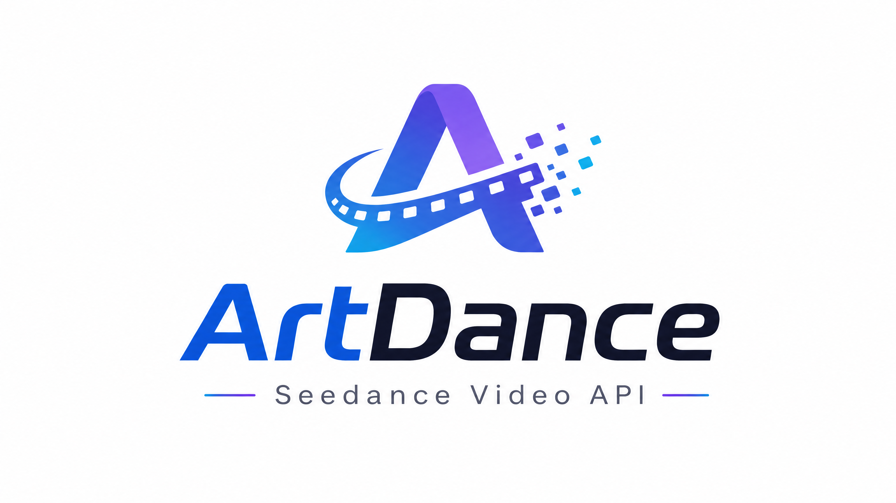 | 商业 | ArtDance | 本项目 Seedance 模型的天使投资人。 | [artbox.top](https://artbox.top) |
| 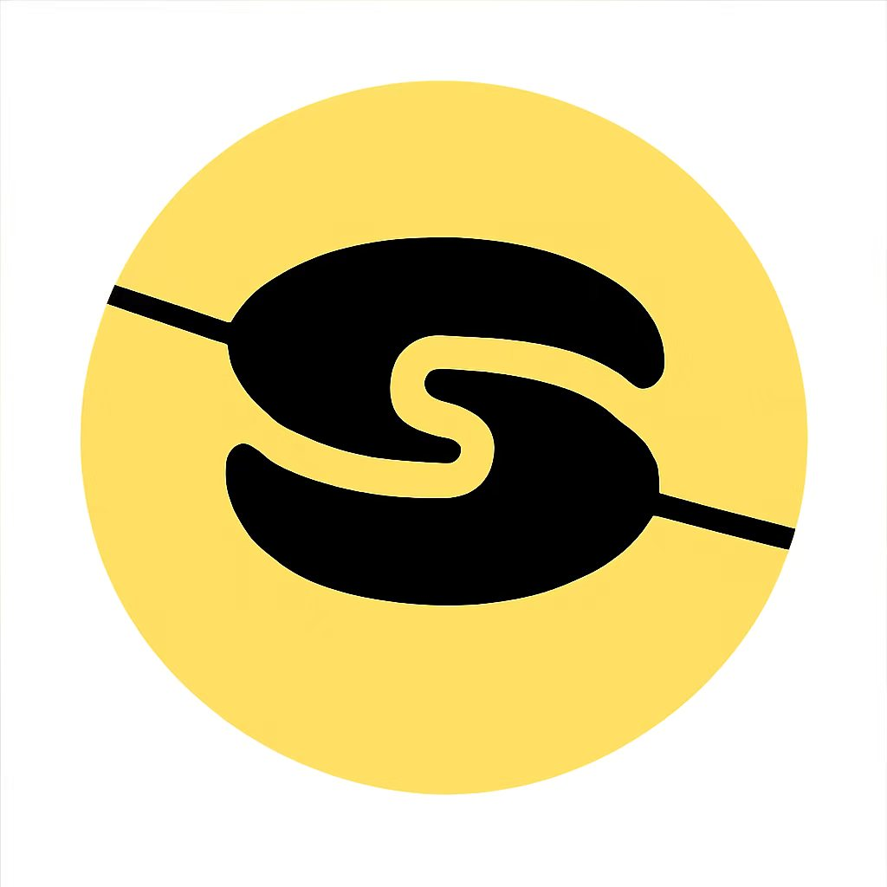 | 商业 | soonstudio | API 一站式网站，自研系统，非 New API；支持手机、短信接码，覆盖国内外几乎所有模型 API 接口，并发高、稳定性强。源于开源，步入 AI 领域，感谢开源。 | [soonstudio.ai](https://soonstudio.ai/) |
|  | 商业 | Fluxion AI | 面向个人开发者、技术团队与企业，通过统一 API 接入并管理全球主流 AI 模型，根据不同模型与线路，API 调用成本较官方或基准价格可降低 40%—98%。 | [注册送 $3.88 试用福利](https://fluxionai.space/register?source=github&campaign=yingce&promo=yingce) |
|  | 团队 | 快乐机艺术小组 | 一支跨学科的艺术创作团队，持续探索数字与艺术的全新表达形式。 | 暂无 |
| 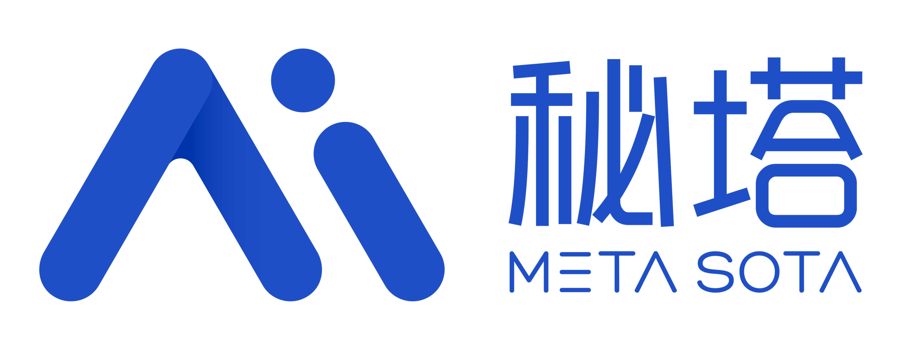 | 企业 | 秘塔 | 提供 MiniMax H3 视频生成 API，支持原生 2K、音画同步和 OpenAI 兼容协议。 | [metaso.cn](https://metaso.cn/minimax-h3/?s=dd) |
| 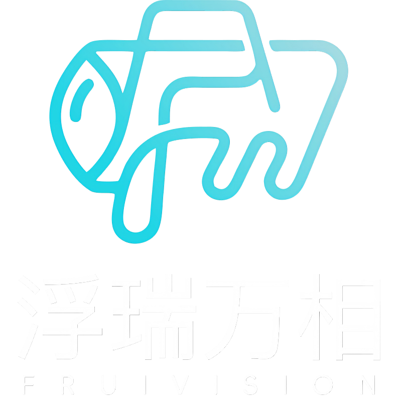 | 企业 | 浮瑞万相AI | 一家专注于AI视听的AI Native公司 | 暂无 |
| 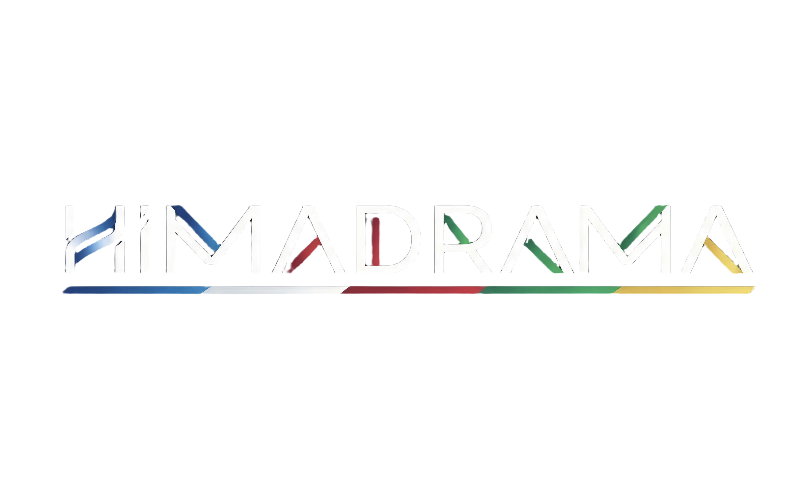 | 团队 | 喜马抓马 | 中国AI视听先锋厂牌/AI 视听全链路综合服务平台 | [himadrama.com](https://himadrama.com) |
| 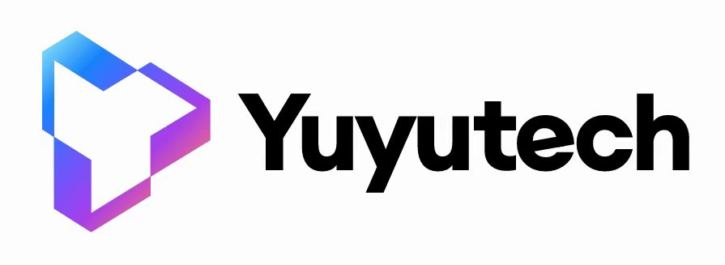 | 企业 | 羽宇科技 | 一站式AI应用平台。提供模型算力入口、AI短剧视频制作（Studio）、企业数字员工（Agent）及内容出海（OPC）全栈解决方案。 | 暂无 |
| 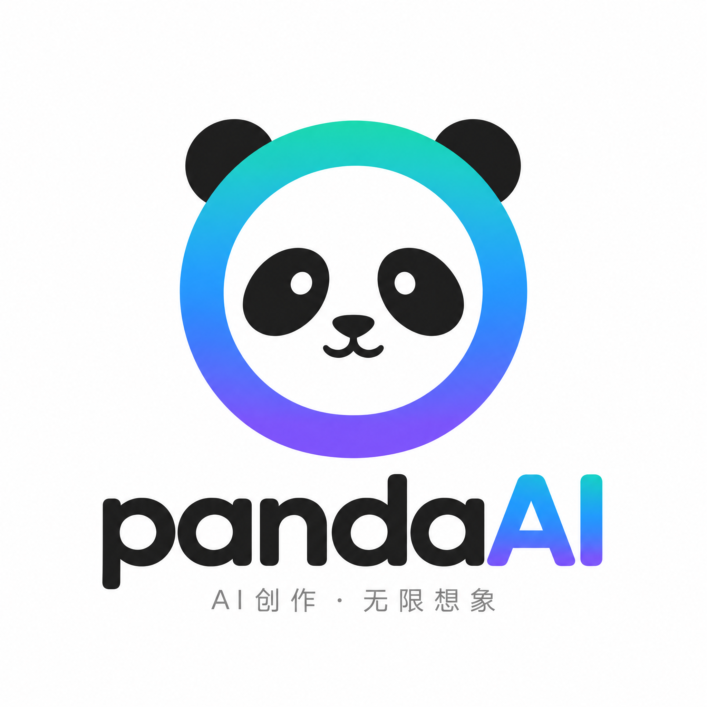 | 团队 | panda AI | API接口平台，面向个人开发者、技术团队与企业，稳定提供GPT、Gemini、grok等图片视频模型 | [api.pandatk.com](https://api.pandatk.com) |
|  | 商业 | 源点动力 | 专注 Seedance、Wan 等视频模型 API，以更优惠的价格降低成本。部分模型个人三折，企业二折，做人民用得起的供应商。 | [ai.tack2ai.cn](https://ai.tack2ai.cn) |

## 产品一览

### 从小说到成片：短剧制作流水线

上传小说或粘贴正文，影策按集拆分剧本，提取角色、道具和场景，生成结构化分镜，再按剧情段逐段生成视频。第 2 段起自动以上一段最后一帧作为首帧，镜头之间保持连贯。每一步都可以人工接管：改写台词、锁定角色形象、单段重新生成。

<table>
<tr>
<td width="50%"></td>
<td width="50%"></td>
</tr>
<tr>
<td><b>剧本</b>：本集梗概、开场钩子和结尾悬念一目了然；每个镜头标注景别、运镜和时长，右侧对照小说原文。</td>
<td><b>设定</b>：角色、道具、场景统一管理。角色有三视图、别名、外貌和声线，锁定后整部剧沿用同一形象。</td>
</tr>
</table>

### 一句话开始创作

创作首页把视频、图片、文本和 Agent 放在同一个输入框里。选模型、调比例和清晰度、加参考图，然后直接生成；灵感大厅收录可复用的提示词案例，点开即可继续创作。

<table>
<tr>
<td width="50%"></td>
<td width="50%"></td>
</tr>
<tr>
<td><b>创作首页</b>：最近画布、快捷入口和灵感大厅集中在一页。</td>
<td><b>画布 Agent</b>：Agent 结合素材、技能和画布上下文直接在画布上生成和修改，生成操作仍需经过审批和额度检查。</td>
</tr>
</table>

### 无限画布

节点、连线、框选、小地图、撤销重做、导入第三方画布和只读分享都已就绪。图片、视频、文本、音频和 3D 预演节点可以互相引用，适合做角色设定、场景概念和镜头实验。

<p align="center">
  
</p>

### 图片与视频工作台

按出品目标选模板（如商品白底图、广告英雄出场），上传参考素材，描述画面，确认参数后生成。进行中的任务和历史结果都在右侧。

<p align="center">
  
</p>

### 技能、插件与素材

<table>
<tr>
<td width="50%"></td>
<td width="50%"></td>
</tr>
<tr>
<td><b>技能库</b>：把分镜方法、角色设计、广告导演思路等沉淀成技能，在对话里用 <code>@技能</code> 调用，也可以从 GitHub 安装社区技能。</td>
<td><b>插件中心</b>：模型协议以插件形式接入，覆盖主流文本、图片、视频、音频供应商，另有支付协议和应用插件。</td>
</tr>
<tr>
<td></td>
<td></td>
</tr>
<tr>
<td><b>素材库</b>：文本、图片、视频、音频和 3D 模型统一归档，按角色、场景、道具分类，删除前检查引用。</td>
<td><b>创作历史</b>：所有生成任务的状态、模型、所属项目和积分消耗，可按画布、类型和模型筛选。</td>
</tr>
</table>

### 自部署管理后台

<table>
<tr>
<td width="50%"></td>
<td width="50%"></td>
</tr>
<tr>
<td><b>运行总览</b>：任务量、服务质量、P95 耗时、成本与收入，异常请求单独列出。</td>
<td><b>渠道与模型</b>：接入多个上游渠道，为每个模型配置请求协议、规格成本和售价。</td>
</tr>
</table>

后台还包括用户管理、登录日志、系统公告、提示词模板、存储资源、积分运营、兑换码和支付充值。

### 更多能力

- **时间线剪辑**：片段编排、拆分、修剪、字幕转写和服务端成片导出，支持插件化编辑面板。
- **3D 预演台**：从画布镜头节点打开，提供摆场、姿态、动画、摄影机与时间轴，可输出构图截图、白模视频和深度图。
- **任务系统**：异步队列、进度与日志、取消和重试，登录后跨设备同步。
- **存储**：媒体可存放在后端数据目录、阿里云 OSS 或腾讯云 COS。
- **明暗主题**：工作台支持明暗主题切换。
- **社区技能**：[judian-skills](https://github.com/itsWyatt-K/judian-skills) 提供 34 个场景域包索引。安装方式：技能页 → 安装技能 → GitHub 标签 → 仓库地址填 `https://github.com/itsWyatt-K/judian-skills`，子目录填 `skills/drama/story-structure-engine` 这类域包路径。

<p align="center">
  
</p>

完整功能以[功能清单](docs/content/docs/overview/features.mdx)为准。

## 快速开始

### 环境要求

- [Bun](https://bun.sh/)：前端和文档站
- [Go 1.25](https://go.dev/)：后端
- Docker Compose：仅在使用容器开发时需要

### 宿主机启动

```bash
git clone https://github.com/ddcat-ai/open-ai-canvas.git
cd open-ai-canvas

# 使用 Git 忽略的目录保存本地开发数据和缓存
mkdir -p .local/project-workbench-debug .local/cache/go-build .local/cache/go-mod

# 终端一：后端
cd backend
CANVAS_BACKEND_ADDR=127.0.0.1:8080 \
CANVAS_BACKEND_DATA_DIR=../.local/project-workbench-debug \
GOCACHE=../.local/cache/go-build \
GOMODCACHE=../.local/cache/go-mod \
go run ./cmd/server

# 终端二：前端
cd ../web
bun install --frozen-lockfile
bun run dev
```

打开 <http://localhost:3000>。首次使用时注册管理员账号，并在设置中配置模型渠道。前端默认将 `/api` 代理到 `http://127.0.0.1:8080`；如需修改代理目标，可设置 `VITE_API_PROXY_TARGET`。

Windows PowerShell 用户可在仓库根目录执行：

```powershell
.\scripts\start-local.ps1
```

### Docker 开发与本地构建

以下命令用于本地开发或试运行。

源码热更新：

```bash
LOCAL_UID=$(id -u) LOCAL_GID=$(id -g) \
  docker compose -f docker-compose.dev.yml up --build
```

本地构建并运行 release 镜像：

```bash
docker compose -f docker-compose.local.yml up -d --build
```

热更新开发默认前端端口为 `3000`、后端端口为 `8080`；端口冲突时可通过 `CANVAS_WEB_HOST_PORT` 和 `CANVAS_BACKEND_HOST_PORT` 覆盖。本地构建编排只暴露 web 的 `3000`，后端留在容器网络内。

更多本地开发说明（包括时间线字幕转写）见[本地开发文档](docs/content/docs/backend/local-development.mdx)。

## 架构概览

```text
浏览器（web/）
  ├─ React 工作区、画布、任务中心和素材库
  ├─ Zustand / localForage 本地状态与降级缓存
  └─ 登录态 API、资源请求和 SSE
          │
          ▼
后端（backend/）
  ├─ Gin handler -> service -> repository/model
  ├─ SQLite（本地）或 PostgreSQL + Redis（部署）
  ├─ 异步任务 worker、权限、资源存储和模型中转
  └─ provider / outbound -> 外部模型渠道
```

前端业务 API 统一经 `web/src/services/api/request.ts` 调用。生产环境由 Nginx 托管前端并代理后端，公网只需暴露 web 入口；SSE 仅在明确的流式路径关闭代理缓冲。

## 安全边界

- 首次管理员注册应在受控网络完成，公网部署保持 `CANVAS_REGISTRATION_ENABLED=false`。
- 设置准确的 `CANVAS_CORS_ORIGINS`，不要在公网使用 `*`；使用 HTTPS 并正确转发代理头。
- 后端默认拒绝本机、私网和链路本地模型地址。开发时只通过 `CANVAS_ALLOWED_PRIVATE_UPSTREAM_HOSTS` 精确放行可信主机，不要使用全量放行开关。
- 用户 API Key 不应出现在 URL、日志、错误上报或服务端长期明文存储中；只在可信部署和 HTTPS 链路中使用真实密钥。
- 后端 `8080` 应留在 Compose 网络内，不要直接暴露到公网；限制 `.env`、数据库、上传目录、备份和 `.settings-key` 的权限。
- 媒体资源可使用后端数据目录、阿里云 OSS 或腾讯云 COS；删除素材前会检查业务引用。

安全问题请按 [`SECURITY.md`](SECURITY.md) 报告，不要在公开 Issue 中粘贴密钥、Cookie、数据库或生产日志。

## 文档与验证

### 文档导航

- [快速开始](docs/content/docs/overview/quick-start.mdx)
- [功能清单](docs/content/docs/overview/features.mdx)
- [代码功能地图](docs/content/docs/backend/code-map.mdx)
- [本地开发](docs/content/docs/backend/local-development.mdx)
- [数据库结构](docs/content/docs/backend/backend-database.mdx)
- [画布操作手册](docs/content/docs/canvas/canvas-node-manual.mdx)
- [插件系统](docs/content/docs/plugins/plugin-system.mdx)
- [待办与待测试](docs/content/docs/progress/todo.mdx) · [待测试清单](docs/content/docs/progress/pending-test.mdx)
- [更新日志](CHANGELOG.md) · [贡献指南](CONTRIBUTING.md)

### 验证命令

按改动范围运行最小验证：

```bash
# 前端
cd web && bun run lint && bun run build

# 后端
cd backend && go test ./...

# 文档站
cd docs && bun run types:check
```

## 许可证

本项目采用 [MIT](LICENSE) 协议。项目特定代码的版权归 Open AI Canvas 贡献者所有；第三方组件按各自附带的许可证和版权声明使用。

---

## 贡献者与团队

感谢参与产品设计、开发、测试、内容和社区建设的成员。

<table>
<tr>
<td align="center" valign="top" width="33%">
  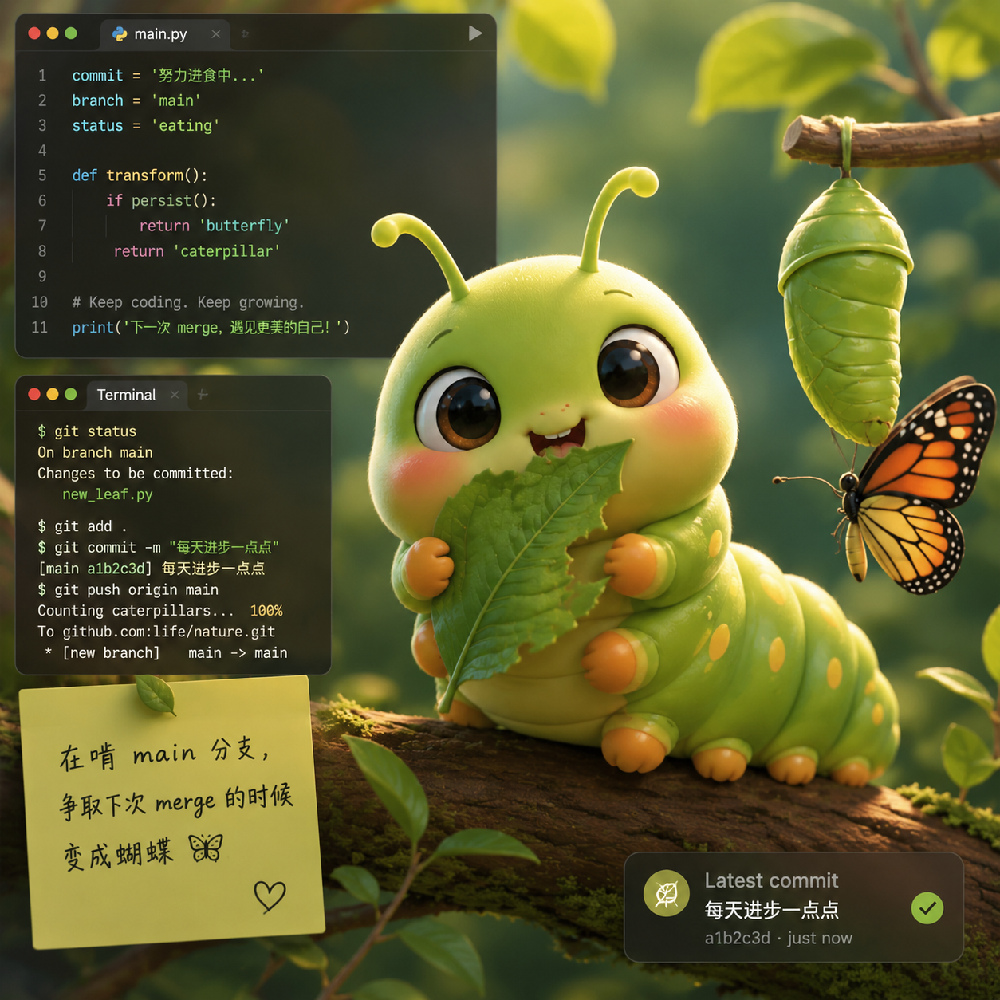<br>
  <strong>爱笑的毛毛虫</strong><br>
  <sub>用户名：sikongyue</sub><br>
  <sub><a href="mailto:315515767@qq.com">315515767@qq.com</a></sub><br>
  <sub><em>正在啃 main 分支，争取下次 merge 的时候变成蝴蝶</em></sub>
</td>
<td align="center" valign="top" width="33%">
  <br>
  <strong>delve-s</strong><br>
  <sub><a href="mailto:3013141136@qq.com">3013141136@qq.com</a></sub><br>
  <sub><em>我亦无他，惟手熟尔</em></sub>
</td>
<td align="center" valign="top" width="33%">
  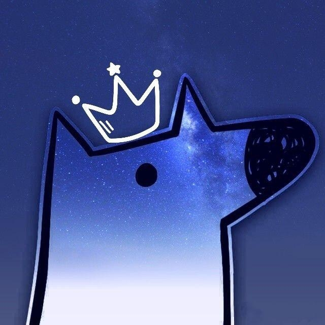<br>
  <strong>CyrusAuyeung</strong><br>
  <sub><a href="mailto:cyrusauyeungho@gmail.com">cyrusauyeungho@gmail.com</a></sub><br>
  <sub><em>HKUST(GZ) UG</em></sub>
</td>
</tr>
<tr>
<td align="center" valign="top" width="33%">
  <br>
  <strong>奶大佬</strong><br>
  <sub><a href="mailto:1304634970@qq.com">1304634970@qq.com</a></sub><br>
  <sub><em>人生就是要不断的探索</em></sub>
</td>
<td align="center" valign="top" width="33%">
  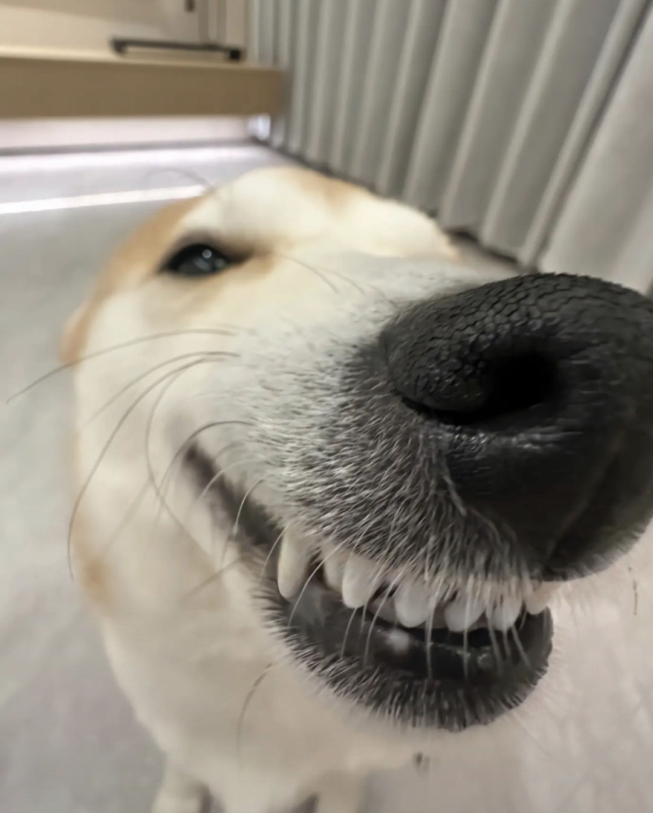<br>
  <strong>dyh</strong><br>
  <sub><a href="mailto:1613203335@qq.com">1613203335@qq.com</a></sub>
</td>
<td align="center" valign="top" width="33%">
  <br>
  <strong>kyori</strong><br>
  <sub><a href="mailto:1771634408@qq.com">1771634408@qq.com</a></sub><br>
  <sub><em>励志成为未来最好用的画布仓库的贡献者</em></sub>
</td>
</tr>
<tr>
<td align="center" valign="top" width="33%">
  <br>
  <strong>Bowen</strong><br>
  <sub><a href="mailto:admin@bowen.games">admin@bowen.games</a></sub><br>
  <sub><em>剑走偏峰，雷厉风行。</em></sub>
</td>
<td align="center" valign="top" width="33%">
  <br>
  <strong>ken</strong><br>
  <sub><a href="mailto:2506802@qq.com">2506802@qq.com</a></sub><br>
  <sub><em>走自己的路</em></sub>
</td>
<td align="center" valign="top" width="33%">
  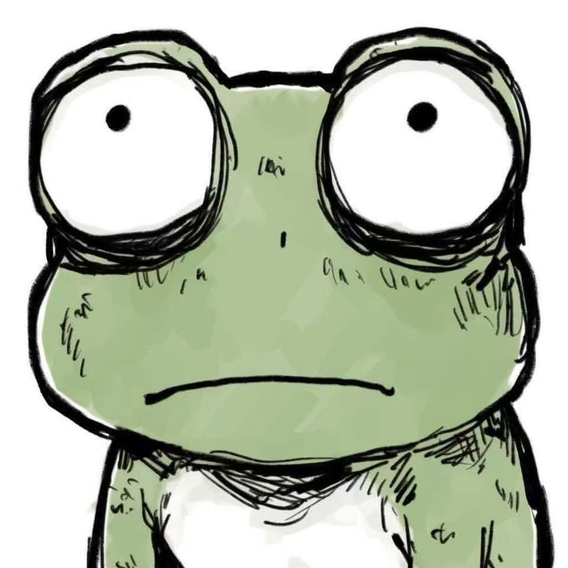<br>
  <strong>fish</strong><br>
  <sub><a href="mailto:cihai.sea@gmail.com">cihai.sea@gmail.com</a></sub><br>
  <sub><em>AI 界热于助人的拖油瓶</em></sub>
</td>
</tr>
<tr>
<td align="center" valign="top" width="33%">
  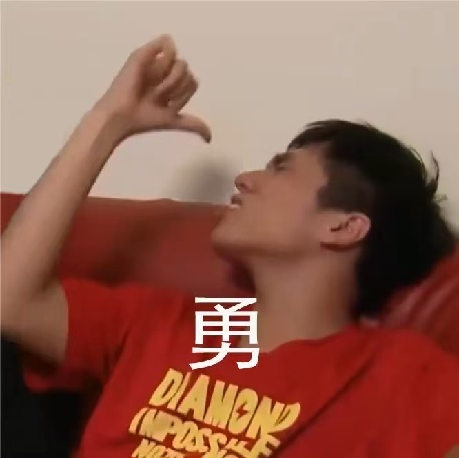<br>
  <strong>QAyong</strong><br>
  <sub>ID / B站：QAyong</sub><br>
  <sub><a href="mailto:2110491559@qq.com">2110491559@qq.com</a></sub><br>
  <sub><em>AI 短剧合规，资产确权</em></sub>
</td>
<td align="center" valign="top" width="33%">
  <br>
  <strong>_K37ix.</strong><br>
  <sub><a href="mailto:2773843782@qq.com">2773843782@qq.com</a></sub><br>
  <sub><em>Making things that think</em></sub>
</td>
<td align="center" valign="top" width="33%">
  <br>
  <strong>Rou</strong><br>
  <sub><a href="mailto:rou325089@163.com">rou325089@163.com</a></sub><br>
  <sub><em>上善若水</em></sub>
</td>
</tr>
<tr>
<td align="center" valign="top" width="33%">
  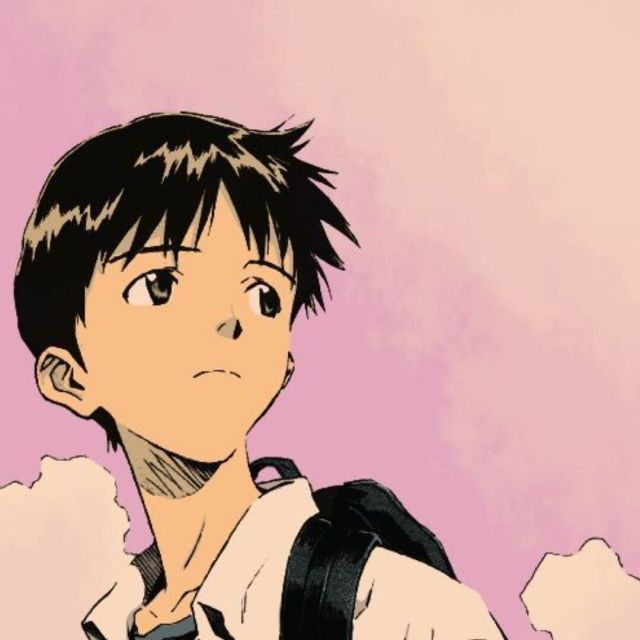<br>
  <strong>vv</strong><br>
  <sub>dy/xhs：荣灵</sub><br>
  <sub><a href="mailto:2838033228@qq.com">2838033228@qq.com</a></sub><br>
  <sub><em>就是水水</em></sub>
</td>
<td align="center" valign="top" width="33%">
  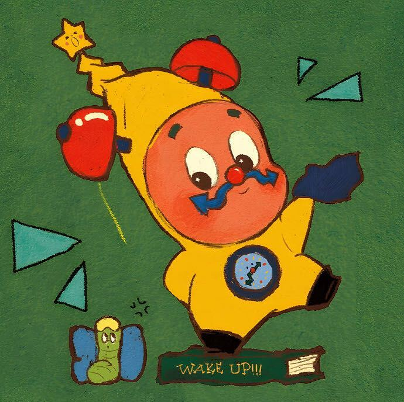<br>
  <strong>Dominic1556</strong><br>
  <sub><a href="mailto:184026530@qq.com">184026530@qq.com</a></sub><br>
  <sub><em>Done is better than perfect</em></sub>
</td>
<td align="center" valign="top" width="33%">
  <br>
  <strong>宇熙</strong><br>
  <sub><a href="mailto:53121904@qq.com">53121904@qq.com</a></sub><br>
  <sub><em>年轻的时候不狂，老了拿什么回忆</em></sub>
</td>
</tr>
<tr>
<td align="center" valign="top" width="33%">
  <br>
  <strong>影子</strong><br>
  <sub><a href="mailto:305818148@qq.com">305818148@qq.com</a></sub><br>
  <sub><em>年纪大佬才明白人要顺势而为。</em></sub>
</td>
<td align="center" valign="top" width="33%">
  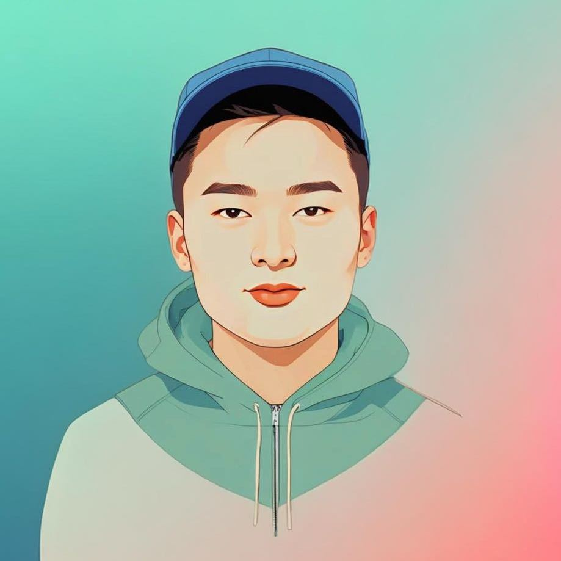<br>
  <strong>Ray</strong><br>
  <sub><a href="mailto:cnraylee@qq.com">cnraylee@qq.com</a></sub><br>
  <sub><em>AI时代的全栈落地工，欢迎找我聊需求</em></sub>
</td>
<td align="center" valign="top" width="33%">
  <br>
  <strong>不见山谷</strong><br>
  <sub>VV：yu170718</sub><br>
  <sub><a href="mailto:1762202553@qq.com">1762202553@qq.com</a></sub><br>
  <sub><em>空山不见人，但闻人语响</em></sub>
</td>
</tr>
<tr>
<td align="center" valign="top" width="33%">
  <br>
  <strong>yep</strong><br>
  <sub><a href="mailto:1239738103@qq.com">1239738103@qq.com</a></sub><br>
  <sub><em>思考，坚持</em></sub>
</td>
<td align="center" valign="top" width="33%">
  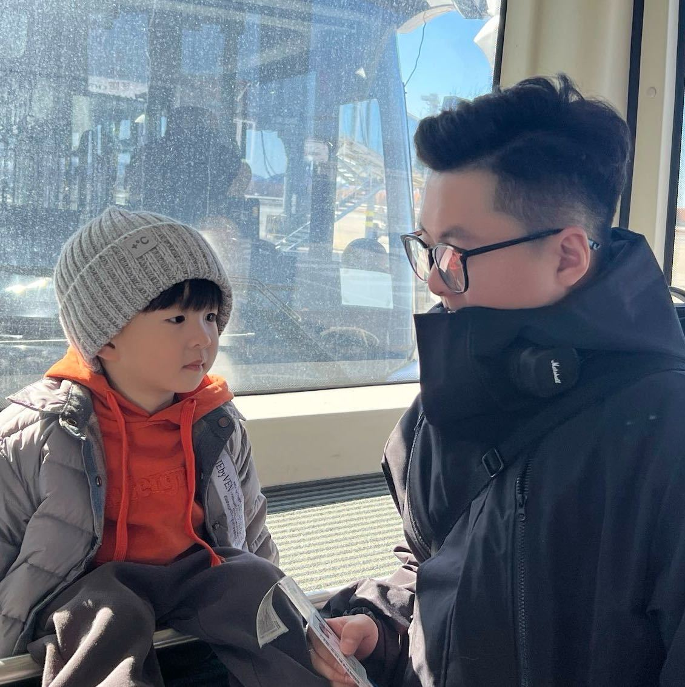<br>
  <strong>汉堡爸爸</strong><br>
  <sub>VV：jxs62888</sub><br>
  <sub><a href="mailto:309151651@qq.com">309151651@qq.com</a></sub><br>
  <sub><em>没什么大不了</em></sub>
</td>
</tr>
<tr>
<td align="center" valign="top" width="33%">
  <br>
  <strong>daqzia</strong><br>
  <sub>VV：wangzhiwei-8234</sub><br>
  <sub><a href="mailto:wzwzcb@gmail.com">wzwzcb@gmail.com</a></sub><br>
  <sub><em>NullPointerException</em></sub>
</td>
<td align="center" valign="top" width="33%">
  <br>
  <strong>醒梦</strong><br>
  <sub>VV：love-is-heart-is</sub><br>
  <sub><a href="mailto:1948863412@qq.com">1948863412@qq.com</a></sub><br>
  <sub><em>Always believe that good things will happen</em></sub>
</td>
<td align="center" valign="top" width="33%">
  <br>
  <strong>morrow</strong><br>
  <sub>VV：morrow0127</sub><br>
  <sub><a href="mailto:3201190041@qq.com">3201190041@qq.com</a></sub><br>
  <sub><em>最难不过坚持</em></sub>
</td>
</tr>
<tr>
<td align="center" valign="top" width="33%">
  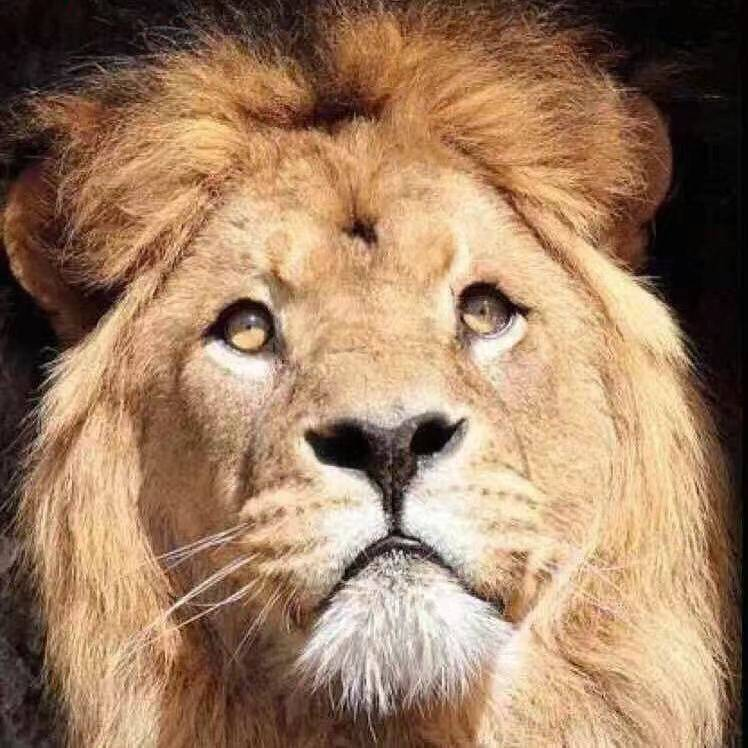<br>
  <strong>春秋</strong><br>
  <sub>Agent 记忆核心贡献者 · VV：A13068788886</sub><br>
  <sub><a href="mailto:558328@qq.com">558328@qq.com</a></sub>
</td>
<td align="center" valign="top" width="33%">
  <br>
  <strong>亿媒网老宋</strong><br>
  <sub><a href="https://em8.top">亿媒网 em8.top</a> · <a href="mailto:61731514@qq.com">61731514@qq.com</a></sub><br>
  <sub><em>全国10W+媒体、自媒体，助力企业品牌传播</em></sub>
</td>
<td align="center" valign="top" width="33%">
  <br>
  <strong>Wyatt_K</strong><br>
  <sub><em>千里之行，始于足下。</em></sub>
</td>
</tr>
</table>

## 3D 预演台赞助用户

感谢以下用户赞助 3D 预演台的开发。

<table>
<tr>
<td align="center" width="20%"><a href="https://github.com/TripsCoder"><br><sub><strong>@TripsCoder</strong></sub></a></td>
<td align="center" width="20%"><a href="https://github.com/sugtex"><br><sub><strong>@sugtex</strong></sub></a></td>
<td align="center" width="20%"><a href="https://github.com/Leyi813"><br><sub><strong>@Leyi813</strong></sub></a></td>
<td align="center" width="20%"><a href="https://github.com/daoge05178"><br><sub><strong>@daoge05178</strong></sub></a></td>
<td align="center" width="20%"><a href="https://github.com/AetherNo2332"><br><sub><strong>@AetherNo2332</strong></sub></a></td>
</tr>
</table>

<table>
<tr>
<td align="center" width="20%"><strong>vv</strong><br><sub>2838033228@qq.com</sub></td>
<td align="center" width="20%"><strong>克里斯</strong><br><sub><a href="https://artbox.top">artbox.top</a></sub></td>
<td align="center" width="20%"><strong>宇熙</strong><br><sub>53121904@qq.com</sub></td>
<td align="center" width="20%"><strong>落羽</strong><br><sub>luoyyv66@gmail.com</sub></td>
<td align="center" width="20%"><strong>今夕何在</strong><br><sub>809321478@qq.com</sub></td>
</tr>
<tr>
<td align="center" width="20%"><strong>Alpha-M·Break</strong><br><sub>15739564793@qq.com</sub></td>
<td align="center" width="20%"><strong>不吃鸭梨</strong><br><sub>elio02519@gmail.com</sub></td>
<td align="center" width="20%"><strong>九月</strong><br><sub>563641352@qq.com</sub></td>
<td align="center" width="20%"><strong>A</strong><br><sub>jiaboxuan1205@gmail.com</sub></td>
<td align="center" width="20%"><strong>fochaobaby</strong><br><sub>leoxie.design@gmail.com</sub></td>
</tr>
</table>
