<p align="center">
  
</p>

<h1 align="center">DMC · 影策二开</h1>

<p align="center">本地优先的 AI 漫剧 / 短剧创作台 · 填一次 LL2 Key 就能出片</p>

<p align="center">
  一句话成片 · 无限画布 · 全站 DMC Agent · 我的片子
</p>

> 本项目是 [影策 open-ai-canvas](https://github.com/ddcat-ai/open-ai-canvas) 的 C 端二开版本。
> 免登录、只使用本机保存的 LL2 Key，不依赖影策账号后端；所有画布、素材和作品默认存在这台电脑。

---

## 这是什么

DMC 把「写一句话 → 出片」和「无限画布」做在同一个本地工作台里：

- **一句话成片**：写一句画面描述，选模型、清晰度、时长和比例，直接生成；支持 AI 润色、多版本候选和角色/风格锁定。
- **全站 DMC Agent**：右下角常驻，能写提示词、设计运镜、写代码，确认价格后可以直接下单出片。
- **无限画布**：用节点组织角色、分镜、参考图和视频；支持首尾帧、参考视频、生成后超分，以及按任务号恢复生成。
- **我的片子**：生成的成片按视频封面陈列，可播放、下载、移除，也可以存到资产库。

<p align="center">
  
</p>

<p align="center">
  
</p>

## 核心能力

### 一句话成片

- 一个视频输入框直接出片；只想写提示词或改稿，交给右下角的 DMC Agent
- **AI 润色提示词**：把一句话补成主体、光线、运镜清楚的画面描述
- **多版本**：同一句话生成 3 个不同侧重点的版本，挑一个再生成
- **角色/风格锁定**：保存人物设定和画风，之后每条生成自动带上
- **生成后顺便超分**：先出片，再按 1080P / 2K / 4K 串行超分（单独计费，提交前展示）
- 提交前按官方价估算本次花费，账单以 LL2 控制台为准

### 全站 DMC Agent

- 首页、资产、灵感广场、我的片子等页面右下角常驻，点开即用
- 能写提示词、设计运镜、写代码、改文案和回答创作问题
- 回答里的代码块会单独渲染，可直接复制
- 支持「直接出片」：先确认模型、秒数、清晰度和价格，确认后自动回到首页提交

### 无限画布

- 节点、连线、框选、小地图、撤销重做、本地保存
- LL2 视频模型直连生成：MiniMax H3、wan3.0、Seedance、Vidu
- 视频节点连两张图就是首尾帧；可带参考视频/音频（按模型限制）
- 已生成的视频可在右键菜单直接超分、下载到本机或存到资产库
- 生成阶段和超分阶段刷新后可按 LL2 taskId 续查，尽量不重复扣费
- 「漫剧五步」入口：画风 → 故事 → 分镜 → 视频 → 成片

<p align="center">
  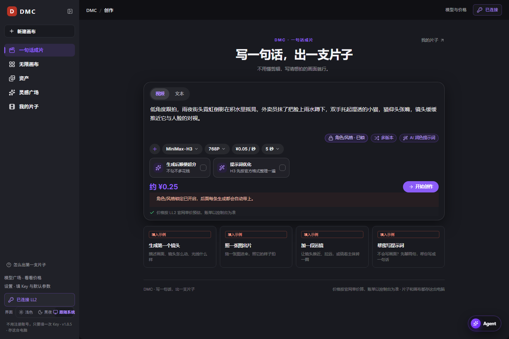
</p>

### 我的片子

<p align="center">
  
</p>

- 本机作品库，按视频首帧封面陈列
- 每支片子可直接播放、下载、移除
- 需要 Bearer 的超分版点击时才取回，不在列表里预加载

## 模型与协议

当前 C 端直连 LL2（api.ll2.cn），不需要影策后端。已适配的视频模型：

| 模型 | 清晰度 | 时长 | 参考素材 |
| --- | --- | --- | --- |
| MiniMax H3 | 768P | 4–15 秒 | 首帧/尾帧、参考视频、参考音频 |
| wan3.0-video / prime | 480P / 720P / 1080P | 4–30 秒 | 图 ≤10、视频 ≤5、音频 ≤5（首尾帧与参考素材二选一） |
| Seedance 2.0 / 2.5 | 480P / 720P / 1080P / 4K | 按模型 | 首尾帧、参考图、参考视频 |
| Vidu Q3 pro / turbo | 540P / 720P / 1080P | 按模型 | 最多 2 张图（首帧 + 尾帧） |
| auto-hd | 1080P / 2K / 4K | 后处理 | 只接在已生成的公网视频后，不单独生成 |

> Super Vega 协议已接入但真机仍失败，素材带图暂不放开。

## 快速开始

### 环境要求

- [Bun](https://bun.sh/)（前端）
- 一个可用的 LL2 API Key（在设置或右上角「连接 LL2」里填一次）

### 本地启动（C 端）

```bash
cd web
bun install --frozen-lockfile
bun run dev
```

打开 <http://localhost:3000>，点「连接 LL2」填 Key 即可。

**不需要启动影策后端。** 登录、账号、积分和后台管理属于上游影策的能力，C 端二开不使用。

### 本地数据

- 画布、作品和素材存在浏览器本地（localStorage / IndexedDB）
- 退出浏览器、重启电脑都会保留；但不同浏览器或不同站点（localhost / 127.0.0.1）数据不互通
- 开发时统一使用 `http://localhost:3000`；访问 `127.0.0.1:3000` 会自动跳转
- LL2 生成的视频直链只在云端保留约 24 小时；长期保存请点「下载到本机」或「存到资产库」

### 构建

```bash
cd web
bun run build
```

Windows 桌面安装包正在规划中（Electron + NSIS）：退出工具后数据保存在用户目录，卸载默认保留；后续会补导出/导入工作区和自动更新方案。

## 开发与验证

```bash
cd web
bun run typecheck
bun test test/ll2-ux-walkthrough-regressions.test.ts
bun run build
```

## 数据与隐私

- LL2 Key 只保存在本机浏览器，不提交到任何业务后端
- 画布、素材、作品默认只存在这台电脑
- 生成的视频会上传到 LL2 网关处理，24 小时后直链可能失效
- 不要把本机开发环境直接暴露到公网

## 目录结构

```text
web/        Vite + React 前端（C 端主要代码）
backend/    上游影策后端（C 端不需要启动）
docs/       上游文档站
desktop/    EXE 桌面壳（规划中）
```

## 许可证

沿用上游 [MIT](LICENSE)。本项目改动部分同样按 MIT 发布；第三方组件和素材遵循各自附带许可证。

---

## 鸣谢

这一版能跑起来，离不开下面这些项目和伙伴：

### 开源上游

- **[影策 open-ai-canvas](https://github.com/ddcat-ai/open-ai-canvas)**：本项目的画布、任务系统和大部分基础能力都来自这个开源项目；没有上游就没有 DMC 二开。
- 上游贡献者、赞助商和社区技能作者：详见下方保留的原始名单。

### 模型与算力

- **[LL2 / DMC](https://api.ll2.cn)**：提供统一的 BYOK 视频/文本模型网关，H3、wan3、Seedance、Vidu、auto-hd 超分都走它。
- **MiniMax、阿里云百炼、火山引擎、Vidu、Super Vega** 等模型提供方：本项目的协议适配基于各家官方文档。

### 产品与桌面参考

- **BeefTV**：桌面端本地化、插件、更新和用户数据落盘的产品形态参考；感谢其验证过的桌面工作流。
- **DeepSeek Harness（DSH）**：本项目开发过程中使用的 Agent 工作台。

### 原项目赞助商

感谢以下赞助商对影策项目的支持：

| LOGO | 类型 | 赞助商名称 | 说明 | 网站 |
| --- | --- | --- | --- | --- |
| 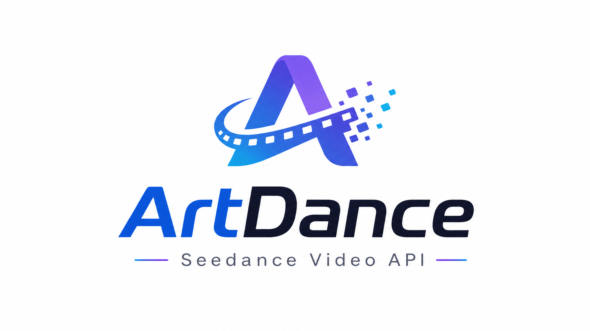 | 商业 | ArtDance | 本项目 Seedance 模型的天使投资人。 | [artbox.top](https://artbox.top) |
| 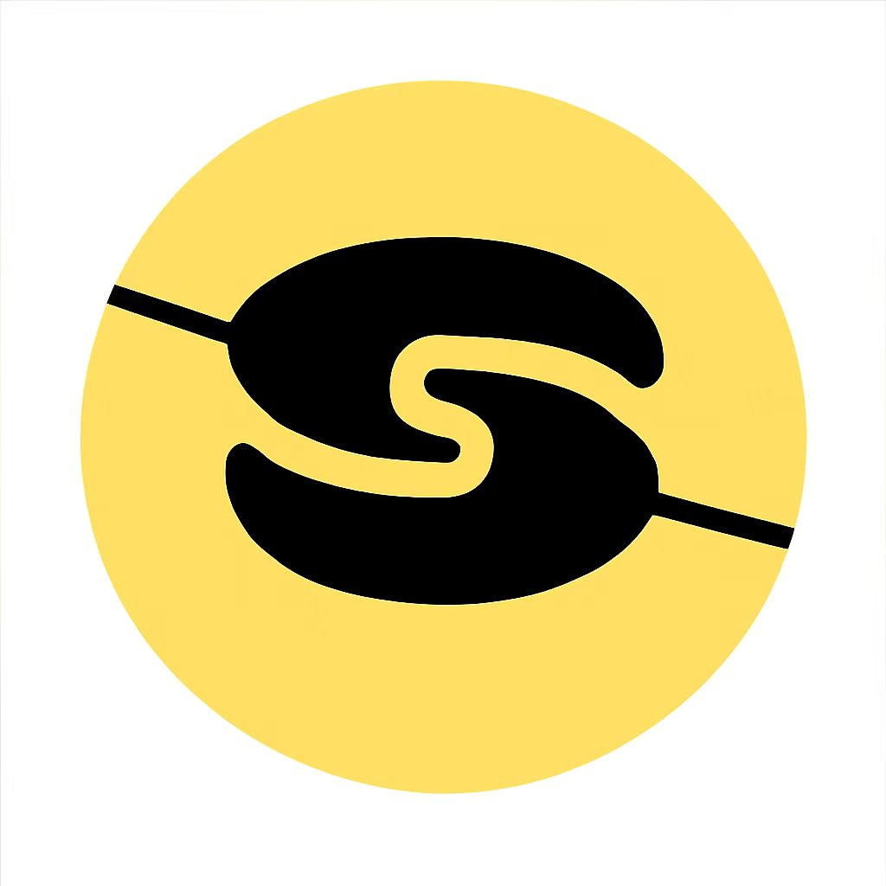 | 商业 | soonstudio | API 一站式网站，自研系统，非 New API；支持手机、短信接码，覆盖国内外几乎所有模型 API 接口，并发高、稳定性强。源于开源，步入 AI 领域，感谢开源。 | [soonstudio.ai](https://soonstudio.ai/) |
|  | 商业 | Fluxion AI | 面向个人开发者、技术团队与企业，通过统一 API 接入并管理全球主流 AI 模型，根据不同模型与线路，API 调用成本较官方或基准价格可降低 40%—98%。 | [注册送 $3.88 试用福利](https://fluxionai.space/register?source=github&campaign=yingce&promo=yingce) |
|  | 团队 | 快乐机艺术小组 | 一支跨学科的艺术创作团队，持续探索数字与艺术的全新表达形式。 | 暂无 |
| 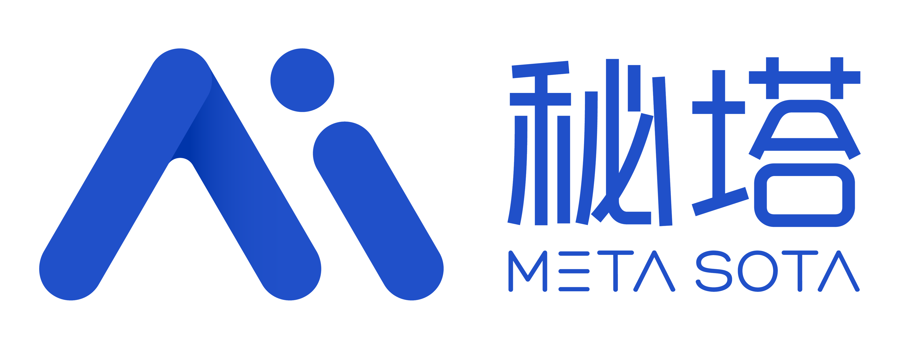 | 企业 | 秘塔 | 提供 MiniMax H3 视频生成 API，支持原生 2K、音画同步和 OpenAI 兼容协议。 | [metaso.cn](https://metaso.cn/minimax-h3/?s=dd) |
| 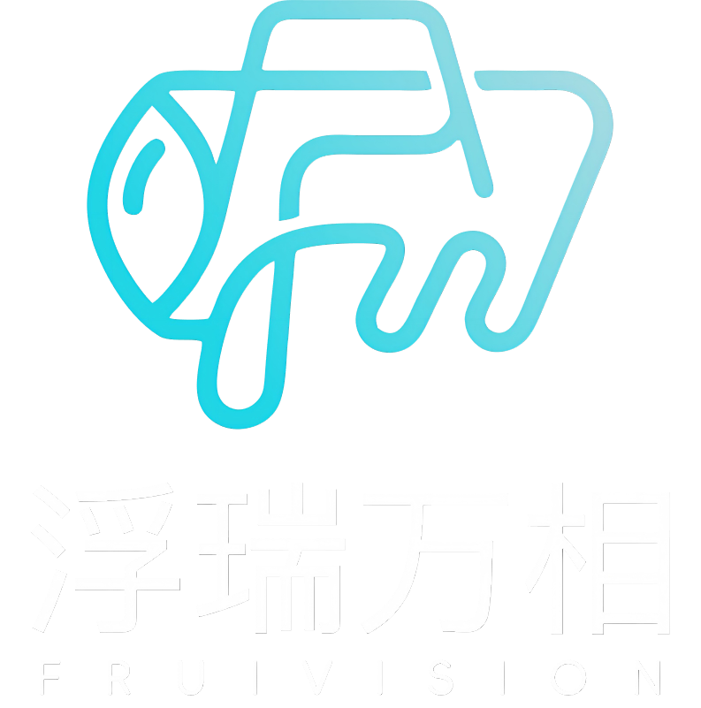 | 企业 | 浮瑞万相AI | 一家专注于AI视听的AI Native公司 | 暂无 |
| 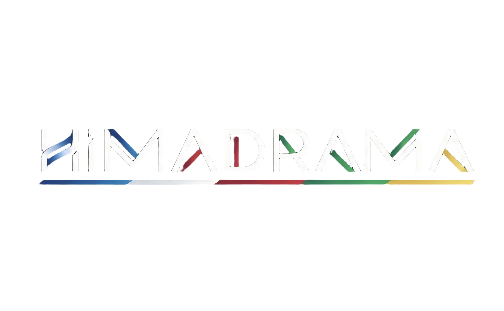 | 团队 | 喜马抓马 | 中国AI视听先锋厂牌/AI 视听全链路综合服务平台 | [himadrama.com](https://himadrama.com) |
| 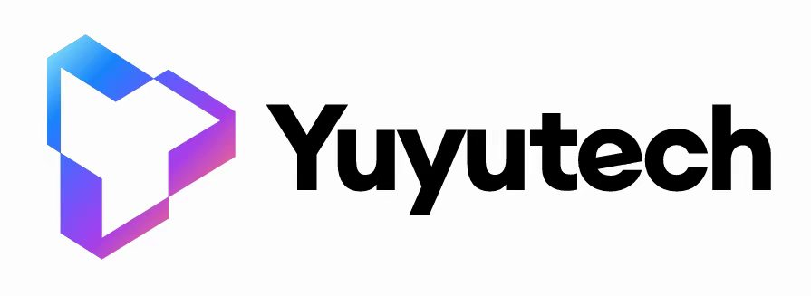 | 企业 | 羽宇科技 | 一站式AI应用平台。提供模型算力入口、AI短剧视频制作（Studio）、企业数字员工（Agent）及内容出海（OPC）全栈解决方案。 | 暂无 |
| 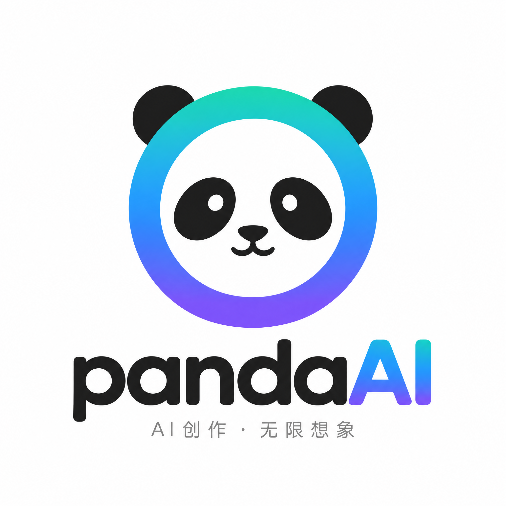 | 团队 | panda AI | API接口平台，面向个人开发者、技术团队与企业，稳定提供GPT、Gemini、grok等图片视频模型 | [api.pandatk.com](https://api.pandatk.com) |
|  | 商业 | 源点动力 | 专注 Seedance、Wan 等视频模型 API，以更优惠的价格降低成本。部分模型个人三折，企业二折，做人民用得起的供应商。 | [ai.tack2ai.cn](https://ai.tack2ai.cn) |

### 贡献者与团队

感谢参与产品设计、开发、测试、内容和社区建设的成员。

<table>
<tr>
<td align="center" valign="top" width="33%">
  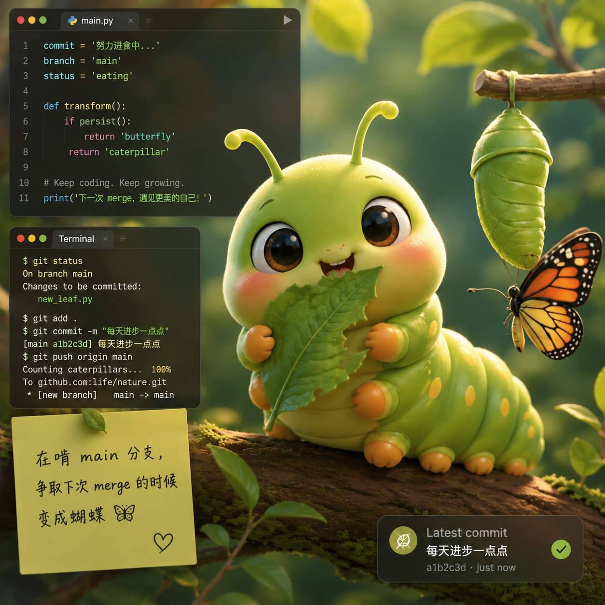<br>
  <strong>爱笑的毛毛虫</strong><br>
  <sub>用户名：sikongyue</sub><br>
  <sub><a href="mailto:315515767@qq.com">315515767@qq.com</a></sub><br>
  <sub><em>正在啃 main 分支，争取下次 merge 的时候变成蝴蝶</em></sub>
</td>
<td align="center" valign="top" width="33%">
  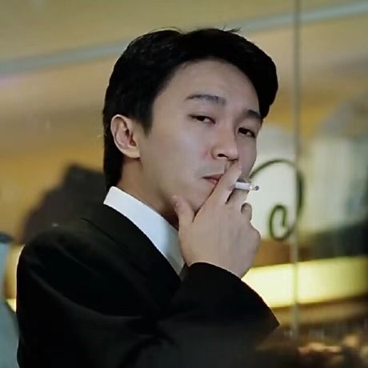<br>
  <strong>delve-s</strong><br>
  <sub><a href="mailto:3013141136@qq.com">3013141136@qq.com</a></sub><br>
  <sub><em>我亦无他，惟手熟尔</em></sub>
</td>
<td align="center" valign="top" width="33%">
  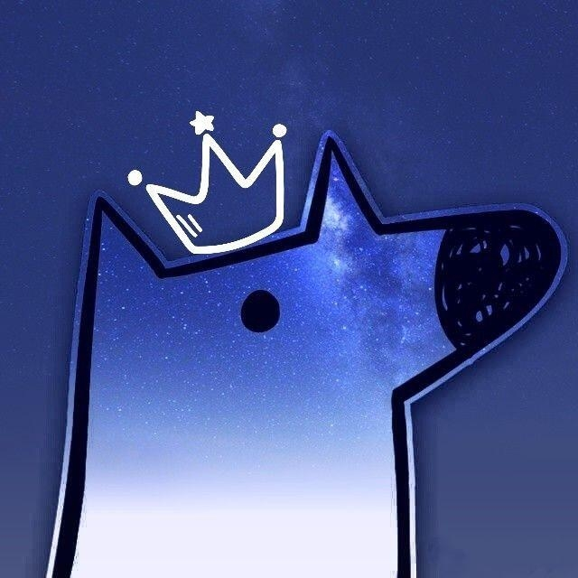<br>
  <strong>CyrusAuyeung</strong><br>
  <sub><a href="mailto:cyrusauyeungho@gmail.com">cyrusauyeungho@gmail.com</a></sub><br>
  <sub><em>HKUST(GZ) UG</em></sub>
</td>
</tr>
<tr>
<td align="center" valign="top" width="33%">
  <br>
  <strong>奶大佬</strong><br>
  <sub><a href="mailto:1304634970@qq.com">1304634970@qq.com</a></sub><br>
  <sub><em>人生就是要不断的探索</em></sub>
</td>
<td align="center" valign="top" width="33%">
  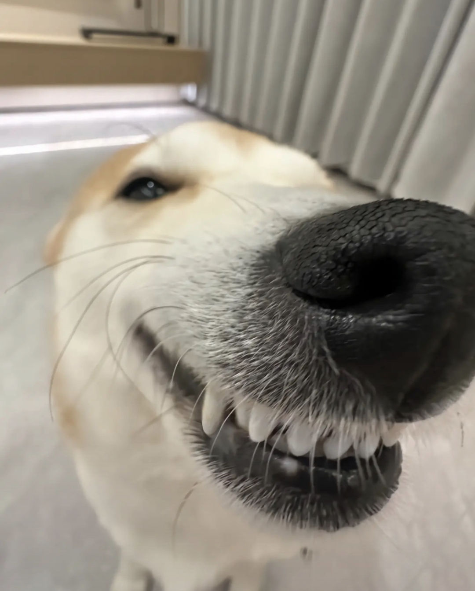<br>
  <strong>dyh</strong><br>
  <sub><a href="mailto:1613203335@qq.com">1613203335@qq.com</a></sub>
</td>
<td align="center" valign="top" width="33%">
  <br>
  <strong>kyori</strong><br>
  <sub><a href="mailto:1771634408@qq.com">1771634408@qq.com</a></sub><br>
  <sub><em>励志成为未来最好用的画布仓库的贡献者</em></sub>
</td>
</tr>
<tr>
<td align="center" valign="top" width="33%">
  <br>
  <strong>Bowen</strong><br>
  <sub><a href="mailto:admin@bowen.games">admin@bowen.games</a></sub><br>
  <sub><em>剑走偏峰，雷厉风行。</em></sub>
</td>
<td align="center" valign="top" width="33%">
  <br>
  <strong>ken</strong><br>
  <sub><a href="mailto:2506802@qq.com">2506802@qq.com</a></sub><br>
  <sub><em>走自己的路</em></sub>
</td>
<td align="center" valign="top" width="33%">
  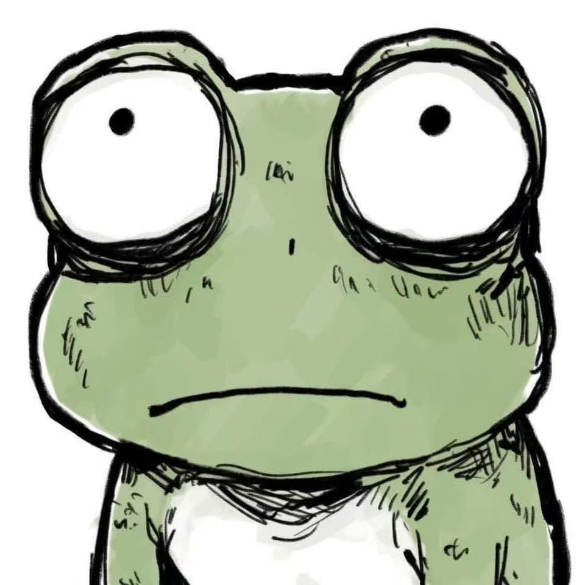<br>
  <strong>fish</strong><br>
  <sub><a href="mailto:cihai.sea@gmail.com">cihai.sea@gmail.com</a></sub><br>
  <sub><em>AI 界热于助人的拖油瓶</em></sub>
</td>
</tr>
<tr>
<td align="center" valign="top" width="33%">
  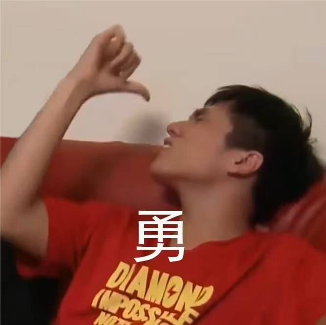<br>
  <strong>QAyong</strong><br>
  <sub>ID / B站：QAyong</sub><br>
  <sub><a href="mailto:2110491559@qq.com">2110491559@qq.com</a></sub><br>
  <sub><em>AI 短剧合规，资产确权</em></sub>
</td>
<td align="center" valign="top" width="33%">
  <br>
  <strong>_K37ix.</strong><br>
  <sub><a href="mailto:2773843782@qq.com">2773843782@qq.com</a></sub><br>
  <sub><em>Making things that think</em></sub>
</td>
<td align="center" valign="top" width="33%">
  <br>
  <strong>Rou</strong><br>
  <sub><a href="mailto:rou325089@163.com">rou325089@163.com</a></sub><br>
  <sub><em>上善若水</em></sub>
</td>
</tr>
<tr>
<td align="center" valign="top" width="33%">
  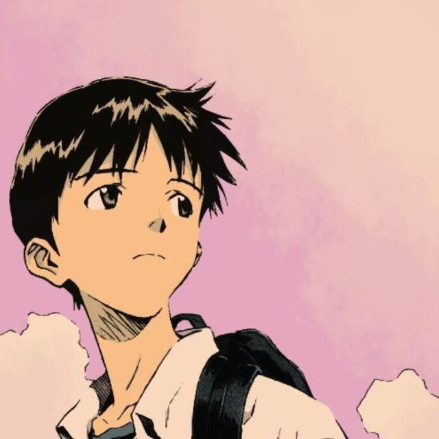<br>
  <strong>vv</strong><br>
  <sub>dy/xhs：荣灵</sub><br>
  <sub><a href="mailto:2838033228@qq.com">2838033228@qq.com</a></sub><br>
  <sub><em>就是水水</em></sub>
</td>
<td align="center" valign="top" width="33%">
  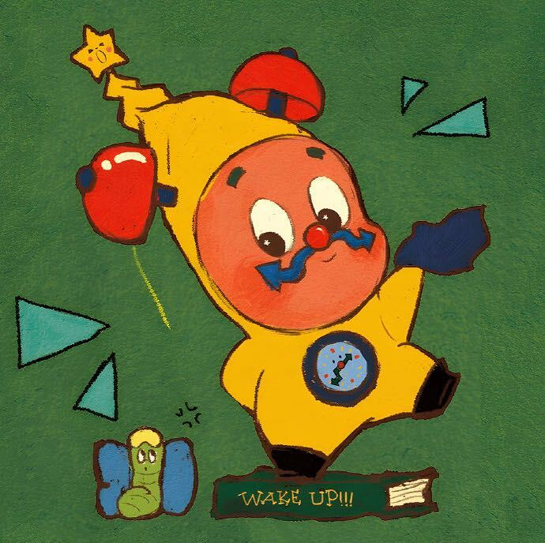<br>
  <strong>Dominic1556</strong><br>
  <sub><a href="mailto:184026530@qq.com">184026530@qq.com</a></sub><br>
  <sub><em>Done is better than perfect</em></sub>
</td>
<td align="center" valign="top" width="33%">
  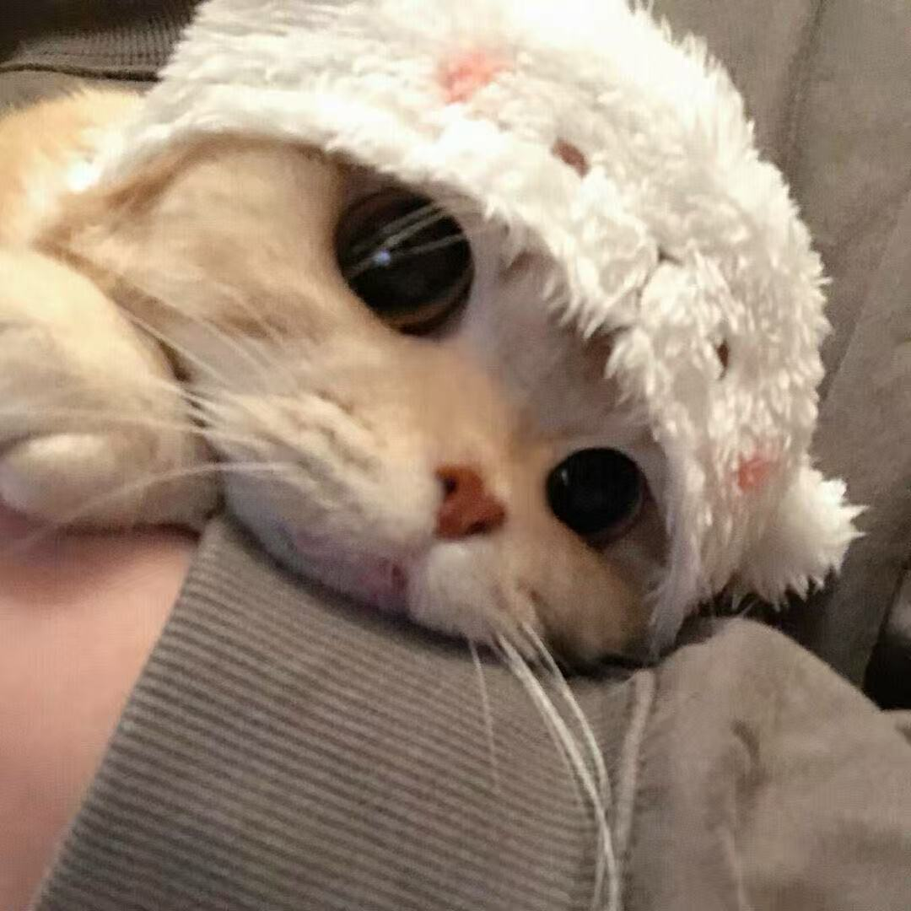<br>
  <strong>宇熙</strong><br>
  <sub><a href="mailto:53121904@qq.com">53121904@qq.com</a></sub><br>
  <sub><em>年轻的时候不狂，老了拿什么回忆</em></sub>
</td>
</tr>
<tr>
<td align="center" valign="top" width="33%">
  <br>
  <strong>影子</strong><br>
  <sub><a href="mailto:305818148@qq.com">305818148@qq.com</a></sub><br>
  <sub><em>年纪大佬才明白人要顺势而为。</em></sub>
</td>
<td align="center" valign="top" width="33%">
  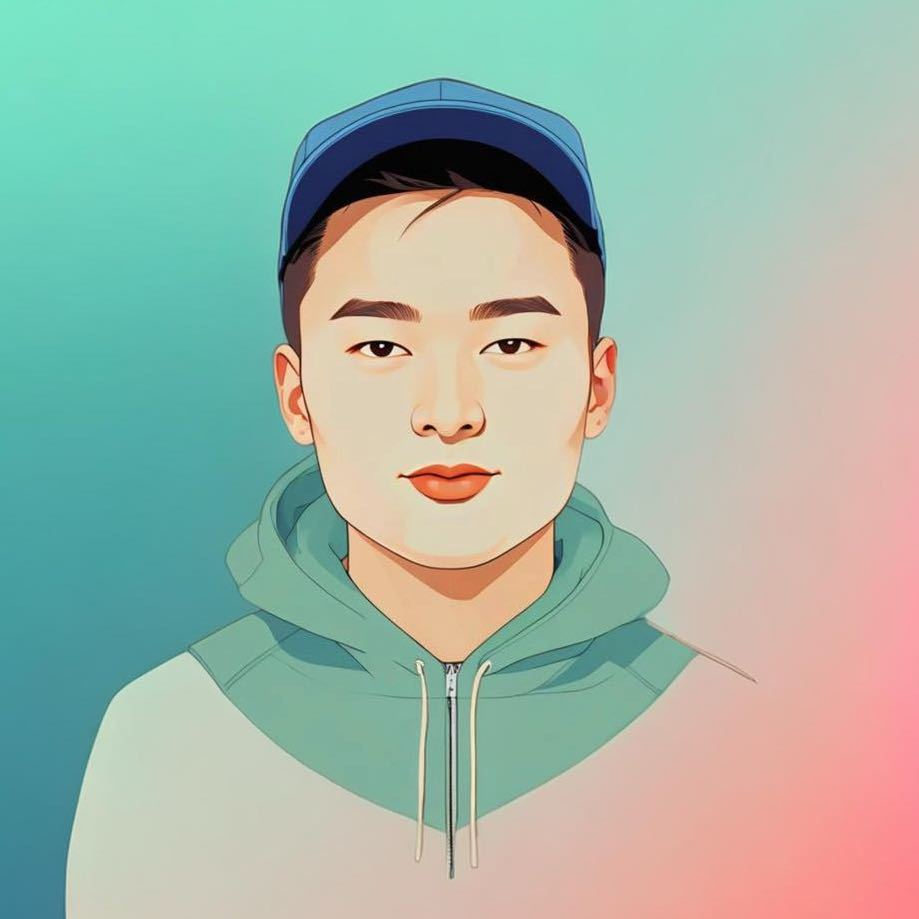<br>
  <strong>Ray</strong><br>
  <sub><a href="mailto:cnraylee@qq.com">cnraylee@qq.com</a></sub><br>
  <sub><em>AI时代的全栈落地工，欢迎找我聊需求</em></sub>
</td>
<td align="center" valign="top" width="33%">
  <br>
  <strong>不见山谷</strong><br>
  <sub>VV：yu170718</sub><br>
  <sub><a href="mailto:1762202553@qq.com">1762202553@qq.com</a></sub><br>
  <sub><em>空山不见人，但闻人语响</em></sub>
</td>
</tr>
<tr>
<td align="center" valign="top" width="33%">
  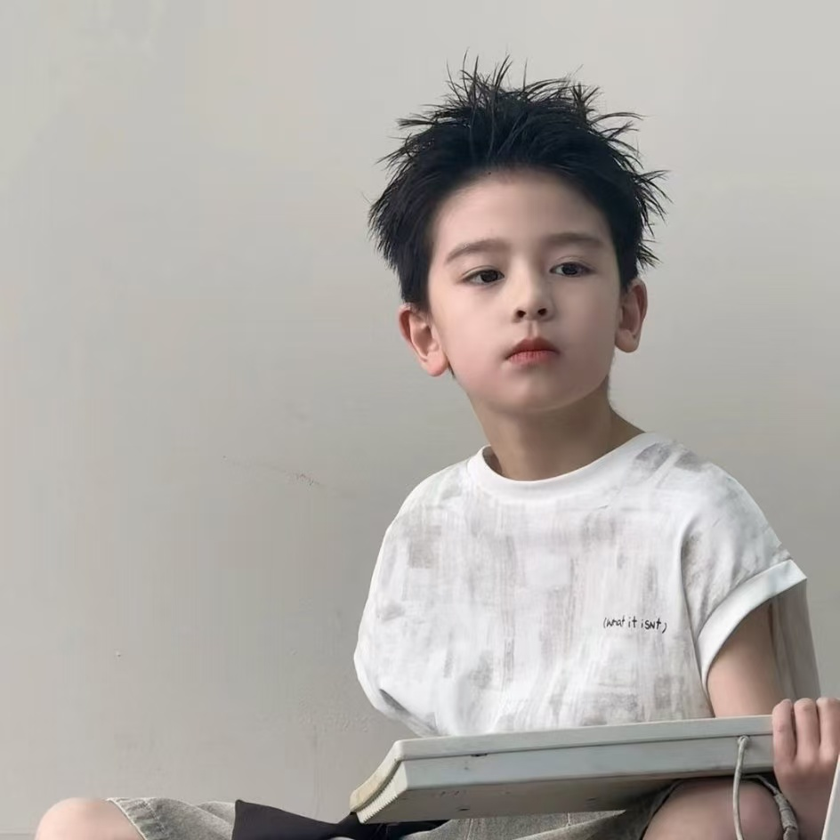<br>
  <strong>yep</strong><br>
  <sub><a href="mailto:1239738103@qq.com">1239738103@qq.com</a></sub><br>
  <sub><em>思考，坚持</em></sub>
</td>
<td align="center" valign="top" width="33%">
  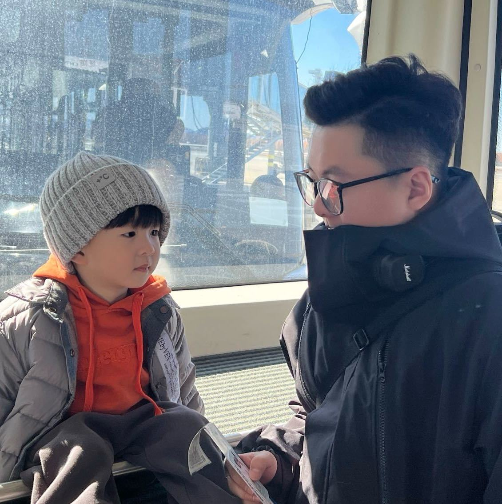<br>
  <strong>汉堡爸爸</strong><br>
  <sub>VV：jxs62888</sub><br>
  <sub><a href="mailto:309151651@qq.com">309151651@qq.com</a></sub><br>
  <sub><em>没什么大不了</em></sub>
</td>
</tr>
<tr>
<td align="center" valign="top" width="33%">
  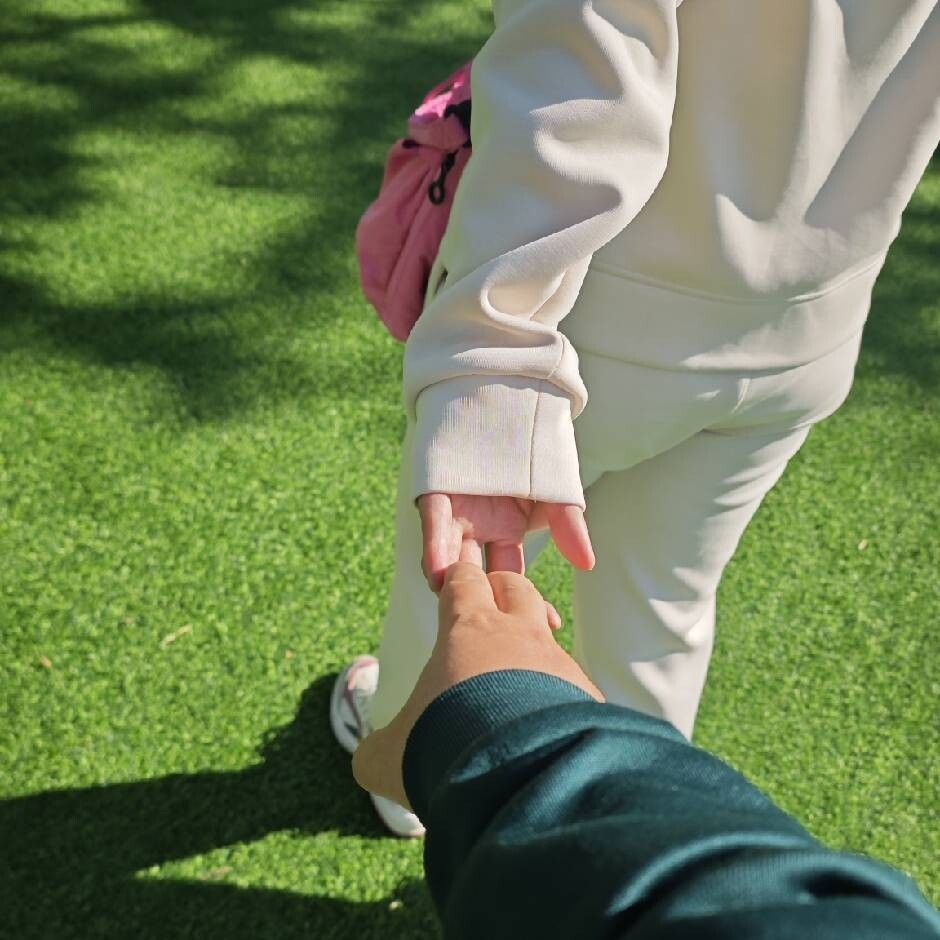<br>
  <strong>daqzia</strong><br>
  <sub>VV：wangzhiwei-8234</sub><br>
  <sub><a href="mailto:wzwzcb@gmail.com">wzwzcb@gmail.com</a></sub><br>
  <sub><em>NullPointerException</em></sub>
</td>
<td align="center" valign="top" width="33%">
  <br>
  <strong>醒梦</strong><br>
  <sub>VV：love-is-heart-is</sub><br>
  <sub><a href="mailto:1948863412@qq.com">1948863412@qq.com</a></sub><br>
  <sub><em>Always believe that good things will happen</em></sub>
</td>
<td align="center" valign="top" width="33%">
  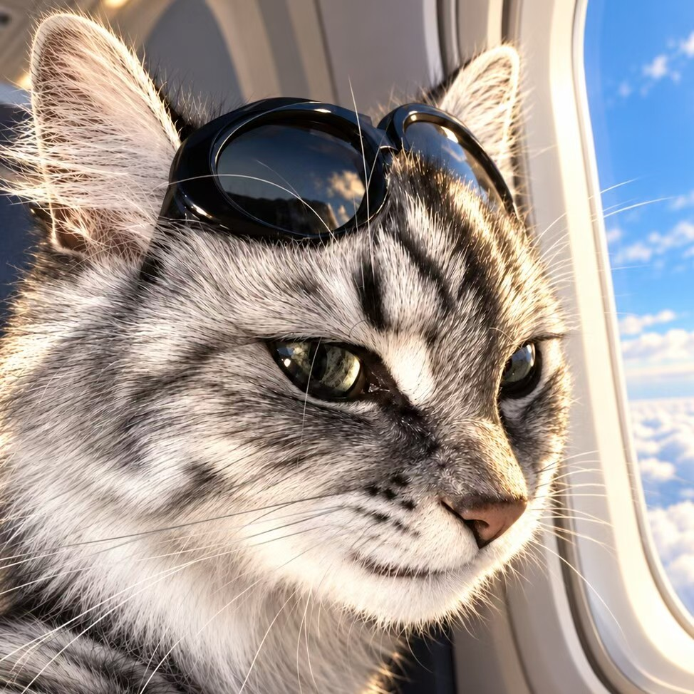<br>
  <strong>morrow</strong><br>
  <sub>VV：morrow0127</sub><br>
  <sub><a href="mailto:3201190041@qq.com">3201190041@qq.com</a></sub><br>
  <sub><em>最难不过坚持</em></sub>
</td>
</tr>
<tr>
<td align="center" valign="top" width="33%">
  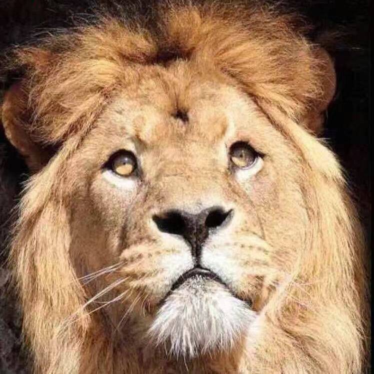<br>
  <strong>春秋</strong><br>
  <sub>Agent 记忆核心贡献者 · VV：A13068788886</sub><br>
  <sub><a href="mailto:558328@qq.com">558328@qq.com</a></sub>
</td>
<td align="center" valign="top" width="33%">
  <br>
  <strong>亿媒网老宋</strong><br>
  <sub><a href="https://em8.top">亿媒网 em8.top</a> · <a href="mailto:61731514@qq.com">61731514@qq.com</a></sub><br>
  <sub><em>全国10W+媒体、自媒体，助力企业品牌传播</em></sub>
</td>
<td align="center" valign="top" width="33%">
  <br>
  <strong>Wyatt_K</strong><br>
  <sub><em>千里之行，始于足下。</em></sub>
</td>
</tr>
<tr>
<td align="center" valign="top" width="33%">
  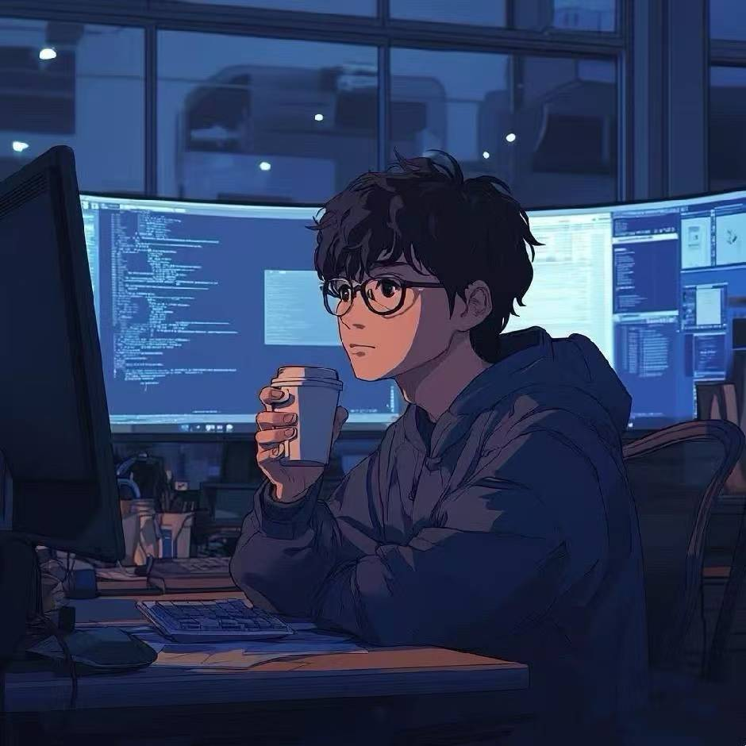<br>
  <strong>Aleyn<br>微信：Aleyn_X</strong><br>
  <sub><a href="mailto:cslin5277@163.com">cslin5277@163.com</a></sub>
</td>
</tr>
</table>

### 3D 预演台赞助用户

感谢以下用户赞助 3D 预演台的开发。

<table>
<tr>
<td align="center" width="20%"><a href="https://github.com/TripsCoder"><br><sub><strong>@TripsCoder</strong></sub></a></td>
<td align="center" width="20%"><a href="https://github.com/sugtex"><br><sub><strong>@sugtex</strong></sub></a></td>
<td align="center" width="20%"><a href="https://github.com/Leyi813"><br><sub><strong>@Leyi813</strong></sub></a></td>
<td align="center" width="20%"><a href="https://github.com/daoge05178"><br><sub><strong>@daoge05178</strong></sub></a></td>
<td align="center" width="20%"><a href="https://github.com/AetherNo2332"><br><sub><strong>@AetherNo2332</strong></sub></a></td>
</tr>
</table>

<table>
<tr>
<td align="center" width="20%"><strong>vv</strong><br><sub>2838033228@qq.com</sub></td>
<td align="center" width="20%"><strong>克里斯</strong><br><sub><a href="https://artbox.top">artbox.top</a></sub></td>
<td align="center" width="20%"><strong>宇熙</strong><br><sub>53121904@qq.com</sub></td>
<td align="center" width="20%"><strong>落羽</strong><br><sub>luoyyv66@gmail.com</sub></td>
<td align="center" width="20%"><strong>今夕何在</strong><br><sub>809321478@qq.com</sub></td>
</tr>
<tr>
<td align="center" width="20%"><strong>Alpha-M·Break</strong><br><sub>15739564793@qq.com</sub></td>
<td align="center" width="20%"><strong>不吃鸭梨</strong><br><sub>elio02519@gmail.com</sub></td>
<td align="center" width="20%"><strong>九月</strong><br><sub>563641352@qq.com</sub></td>
<td align="center" width="20%"><strong>A</strong><br><sub>jiaboxuan1205@gmail.com</sub></td>
<td align="center" width="20%"><strong>fochaobaby</strong><br><sub>leoxie.design@gmail.com</sub></td>
</tr>
</table>

---

感谢所有让这个项目变得更好的人。
