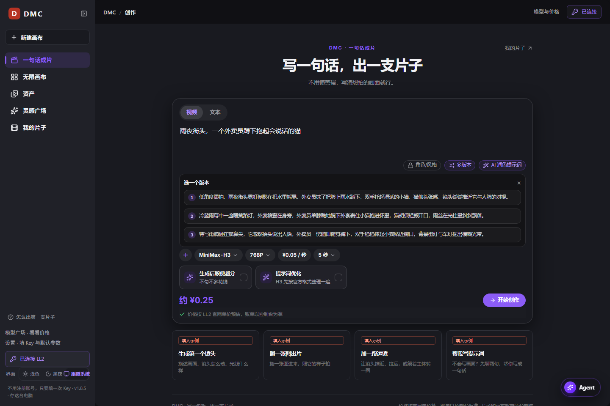
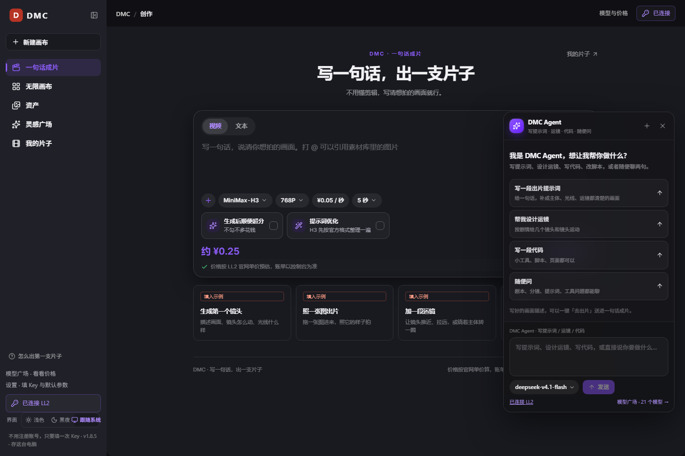
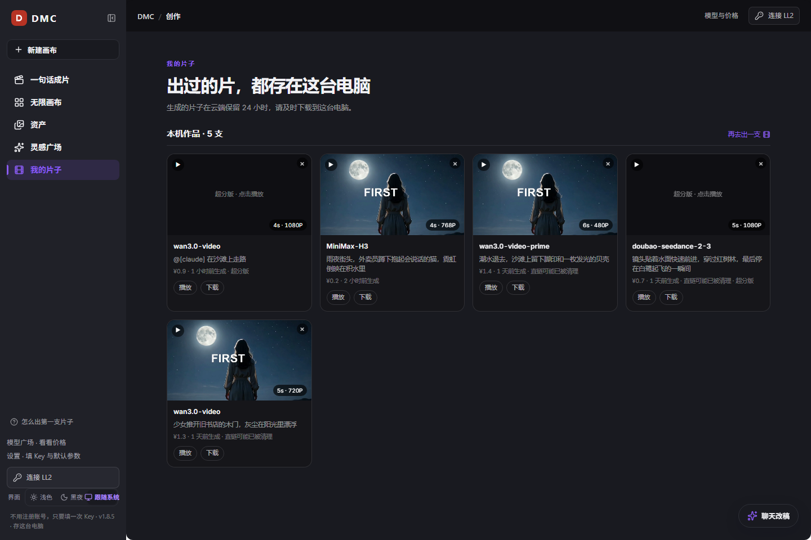

  

<h1 align="center">DMC · 影策二开</h1>

本地优先的 AI 漫剧 / 短剧创作台 · 填一次 LL2 Key 就能出片

  <a href="https://hub.ll2.cn?p=s93d" target="_blank" rel="noopener noreferrer"><strong>👉 点这里注册 LL2，填 Key 就能出片</strong></a>

  一句话成片 · 无限画布 · 全站 DMC Agent · 我的片子

> DMC 是 [影策 open-ai-canvas](https://github.com/ddcat-ai/open-ai-canvas) 的 C 端二开版本。
> 免登录、只使用本机保存的 LL2 Key，不依赖影策账号后端；画布、素材和作品默认存在这台电脑。

---

## 产品介绍

DMC 把「写一句话 → 出片」和「无限画布」放在同一个本地工作台里，面向漫剧、短剧和个人创作者。

### 一句话成片

写一句画面描述，选好模型、清晰度、时长和比例，直接生成。

- **AI 润色提示词**：把一句话补成主体、光线、运镜清楚的画面描述
- **多版本**：同一句话生成 3 个不同侧重点的版本，挑一个再生成
- **角色/风格锁定**：保存人物设定和画风，之后每条生成自动带上
- **生成后顺便超分**：先出片，再按 1080P / 2K / 4K 串行超分（单独计费，提交前展示）
- 提交前按官方价估算本次花费，账单以 LL2 控制台为准

  

### 全站 DMC Agent

首页、资产、灵感广场、我的片子等页面右下角常驻，点开即用。

- 能写提示词、设计运镜、写代码、改文案和回答创作问题
- 回答里的代码块单独渲染，可直接复制
- 支持「直接出片」：先确认模型、秒数、清晰度和价格，确认后自动回到首页提交

  

### 无限画布

用节点组织角色、分镜、参考图和视频，像摆分镜一样把一部戏慢慢搭出来。

- 节点、连线、框选、小地图、撤销重做、本地保存
- LL2 视频模型直连生成：MiniMax H3、wan3.0、Seedance、Vidu
- 视频节点连两张图就是首尾帧；可带参考视频/音频（按模型限制）
- 已生成的视频可在右键菜单直接超分、下载到本机或存到资产库
- 生成阶段和超分阶段刷新后可按 LL2 taskId 续查，尽量不重复扣费
- 「漫剧五步」入口：画风 → 故事 → 分镜 → 视频 → 成片

  

### 我的片子

生成的成片按视频首帧封面陈列，可播放、下载、移除。

  

## 模型与协议

当前 C 端直连 LL2（api.ll2.cn），不需要影策后端。已适配的视频模型：

| 模型 | 清晰度 | 时长 | 参考素材 |
| --- | --- | --- | --- |
| MiniMax H3 | 768P | 4–15 秒 | 首帧/尾帧、参考视频、参考音频 |
| wan3.0-video / prime | 480P / 720P / 1080P | 4–30 秒 | 图 ≤10、视频 ≤5、音频 ≤5（首尾帧与参考素材二选一） |
| Seedance 2.0 / 2.5 | 480P / 720P / 1080P / 4K | 按模型 | 首尾帧、参考图、参考视频 |
| Vidu Q3 pro / turbo | 540P / 720P / 1080P | 按模型 | 最多 2 张图（首帧 + 尾帧） |
| auto-hd | 1080P / 2K / 4K | 后处理 | 只接在已生成的公网视频后，不单独生成 |

## Windows 桌面版

Windows EXE 安装包已发布：[下载 DMC-Setup-1.8.5.exe](https://github.com/DAV-SAM/LL2TV/releases/download/v1.8.5-exe/DMC-Setup-1.8.5.exe)，安装后双击即用，不需要浏览器和本地后端。

- 免登录，只填一次 LL2 Key
- 画布、素材和作品保存在本机用户目录，退出工具后仍然保留
- 生成的视频直链只在云端保留约 24 小时；长期保存请下载到本机或存到资产库
- 卸载默认保留用户数据，重装不会清空作品

## 数据与隐私

- LL2 Key 只保存在本机，不提交到业务后端
- 画布、素材、作品默认只存在这台电脑
- 生成的视频会上传到 LL2 网关处理，24 小时后直链可能失效

## 鸣谢

- **[影策 open-ai-canvas](https://github.com/ddcat-ai/open-ai-canvas)**：本项目的画布、任务系统和大部分基础能力来自这个开源项目。感谢上游原作者、贡献者和赞助商。
- **[LL2 / DMC](https://hub.ll2.cn?p=s93d)**：提供统一的 BYOK 视频/文本模型网关，H3、wan3、Seedance、Vidu、auto-hd 超分都走它；点这里可以直接注册。
- **BeefTV**：桌面端本地化、插件、更新和用户数据落盘的产品形态参考。
- **DeepSeek Harness（DSH）**：本项目开发过程中使用的 Agent 工作台。
- 也感谢 MiniMax、阿里云百炼、火山引擎、Vidu、Super Vega 等模型提供方的官方文档。

## 许可证

沿用上游 [MIT](LICENSE)。本项目改动部分同样按 MIT 发布；第三方组件和素材遵循各自附带许可证。

---

感谢所有让这个项目变得更好的人。
