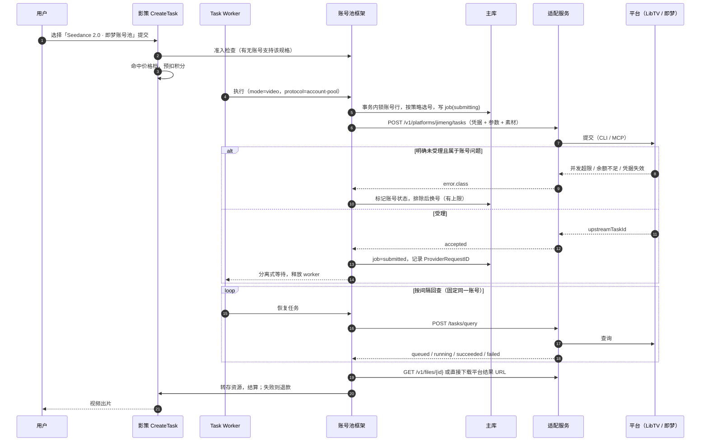
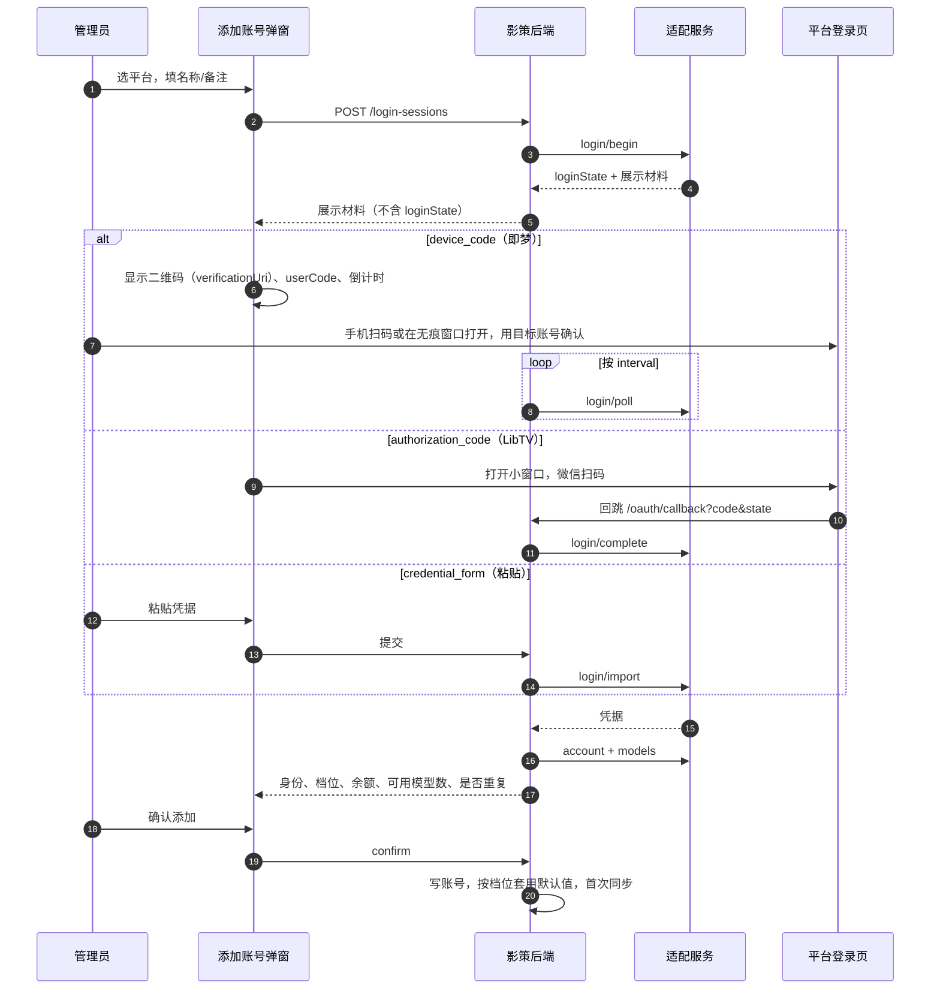

# 多平台账号池最终指导方案

> 状态：最终指导方案，未实施。
>
> 本文是实施依据。标注「〔P0〕」的条目依赖平台未公开的细节，必须在第 0 阶段用真实账号核实并回填本文后再进入对应开发。其余条目均已对照影策代码、平台官方资料或开源项目实现核对过，依据列在第 18 节。

## 0. 阅读指引

| 读者 | 先读 |
| --- | --- |
| 评审方案的人 | 第 1、4、14、16 节 |
| 实现影策后端的人 | 第 5、6、9、11、12 节 |
| 实现平台适配的人 | 第 5、7、9.2 节 |
| 部署运维 | 第 10、11 节 |

术语：

- **平台**：账号的来源方，例如 LibTV、即梦。
- **账号**：某平台上的一个登录身份，带凭据、档位、余额。
- **适配**：把某个平台的协议转换成本文第 5 节标准的代码。
- **适配服务**：运行一个或多个适配的独立进程（容器）。
- **账号池框架**：影策后端里与平台无关的部分：凭据保管、选号、任务、计费、渠道、页面。
- **托管渠道**：账号池为每个平台自动建立的系统渠道。用户看到的模型就是这个渠道下的渠道模型。

## 1. 结论

1. **影策后端内置一个与平台无关的账号池框架**，一次建好。它负责凭据加密保管、余额与档位同步、启停、优先级和选号策略、任务固定账号、失败换号、计费、后台页面。
2. **平台差异全部收敛到一份「平台适配标准」**（第 5 节，协议名 `yingce.accountpool/v1`）。适配运行在**独立的适配服务**里，影策通过 HTTP 调用，做法与现有的 `yingce-agent` 一致。新增平台只需实现标准、部署适配、在后台登记，**不改影策代码**。
3. **首批平台**：
   - **LibTV**：走官方 Remote MCP（`https://mcp.liblib.tv/mcp`），OAuth 2.1 授权码 + PKCE，微信扫码。
   - **即梦**：走**即梦官方 CLI `dreamina`**，它使用 OAuth 设备码登录（Device Flow），提供积分查询和异步任务命令。不使用网页接口逆向。
4. **添加账号**：页面内完成。支持三种方式：设备码扫码（即梦）、授权页扫码（LibTV）、粘贴凭据（任意平台的兜底）。添加后自动识别身份、档位、余额和可用模型。
5. **用户侧无差别**：每个平台对应一个托管的系统渠道，LibTV、即梦的模型就是普通渠道模型。价格、成本价、能力参数、启停全部在「渠道与模型」里配置，和其他渠道是同一条线。托管渠道也能和官方 API 渠道一起挂到同一个前台模型下，按优先级互为备份。
6. **调度**：账号可单独启停，设置优先级和权重；策略支持「按优先级用完一个再换」「负载均衡」「余额优先」「先用快过期的额度」「加权」。选号同时看档位能力、并发、余额和冷却。
7. **部署**：适配服务用**独立的 Compose 项目**部署并接入影策的网络。原因是 Host Updater 升级时执行 `up --remove-orphans`，同项目里不在 `docker-compose.deploy.yml` 中的容器会被删除。

## 2. 需求与验收点

| 需求 | 验收点 |
| --- | --- |
| 后端账号池，可托管不同平台账号 | 后台「账号池」页面按平台分组展示账号；同一套页面和接口管理 LibTV、即梦；新增平台不改影策代码 |
| 期初定义好标准 | 第 5 节标准有版本号、字段定义、错误分类和一致性测试；首批两个平台都按标准实现并通过测试 |
| 输入 Token 或扫码都能添加 | 设备码扫码、授权页扫码、粘贴凭据三种方式；添加完成前展示平台身份供核对；同一平台账号不能重复添加 |
| 识别剩余余额 | 每个账号显示余额（可多种余额）、档位、到期、下次额度刷新时间；定时同步并在任务结束后刷新 |
| 开启/关闭调用 | 账号级启停；账号 × 模型级启停 |
| 优先级与调度策略 | 优先级、权重、并发上限可设；平台级策略可选（第 6.8 节） |
| 每个账号开放的模型 | 每个账号单独记录可用模型和规格范围；后台按模型、规格显示可用账号数 |
| 用户看到的模型和系统渠道无区别 | 模型在画布、创作台、Agent 中的表现与其他渠道模型完全一致；价格在渠道模型价格档配置 |
| 仅限内部使用 | 账号池插件默认停用；可限定用户分组；适配服务代码放私有仓库 |

## 3. 调研结论

### 3.1 LibTV

| 接入面 | 事实 | 结论 |
| --- | --- | --- |
| **Remote MCP** `https://mcp.liblib.tv/mcp` | 授权服务器元数据（已直接读取）：`/authorize`、`/token`、`/register`（动态客户端注册）、`/revoke`；`grant_types=[authorization_code, refresh_token]`；`code_challenge_methods=[S256]`；scope 为 `libtv:account:read`、`libtv:project:read`、`libtv:project:write`、`libtv:media:write`、`libtv:task:write`、`libtv:export:write`。未授权调用返回 401（已实测）。社区桥接实现表明：授权与换 token 必须带 `resource=https://mcp.liblib.tv/mcp`；access token 约 1 小时，靠 refresh token 续期；登录为微信扫码；工具包括 `account_user`、`search_models`、`get_model`、`generation_submit`、`generate_video`、`task_status`、`upload_media` 等。LibTV 官方技能要求模型和参数从实时 schema 读取，传输超时不等于失败，不能因此重复提交 | **选用** |
| 官方 CLI `libtv` | 能操作画布、节点、模型、素材；`libtv node <key> --run` 同步阻塞到出结果并写回画布。公开渠道未找到安装包 | 只在 P0 作协议对照 |
| IM OpenAPI | `sk-libtv-…` 静态密钥，给后端 Agent 发自然语言，不能指定模型和规格 | 不选用 |
| 网页 API | 影策现有 LibTV 画布导入使用的 `token` 请求头接口 | 不用于生成 |

LibTV 的计价单位是积分，存在多档会员（社区反馈最低档约每月 47 元含 1500 积分，仅作参考〔P0〕）。

### 3.2 即梦

| 接入面 | 事实 | 结论 |
| --- | --- | --- |
| **官方 CLI `dreamina`** | 字节官方发布，安装脚本 `https://jimeng.jianying.com/cli` 列出 linux 与 darwin 的 amd64、arm64 以及 windows amd64 二进制（已下载 macOS arm64 版本核对各子命令帮助）。登录为 **OAuth Device Flow**：输出 `verification_uri`、`user_code`、`device_code`；`login --headless` 输出后立即退出，再用 `login checklogin --device_code=…` 完成。命令包括 `user_credit`（积分）、`text2video`、`image2video`、`frames2video`、`multimodal2video`、`query_result --submit_id`、`list_task`、`session`。生成为异步：`submit_id` + `gen_status=querying` 只代表受理，`gen_status=success` 才是成功；查询结果里的 `video_url` 只是预览链接，下载必须用 `query_result --download_dir`。并发超限返回 `ExceedConcurrencyLimit`（ret `1310`）；部分模型首次使用需在网页端完成一次生成，否则返回 `AigcComplianceConfirmationRequired`。模型和规格按命令区分，例如 `seedance2.5` 为 VIP 专属、时长 4–30 秒、参考帧生成时拒绝显式比例；`seedance2.0_vip` 支持 720p/1080p/4k | **选用** |
| 火山引擎官方 API | 影策已支持（`volcengine-jimeng-video` 插件、火山方舟 Seedance） | 保留为独立渠道，可与账号池组成前台模型路由 |
| 网页逆向（jimeng-free-api-all 等） | 用网页 Cookie `sessionid`；部分 Seedance 2.0 线路被风控拦截，需要无头浏览器代签名；作者声明可能违反服务条款、账号有被限制风险 | **不采用**，只参考其积分与模型字段 |

从 CLI 二进制的字符串可以看到它使用 ByteDance passport 的设备码接口（`/passport/open/get_device_code/`、`/passport/open/check_device_code/`、`/passport/open/refresh_token/`），并包含本地 `tasks.db` 和 keyring 相关代码。凭据在 Linux 无图形环境下的存放方式需 P0 核实〔P0〕。

### 3.3 开源账号池项目的可借鉴做法与已知坑

| 项目 | 借鉴 | 对应设计 |
| --- | --- | --- |
| new-api | 渠道多密钥（轮询/随机）、自动禁用、余额查询、普通渠道与插件渠道按优先级权重一起选择 | 托管渠道参与现有逻辑模型路由；账号自动停用与余额同步 |
| claude-relay-service | 多账号 OAuth 托管；「生成授权链接 → 粘贴授权码」；上游 5xx/503 临时暂停，账号级覆盖冷却时长；列表显示「不可路由原因、剩余时间、预计恢复时间」并可一键重置 | 粘贴回调兜底；冷却可按账号覆盖；页面显示不可用原因并可重置 |
| CLIProxyAPI | 多账号轮询、fill-first（用完再换）；社区插件做按剩余额度配速、按重置时间优先 | 策略 `fill_first`、`soonest_reset` |
| CLIProxyAPI 已知问题 | 客户端取消被误判为账号故障（#4819）；亚秒级 Retry-After 引发多账号重试风暴（#5265）；单个调用方耗尽全部账号（#3467）；持久化的过期冷却阻断恢复（#5404、#5770） | 只有归类为账号问题的上游错误才影响账号；冷却有下限、换号有上限；按用户限制在途任务；冷却由余额同步复核并可人工重置 |
| underclass | 额度耗尽的账号冷却到窗口重置后自动回来；401 只做一次单飞刷新再重试；refresh token 轮换后立即持久化；只在上游受理前换号；全部不可用时立即返回最早恢复时间 | 第 6.5、6.8、6.9 节对应规则 |
| sub2api 已知问题 | 网关自身的并发拒绝被标成上游限流，运维无法区分（#6530）；需要按账号设置周期消费上限（#704） | 池内拒绝与上游错误分开编码；账号日消耗上限 |

这些项目都提示了平台条款风险：多账号集中托管可能违反平台用户协议，账号可能被限制。本方案只用官方接口，但集中托管本身的风险仍在，只限内部使用。

### 3.4 影策现状约束

- **插件**：插件不能注册路由、表、Worker，也不能注入菜单（`docs/content/docs/plugins/plugin-system.mdx` §3；`admin-shell.tsx` 的 `adminNavigation` 是静态数组）。只有 Go 内置的 manifest 能用 `host:` 执行器（先例 `app/sms_plugins.go`、`app/workflow_plugins.go`）。
- **视频链路可复用**：分离式回查（`provider_protocol_async.go`，最长 48 小时）、`resumedProviderRequestID` 恢复、`runVideoDownload` 下载、`persistGeneratedMediaResult` 转存、`task_billing.go` 预扣/结算/退款/复核、`ChannelSlotFailureDetails` 可识别的「上游未发出」退款路径。
- **渠道与价格**：渠道模型页已有「获取模型 → 选择导入」（`app/channel_models_catalog.go`）和「规格成本价 / 销售价 / 加价」（`ChannelModelCostSummary`）。逻辑模型路由支持优先级、权重和路由封禁（`model_router.go` 的 `logicalRouteBlocked`、`Coordinator.BlockRoute`）。用户分组按渠道白名单限制（`userGroupAccess.allowsChannel`）。
- **基础设施**：`runWorkerLoop` 后台循环；`Coordinator.AcquireLease` 分布式锁；`.settings-key` AES-256-GCM 加密；数据库迁移 `CurrentSchemaVersion = 83`（`backend/internal/database/migrations.go`），新表追加迁移；错误原因定义在 `backend/internal/kernel/error_codes.go`，取值为 snake_case，前端在 `web/src/services/api/error-codes.ts` 登记；前端已有 antd `QRCode` 的使用先例（`web/src/components/payment-checkout-code.tsx`）。
- **独立服务先例**：`yingce-agent` 是独立容器，后端用 `YINGCE_AGENT_URL` 和至少 32 位的 `YINGCE_AGENT_TOKEN` 调用；它不连数据库、不计费；远程失败不回退到本地执行，避免同一步执行两次。
- **Host Updater**：每次升级下载目标版本的 `docker-compose.deploy.yml`，以 `--project-name <安装目录名>` 执行 `up -d --remove-orphans`（`backend/internal/hostupdate/manager_ops.go`）。同一项目中不在该文件里的容器会被当作孤儿删除。

## 4. 总体架构与关键决策

### 4.1 架构

```text
┌──────────────────────────────── 影策 web 后台 ────────────────────────────────┐
│ 渠道与模型（现有）                         账号池（新，插件启用后可见）          │
│  └ 托管渠道「LibTV 账号池」「即梦账号池」   平台 | 账号 | 模型覆盖 | 调用记录 | 设置 │
│     获取模型 / 能力 / 价格档 / 启停          添加账号弹窗（设备码 / 授权页 / 粘贴）  │
└───────────────┬─────────────────────────────────────┬────────────────────────┘
                │ 现有渠道接口                           │ /api/admin/account-pool/*
┌───────────────▼─────────────────────────────────────▼──────── backend ───────┐
│ internal/accountpool   账号、凭据、登录会话、同步、调度、任务记录、用量（与平台无关） │
│ internal/accountpool/adapterclient   标准协议的 HTTP 客户端                      │
│ app/account_pool_*.go  组合根：插件、托管渠道、执行器、准入、后台循环              │
│ 现有：任务队列、分离式回查、计费、资源转存、逻辑模型路由、用户分组                 │
└───────────────┬──────────────────────────────────────────────────────────────┘
                │ HTTP + Bearer（内部网络，地址精确放行）
┌───────────────▼──────────── 适配服务（独立容器，私有仓库）──────────────────────┐
│ /v1/platforms  /login/*  /account  /models  /tasks  /files                      │
│  ├ libtv  适配：MCP Go SDK + OAuth（授权码 + PKCE）                              │
│  └ jimeng 适配：官方 dreamina CLI（设备码登录），每次调用使用独立临时 HOME           │
│ 不连数据库、不保存凭据；只保留短期幂等记录和待取回的结果文件                         │
└───────────────┬──────────────────────────────────────────────────────────────┘
                │ HTTPS
       mcp.liblib.tv / libtv-res.liblib.art      jimeng.jianying.com（经 CLI）
```

### 4.2 关键决策

| 编号 | 决策 | 备选 | 理由 |
| --- | --- | --- | --- |
| D1 | 账号池框架内置在影策后端 | 独立网关（自带页面和数据库） | 后台菜单和页面在影策里；复用任务、计费、渠道、路由；凭据进主库统一加密和备份 |
| D2 | 平台适配放独立适配服务，经 HTTP 标准协议调用 | 编进影策后端 | 平台协议变化快，与影策发布解耦；官方 CLI 二进制和子进程与主后端隔离；适配代码可放私有仓库；语言不限；新增平台不改影策代码 |
| D3 | 凭据只存在影策主库，适配服务无状态 | 适配服务自己保存凭据 | 备份、权限、审计在一处；适配服务重建不丢账号；适配服务本身不形成凭据库 |
| D4 | 每个平台一个托管系统渠道 | 每个账号一个渠道 | 价格只配一遍；渠道列表不膨胀；能按余额和档位选号 |
| D5 | 价格、能力、启停沿用渠道模型 | 账号池单独定价 | 与其他渠道一条线，计费链路零改动 |
| D6 | 即梦用官方 `dreamina` CLI | 网页逆向；自行实现 passport 接口 | 官方工具，登录是标准设备码流程，风控和条款风险最低；CLI 升级由官方维护。自行实现 passport 接口作为 CLI 不可用时的后备〔P0〕 |
| D7 | LibTV 用官方 Remote MCP | CLI；IM OpenAPI；网页 API | 唯一能精确指定模型、查积分、读 schema 的官方程序接口 |
| D8 | 提交时选号，任务固定账号 | 每次请求重新选号 | 平台任务按账号隔离，换账号查不到 |
| D9 | 内置系统插件 `account-pool` 控制启停和菜单 | 功能开关 | 符合「插件安装后出现菜单」的预期；沿用插件管理的启停与审计 |
| D10 | 适配服务用独立 Compose 项目部署 | 同一 Compose 项目里的覆盖文件 | Host Updater 的 `--remove-orphans` 会删除同项目中的额外容器 |
| D11 | 标准带主版本号，主版本不同即拒绝 | 不做版本管理 | 适配服务与影策分开发布，必须能识别不兼容 |

### 4.3 生成时序



## 5. 平台适配标准 `yingce.accountpool/v1`

### 5.1 原则

1. 适配只翻译协议，不做调度、计费、重试、换号。
2. 适配无状态：凭据由影策每次随请求传入，用完即弃；允许保留的只有短期幂等记录和待取回的结果文件。
3. 凭据只出现在请求体里，不出现在 URL、日志、错误信息中。
4. 适配可以在任意一次调用中返回更新后的凭据（例如 token 轮换），影策负责持久化。
5. 所有错误必须归入第 5.9 节的分类；无法确定的一律归为 `ambiguous`。

### 5.2 传输与鉴权

- HTTP/1.1 + JSON；提交任务用 `multipart/form-data`（JSON 请求部分 + 素材文件）。
- 影策 → 适配：`Authorization: Bearer <适配服务令牌>`，令牌至少 32 个字符，与 `YINGCE_AGENT_TOKEN` 规则一致。
- 每个请求带 `X-Request-Id`，适配原样写入日志与响应，便于和影策任务关联。
- 除 `GET /healthz`、`GET /v1/platforms` 和文件下载外，全部接口使用 `POST`，凭据只放在请求体里，不进入 URL。
- 响应统一为成功体或错误体：

```json
{ "error": { "class": "concurrency_limit", "code": "1310", "message": "当前账号并发已满", "retryAfterSeconds": 60, "action": null } }
```

### 5.3 接口清单（适配服务侧）

| 方法与路径 | 用途 |
| --- | --- |
| `GET /healthz` | 健康检查 |
| `GET /v1/platforms` | 返回该服务提供的平台描述（5.4） |
| `POST /v1/platforms/{platform}/login/begin` | 开始登录，返回展示材料与不透明的 `loginState` |
| `POST /v1/platforms/{platform}/login/poll` | 设备码类登录轮询 |
| `POST /v1/platforms/{platform}/login/complete` | 授权码类登录完成（带回调参数） |
| `POST /v1/platforms/{platform}/login/import` | 粘贴凭据 |
| `POST /v1/platforms/{platform}/credential/refresh` | 主动续期 |
| `POST /v1/platforms/{platform}/credential/revoke` | 吊销（删除账号时调用） |
| `POST /v1/platforms/{platform}/account` | 身份、档位、余额（5.6） |
| `POST /v1/platforms/{platform}/models` | 该账号可用模型与规格（5.7） |
| `POST /v1/platforms/{platform}/tasks` | 提交任务（5.8） |
| `POST /v1/platforms/{platform}/tasks/query` | 查询任务 |
| `POST /v1/platforms/{platform}/tasks/reconcile` | 提交结果不确定时对账 |
| `POST /v1/platforms/{platform}/tasks/cancel` | 取消（可选） |
| `GET /v1/files/{fileId}` | 取回适配服务暂存的结果文件，取回成功或过期后删除 |

### 5.4 平台描述

```json
{
  "protocolVersion": "yingce.accountpool/v1",
  "adapterVersion": "1.0.0",
  "platform": "jimeng",
  "displayName": "即梦",
  "capabilities": ["video"],
  "login": {
    "kinds": ["device_code", "credential_form"],
    "formFields": [
      { "name": "credentialsJson", "type": "textarea", "label": "凭据 JSON", "secret": true, "required": true }
    ]
  },
  "credential": { "refreshable": true, "mutatesOnUse": true },
  "features": { "balance": true, "models": true, "cancel": false, "reconcile": true },
  "limits": { "maxUploadBytes": 209715200, "maxInputs": 50 },
  "balanceKinds": [{ "kind": "credits", "label": "积分", "unit": "积分" }]
}
```

- `credential.mutatesOnUse=true` 表示任何调用都可能刷新凭据（CLI 类）。影策据此把该账号的所有调用串行化（第 6.5 节）。
- `protocolVersion` 主版本与影策不一致时，影策拒绝登记该平台。

### 5.5 登录方式

| `kind` | 适用 | 流程 | 展示材料 |
| --- | --- | --- | --- |
| `device_code` | 即梦 | `begin` → 管理员在任意浏览器或手机打开地址并用目标账号确认 → 影策按 `interval` 调 `poll` | `verificationUri`、`userCode`、`expiresIn`、`interval` |
| `authorization_code` | LibTV | `begin`（影策提供 `redirectUri`）→ 打开 `authorizeUrl` 扫码 → 平台回跳影策 → 影策调 `complete` | `authorizeUrl`、`expiresIn` |
| `credential_form` | 任意平台兜底 | 管理员按 `formFields` 填写 → `import` | 表单字段定义 |
| `qr_image`（预留） | 平台原生扫码 | `begin` 返回二维码图片 → `poll` | `qrImage`、`expiresIn` |

`loginState` 由适配生成（例如包含 PKCE verifier、device_code、动态注册得到的 client_id），对影策不透明。影策加密保存，不发给浏览器。

### 5.6 凭据与账号信息

凭据：

```json
{ "kind": "oauth", "data": "<适配自定义的不透明 base64>", "expiresAt": "2026-11-05T12:00:00Z", "fingerprint": "sha256:…" }
```

账号信息：

```json
{
  "platformUserId": "12345678",
  "displayName": "影策采购 07",
  "tier": { "code": "vip", "name": "高级会员", "expiresAt": "2027-01-31T00:00:00Z" },
  "balances": [
    { "kind": "credits", "label": "会员积分", "amount": 12800, "unit": "积分", "expiresAt": null, "resetAt": null },
    { "kind": "daily_free", "label": "每日赠送", "amount": 0, "unit": "积分", "expiresAt": "2026-11-05T16:00:00Z", "resetAt": "2026-11-05T16:00:00Z" }
  ],
  "concurrencyHint": 3,
  "credentialUpdate": null
}
```

`platformUserId` 是去重依据，必须稳定。`balances` 可以有多项；`resetAt` 表示额度在该时间恢复，影策据此设置冷却截止时间。

### 5.7 模型与规格

```json
{
  "models": [
    {
      "modelKey": "seedance2.0_vip",
      "displayName": "Seedance 2.0 VIP",
      "family": "seedance",
      "capability": "video",
      "available": true,
      "video": {
        "operations": ["text_to_video", "image_to_video", "reference_to_video", "audio_to_video"],
        "defaultOperation": "text_to_video",
        "duration": { "selection": "range", "min": 4, "max": 15, "step": 1, "default": 5 },
        "ratios": ["1:1", "3:4", "16:9", "4:3", "9:16", "21:9"],
        "defaultRatio": "16:9",
        "resolutions": ["720p", "1080p", "4k"],
        "defaultResolution": "720p",
        "references": { "maxImages": 9, "maxVideos": 3, "maxAudios": 3, "maxVideoDurationSeconds": 15, "maxAudioDurationSeconds": 15 },
        "generateAudio": { "supported": true, "default": true }
      },
      "rules": [{ "operation": "image_to_video", "ratio": "follow_first_frame" }],
      "costHints": [{ "selector": { "operation": "text_to_video", "vquality": "1080p", "videoSeconds": "10" }, "amount": 120, "unit": "积分" }],
      "actionRequired": null
    }
  ]
}
```

- `video` 字段与影策 `VideoCapabilityConfig`（`backend/internal/app/model_capability.go`）同构，影策直接用它预填渠道模型能力。
- `rules` 描述适配会在请求时做的规范化，例如即梦 `seedance2.5` 参考帧生成时比例跟随首帧。页面上提示管理员。
- `costHints` 只作调度和成本参考，不参与用户计费。
- `actionRequired` 非空表示该账号使用该模型前需要人工操作，例如即梦的网页端首次生成确认。

### 5.8 任务

提交请求（multipart 的 `request` 部分）：

```json
{
  "idempotencyKey": "acpool-3f1c…",
  "modelKey": "seedance2.0_vip",
  "operation": "image_to_video",
  "prompt": "镜头缓慢推近，人物转身",
  "durationSeconds": 10,
  "ratio": "16:9",
  "resolution": "1080p",
  "generateAudio": true,
  "inputs": [
    { "role": "first_frame", "part": "file0", "mimeType": "image/png", "sha256": "…" },
    { "role": "last_frame", "part": "file1", "mimeType": "image/png", "sha256": "…" }
  ],
  "options": {}
}
```

`role` 取值：`first_frame`、`last_frame`、`reference_image`、`reference_video`、`reference_audio`，与影策现有的首尾帧和参考素材语义一一对应。

提交响应：

```json
{ "status": "accepted", "upstreamTaskId": "550e8400-…", "estimatedRemainingSeconds": 180, "credentialUpdate": null }
```

查询响应：

```json
{
  "status": "running",
  "progress": 40,
  "stage": "排队中，前方 3 个",
  "queueAhead": 3,
  "estimatedRemainingSeconds": 120,
  "results": [],
  "charged": null,
  "credentialUpdate": null
}
```

成功时 `results` 为 `[{ "kind": "video", "url": "https://…", "mimeType": "video/mp4", "expiresAt": "…" }]` 或 `[{ "kind": "video", "fileId": "f_…", "mimeType": "video/mp4", "expiresAt": "…" }]`。`url` 必须是公网 HTTPS 且无需凭据；需要凭据或经平台下载流程的结果，由适配下载后以 `fileId` 暂存。`charged` 为本次实际消耗（可选）。

对账请求带 `idempotencyKey`、`submittedAfter`、`hints`（模型、提示词哈希），返回 `found`（附 `upstreamTaskId`）、`not_found` 或 `unknown`。只有在平台能可靠查到时才可返回 `not_found`。

### 5.9 错误分类

| `class` | 含义 | 影策对账号 | 影策对任务 |
| --- | --- | --- | --- |
| `auth_expired` | access token 过期，可刷新 | 加锁刷新后重试一次 | 继续 |
| `auth_invalid` | 刷新失败或凭据被吊销 | `reauth_required` | 换号（提交阶段）/ 等待人工（回查阶段） |
| `insufficient_balance` | 余额不足 | `exhausted`，有 `resetAt` 时冷却到该时间 | 换号 |
| `quota_window` | 周期额度用完 | 冷却到 `resetAt` | 换号 |
| `rate_limited` | 频率限制 | 冷却 `max(retryAfter, 下限)` | 换号 |
| `concurrency_limit` | 并发已满 | 记录学习到的并发上限，短冷却 | 换号 |
| `model_unavailable` | 该账号无此模型或规格 | 更新账号模型可用性 | 换号 |
| `account_action_required` | 需人工操作（例如网页端首次确认） | 该账号该模型暂停，显示 `action` | 换号 |
| `account_suspended` | 账号被封禁 | `suspended` | 换号 |
| `invalid_request` | 参数不合法 | 不处罚 | 失败退款，不换号 |
| `content_rejected` | 内容审核拦截 | 不处罚 | 失败退款，不换号 |
| `upstream_unavailable` | 平台临时故障，确定未受理 | 不处罚 | 有限重试 |
| `ambiguous` | 不能确定是否受理 | 不处罚 | 进入对账，不自动重提 |

### 5.10 一致性测试

标准随附一套一致性测试（第 12 节），新平台适配必须通过才能登记：描述字段完整、登录各状态、错误分类映射、`credentialUpdate` 行为、幂等提交、凭据不出现在日志与错误中。

## 6. 影策账号池框架

### 6.1 插件、菜单与托管渠道

- 内置系统插件 `account-pool`（Go manifest，`runtime.backend = host:account-pool`），贡献一个 provider `account-pool`（`capabilities=[video]`，`detachedPolling=true`）。它只用于把协议登记进注册表，让 `validateGenerationInterface`、`shouldDeferProviderTask` 识别；真实执行由账号池执行器完成，host 适配器的 `BuildCreate` 直接报错，防止被通用链路误用。
- `pluginRuntime.reload()` 只对 `Source=system` 且 `PackagePath==""` 的记录传入宿主执行器解析函数；上传包和官方包仍不能使用 `host:`。
- 插件默认停用。启用后「模型与渠道」分组出现「账号池」菜单。`AdminNavigationItem` 增加 `requirePlugin?: string`，按 `GET /api/admin/plugins` 返回的平台可用状态过滤。
- 停用插件只拦截新任务，已提交任务继续回查到终态；后台循环只保留凭据续期和在途对账。
- 每个已登记的平台自动建立一个托管系统渠道（`model_channels.managed_by = account-pool:<platform>`）。渠道页对它隐藏 Base URL、API Key、请求头、代理和并发字段，显示「账号池托管」与「可用账号 x/y」，禁止删除。名称、排序、标签、用户分组白名单照常可改。

### 6.2 数据模型

新迁移 v84 `account_pool`。GORM model 放 `backend/internal/model/models_account_pool.go`，同步更新 `docs/content/docs/backend/backend-database.mdx`。

**`account_pool_adapters`**（适配服务登记）

| 字段 | 说明 |
| --- | --- |
| `id`、`name`、`base_url` | 地址主机必须在 `CANVAS_ALLOWED_PRIVATE_UPSTREAM_HOSTS` 精确放行或为公网 HTTPS |
| `token_enc` | 适配服务令牌，加密 |
| `status`、`last_health_at`、`last_error` | 健康状态 |
| `descriptors_json`、`protocol_version`、`adapter_version` | 最近一次 `/v1/platforms` 结果 |

**`account_pool_platforms`**

| 字段 | 说明 |
| --- | --- |
| `id`（平台标识，如 `libtv`、`jimeng`） | 唯一 |
| `adapter_id`、`display_name`、`descriptor_json` | |
| `enabled` | 平台级启停 |
| `channel_id` | 托管渠道 |
| `settings_json` | 第 6.8 节平台设置 |

**`account_pool_accounts`**

| 字段 | 说明 |
| --- | --- |
| `id`、`platform_id`、`name`、`remark` | 名称可单击铅笔编辑 |
| `enabled` | 管理员开关 |
| `status` | `active` / `reauth_required` / `exhausted` / `cooling` / `suspended` |
| `credential_kind`、`credential_enc`、`credential_version`、`credential_expires_at`、`credential_fingerprint` | 凭据加密存储；`credential_version` 用于 CAS 写回 |
| `platform_user_id`（同平台未删除记录唯一）、`display_name` | 身份 |
| `tier_code`、`tier_name`、`tier_expires_at`、`tier_overridden` | 档位 |
| `balances_json`、`primary_balance`、`balance_synced_at`、`next_reset_at` | 余额；`primary_balance` 便于排序与筛选 |
| `max_concurrency`、`max_concurrency_overridden`、`learned_concurrency`、`learned_concurrency_at` | 并发上限、从并发拒绝中学到的上限 |
| `priority`、`weight`、`low_balance_threshold`、`daily_spend_limit` | 调度参数 |
| `cooldown_until`、`cooldown_reason` | 冷却 |
| `last_error_class`、`last_error_code`、`last_error` | 已脱敏 |
| `last_used_at`、`last_synced_at`、`created_by`、时间戳、`deleted_at` | 软删除 |

**`account_pool_login_sessions`**

`id`、`platform_id`、`kind`、`state_enc`（适配的 `loginState`）、`display_json`（可给浏览器看的展示材料）、`target_account_id`（重新授权）、`draft_json`（名称、备注、档位覆盖）、`batch_id`（连续添加）、`created_by`、`status`（`pending` / `authorized` / `confirmed` / `failed` / `expired` / `cancelled`）、`preview_json`（身份、档位、余额、可用模型数、是否重复）、`pending_credential_enc`、`error`、`expires_at`、`consumed_at`。

**`account_pool_models`**（平台级目录）

`platform_id`、`model_key`（联合唯一）、`display_name`、`family`、`capability`、`union_video_json`（各账号能力并集）、`status`（`active` / `changed` / `retired`）、`first_seen_at`、`last_seen_at`。

**`account_pool_account_models`**

`account_id`、`model_key`（联合唯一）、`available`、`enabled`（管理员可单独关闭）、`video_json`、`rules_json`、`cost_hints_json`、`action_required_json`、`schema_hash`、`last_seen_at`。

**`account_pool_jobs`**（任务与账号绑定的唯一依据）

| 字段 | 说明 |
| --- | --- |
| `task_id`、`route_attempt_id`（唯一） | 用户重试产生新 attempt，对应新 job |
| `user_id`、`platform_id`、`account_id`、`tier_code` | 档位为提交时快照 |
| `model_key`、`spec_key` | 规格，例如 `{"operation":"image_to_video","vquality":"1080p","videoSeconds":"10"}` |
| `idempotency_key`（唯一） | 发给适配 |
| `upstream_task_id` | 同时写入 `tasks.provider_request_id` |
| `status` | `submitting` / `submitted` / `running` / `succeeded` / `failed` / `ambiguous` / `cancelled` |
| `balance_reserved`、`balance_charged`、`balance_unit` | 预留与实际消耗（平台单位） |
| `error_class`、`error_code`、`error_message` | 已脱敏 |
| `submitted_at`、`completed_at` | |

**`account_pool_balance_snapshots`**：`account_id`、`balances_json`、`tier_code`、`captured_at`，保留 90 天。

**已有表**：`model_channels` 增加 `managed_by varchar(64) not null default ''`。不改 `tasks`、`route_attempts`、`billing_orders`、`channel_model_price_tiers`。

### 6.3 账号状态

```text
               确认添加
  (新) ─────────────────▶ active ◀─────────────────────────┐
                           │                                 │
     管理员关闭 enabled=false（与 status 独立，不参与调度）     │
                           ├─ 余额不足 ──────▶ exhausted ─────┤ 同步显示余额恢复 / 到达 resetAt
                           ├─ 限流 / 并发 ───▶ cooling ───────┤ 冷却到期
                           ├─ 刷新失败 ──────▶ reauth_required ┤ 重新授权成功
                           └─ 平台封禁 ──────▶ suspended（人工处理）
```

- 冷却不会因为重启而失效，也不会无限延长：冷却截止时间取「平台给出的恢复时间」和「平台设置中的冷却上限」中较早者；每次余额同步都会复核，余额已恢复就提前解除。
- 页面显示不可用原因、剩余时间、预计恢复时间，并提供「重置状态」按钮。

### 6.4 添加账号

入口：账号页「添加账号」，先选平台，再按平台支持的方式进入。账号行的「重新授权」用同一个弹窗，锁定目标账号。弹窗使用 `AppModal flush`。



| 步骤 | 规则 |
| --- | --- |
| ① 选择平台与基本信息 | 名称默认按平台自动编号（`即梦-01`）；可选「连续添加」 |
| ② 登录 | 每次进入生成新的登录会话；10 分钟过期（或按平台 `expiresIn`）；可「重新生成」「换一种方式」；设备码方式用 antd `QRCode` 渲染 `verificationUri` 并显示 `userCode`；授权页方式用小窗口打开，回调页 `postMessage` 后关闭，弹窗同时每 2 秒轮询会话状态兜底；回调地址不可用时提供「粘贴回调地址」输入框，后端只解析其中的 `code`、`state`、`error` |
| ③ 确认身份 | 展示平台昵称、用户 ID、档位、余额、可用模型数；同平台 `platform_user_id` 已存在则拦截；重新授权时必须与原账号一致 |
| ④ 完成 | 写入账号；按档位配置套用并发等默认值；首次同步模型；连续添加时回到 ② |

防止授权错账号：浏览器可能还登录着上一个账号。

- 设备码方式天然不依赖影策页面的浏览器会话，推荐在手机上用目标账号确认。
- 授权页方式在连续添加时提示先退出平台登录或使用无痕窗口；若平台支持强制重新登录参数则带上〔P0〕。
- 第 ③ 步强制核对身份，重复即拦截。

确认前拿到的凭据只加密暂存在登录会话里；取消、过期或被拒绝时调用适配吊销接口。

### 6.5 凭据续期与调用串行

- 后台每分钟检查 `credential_expires_at` 在 10 分钟内的账号，取锁后调用 `credential/refresh`。
- 锁：`Coordinator.AcquireLease("account-pool:cred:<accountId>", 1, ttl)`，无 Redis 时用数据库行锁。拿到锁后重读账号；若 `credential_version` 已变化说明别人刚刷新过，直接使用新凭据。
- 写回：`UPDATE … WHERE id = ? AND credential_version = ?`，成功后版本加一。refresh token 轮换时，新值在同一事务内立即持久化。
- `mutatesOnUse=true` 的平台（CLI 类）：该账号的所有适配调用都在同一把锁内执行，避免两次调用同时刷新导致其中一个拿着作废的 refresh token。这类调用本身很短（提交、查询为秒级），账号并发上限又低，串行不构成瓶颈。
- 401 只做一次单飞刷新再重试；刷新失败置 `reauth_required`，概览告警，账号行出现「重新授权」。
- 删除账号前确认无在途任务，再调用 `credential/revoke`；吊销失败只告警，不阻止删除。

### 6.6 同步

| 循环 | 间隔 | 内容 |
| --- | --- | --- |
| 凭据续期 | 1 分钟 | 第 6.5 节 |
| 账号同步 | 10 分钟（可配置），任务结束后对该账号防抖同步 | 身份、档位、余额、`resetAt`；写快照；复核冷却 |
| 模型同步 | 6 小时（可手动） | 每个账号调用 `models`，更新账号 × 模型；汇总平台目录并集；能力变化标记 `changed` |
| 适配健康 | 1 分钟 | `/healthz` 与 `/v1/platforms`，协议版本不兼容即停用该平台 |
| 在途对账 | 1 分钟 | 处理超过 2 分钟仍为 `submitting` 或 `ambiguous` 的 job |
| 登录会话清理 | 5 分钟 | 过期会话吊销暂存凭据 |
| 快照清理 | 每天 | 删除 90 天前的余额快照 |

多副本部署时每个循环用 `Coordinator.AcquireLease` 保证只有一个实例执行。档位变化时，未被管理员覆盖的并发等参数按新档位默认值更新，概览提示「账号 X 档位从 A 变为 B」。识别到新档位代码时自动加入平台档位配置，先套用 `default`，并提示管理员确认。

### 6.7 托管渠道与模型导入（一条线）

- 管理员在「渠道与模型」对托管渠道点「获取模型」：`fetchAdminChannelModelCatalog` 对 `managed_by` 以 `account-pool:` 开头的渠道不请求上游 `/models`，改为返回该平台 `account_pool_models` 中 `active` 的模型。
- `ImportAdminChannelModels` 为这类渠道建模型时预填：`Protocol=account-pool`、`Capability=video`、`ProviderModelKey=<model_key>`、`DisplayName`、`Tags=[平台名]`、`CapabilityConfigJSON=union_video_json`（经 `NormalizeModelCapabilityConfigForModel` 校验）。导入后默认停用，配好价格档再启用，和普通渠道一样。
- 并集预填让高档位账号的能力可以开放给用户。只想开放所有账号都支持的规格时，在渠道模型编辑器里收窄；编辑器为托管渠道增加「按全部账号交集填充」按钮。
- 平台目录中模型变为 `retired` 时，对应渠道模型自动停用（不删除，保留历史引用）。能力变为 `changed` 时只提示，不自动改写已发布的渠道模型。
- 每个平台模型 key 对应一个渠道模型。例如即梦的 `seedance2.0` 与 `seedance2.0_vip` 是两个渠道模型，后者只派给支持它的账号。

### 6.8 调度

**平台设置**（`settings_json`）：

```json
{
  "strategy": "fill_first",
  "tierProfiles": {
    "vip": { "label": "高级会员", "maxConcurrency": 3, "priority": 10, "weight": 100, "lowBalanceThreshold": 200 },
    "default": { "label": "未识别档位", "maxConcurrency": 1, "priority": 0, "weight": 50, "lowBalanceThreshold": 200 }
  },
  "balanceReserveMultiplier": 1.2,
  "failoverMaxAccounts": 3,
  "busyWaitSeconds": 600,
  "cooldownFloorSeconds": 30,
  "cooldownCapSeconds": 86400,
  "perUserMaxInFlight": 5,
  "allowedUserGroupCodes": ["internal"],
  "accountSyncIntervalMinutes": 10,
  "modelSyncIntervalHours": 6
}
```

**候选条件**（全部满足）：

1. 平台启用；账号 `enabled=true` 且 `status=active`；冷却已过。
2. 凭据有效或可刷新。
3. 账号 × 模型 `available=true`、`enabled=true`、无 `actionRequired`。
4. 账号能力覆盖请求规格的每一项（模式、分辨率、时长、比例、参考素材数量、音频）。
5. 在途 job 数小于 `min(max_concurrency, learned_concurrency)`（后者为空则忽略）。
6. `可用余额 − 在途预留 ≥ 预估消耗 × balanceReserveMultiplier + 低余额阈值`；预估缺失时跳过余额预检。
7. 今日消耗未超过 `daily_spend_limit`（为空则不限）。
8. 不在本次已排除集合中。

**策略**：

| 策略 | 规则 | 适用 |
| --- | --- | --- |
| `fill_first`（一个号用完再换） | 按优先级从高到低，同优先级按添加顺序；用到低余额阈值或不可用才换下一个 | 集中消耗、便于对账 |
| `least_loaded`（负载均衡） | 在途/上限最低 → 余额最多 → 最久未用 | 追求出片速度 |
| `most_balance` | 可用余额最多优先 | 平均消耗各账号 |
| `soonest_reset` | 最早过期或最早重置的余额优先 | 有每日赠送或即将到期积分的平台 |
| `weighted` | 平滑加权轮询（`weight`） | 不同档位按比例分配 |

所有策略都先按优先级分层，只在最高的可用层内应用规则。

**防超卖**：选号与写 job 在同一事务内完成。PostgreSQL 用 `SELECT … FOR UPDATE` 锁住候选账号行后重算在途数与预留；SQLite 写事务串行。

**预估消耗**依次取：该账号 `cost_hints` 命中规格的值；同模型同规格最近 20 次实际消耗的 P90；都没有则跳过余额预检。

**学习并发**：收到 `concurrency_limit` 时，把当时的在途数记为 `learned_concurrency`，24 小时后失效重新探测。

**换号**：只在上游明确未受理且属于账号问题时换号，最多 `failoverMaxAccounts` 个账号。换号前加入 0.5–2 秒随机抖动；被冷却账号的冷却时长不低于 `cooldownFloorSeconds`，避免亚秒级 Retry-After 引发多账号重试风暴。客户端断开、worker 超时等本地事件不影响账号状态。

**全部繁忙**：支持该规格的账号都达到并发上限时，执行器在 worker 内每 3 秒重试选号，最长 `busyWaitSeconds`，任务阶段显示「等待账号空闲」；超时返回与渠道槽位超时同类的错误，走「上游未发出」退款。

**全部不可用**（无账号支持该规格，或全部冷却/余额不足/需重新授权）：

- 创建任务时准入直接拒绝，不预扣，提示最早恢复时间。
- 同时把该托管渠道模型标记为不可路由，键为 `channel-model:<id>`，截止到最早恢复时间。复用 `blockLogicalRouteForFailure` 的同一机制：有 Redis 时写 `Coordinator.BlockRoute`，否则写进程内路由健康表；`logicalRouteBlocked` 会读取这两处。如果该前台模型还挂着其他渠道（例如火山方舟官方 Seedance），现有路由会自动选择其他路由。

**公平性**：同一用户在同一平台的在途任务不超过 `perUserMaxInFlight`，避免单个用户占满全部账号。池内拒绝使用独立的错误原因，不与上游限流混用。

**用户分组**：创建任务时强校验 `allowedUserGroupCodes`。默认分组常是「全部渠道」，只靠渠道白名单挡不住，所以必须在准入里再校验一次。

### 6.9 生成执行

**分叉位置**：`app/provider.go` 的 `processCanvasGenerationTask` 中，与 `isWorkflowProviderInterface` 并列，放在「缺少 Base URL / API Key」检查之前（托管渠道没有 API Key）。

```go
if isAccountPoolInterface(input.Config.InterfaceType) {
    if resumedProviderRequestID(ctx) == "" {
        if err := s.requireAccountPoolForCreate(userID, input.Config.ChannelID); err != nil { return nil, err }
    }
    if err := s.validateResolvedVideoCapability(&input); err != nil { return nil, err }
    if resumedProviderRequestID(ctx) == "" {
        if err := s.hydrateGenerationMedia(userID, &input, providerMediaHydrationPolicy{}); err != nil { return nil, err }
        if err := validateVideoTask(input.VideoCapability, input); err != nil { return nil, err }
    }
    return s.runAccountPoolVideoTask(ctx, input)
}
```

**准入**：`app/task_creation.go` 在模型与价格档选定后，若协议为 `account-pool`，调用 `accountPool.Admit(channel, model, spec, user)`，检查插件、平台、用户分组、`perUserMaxInFlight` 以及是否存在支持该规格的可用账号。

**执行器**（`app/account_pool_executor.go`）：

```text
runAccountPoolVideoTask:
  若 resumedProviderRequestID 非空：按 (taskId, upstreamTaskId) 找 job，固定账号回查
  若本 attempt 已有 submitting / ambiguous 的 job：对账，绝不直接重提
  spec ← 由 input 归一化（模式、分辨率、时长、比例、素材角色与数量、音频）
  循环（最多 failoverMaxAccounts 次，总等待不超过 busyWaitSeconds）：
    account, job ← Reserve(platform, model, spec, 预估, 已排除)
    在账号锁内（mutatesOnUse 平台）或直接（其他平台）：
      POST /tasks（凭据、idempotencyKey、参数、素材字节）
      写回 credentialUpdate（CAS）
    accepted        → job=submitted；recordWorkflowProviderRequest；返回分离式等待
    账号问题         → 标记账号；释放 job；排除后换号
    请求问题         → 失败退款，不换号
    upstream_unavailable → 有限重试同一账号（幂等键不变）
    ambiguous       → job=ambiguous；对账
回查：
  POST /tasks/query（固定账号）
    queued/running → 分离式等待（阶段、排队位置、预计剩余时间决定下次间隔）
    succeeded      → 取结果（url 直接下载 / fileId 从适配服务取回）→ 转存 → job=succeeded，记录消耗 → 触发账号同步
    failed         → job=failed，返回平台原因
```

- 分离式等待复用 `providerStatePendingError{Detached:true}`，`shouldDeferProviderTask` 通过注册表元数据 `DetachedPolling=true` 识别，最长 48 小时。下次回查间隔取 `estimatedRemainingSeconds` 与 `detachedPollDelay(queueAhead)` 的较大者，上限 2 分钟，避免预计还要很久时频繁查询。
- **幂等与对账**：提交前先写 job 和 `idempotency_key`。适配服务保留 24 小时幂等记录，同一键重复提交直接返回首次结果。进程崩溃后发现 `submitting`/`ambiguous` 的 job，调用 `tasks/reconcile`：`found` 补记并回查；`not_found` 失败退款；`unknown` 交给现有 `BillingFailureRequiresReview` 人工复核。
- **素材**：影策从自己的存储读取字节随提交发送，不要求资源可公网访问；适配负责上传到平台（LibTV 的上传工具、即梦 CLI 的本地文件参数）。
- **结果**：`url` 结果必须通过影策出站校验后直接下载；`fileId` 结果从适配服务取回，取回后适配删除。下载复用 `runVideoDownload`，失败走现有媒体恢复。
- **取消**：平台描述 `features.cancel=true` 时接入 `requestProviderCancellation`；否则后台仍回查到终态并记录消耗。
- **人工恢复**：`QueryFailedVideoTask`、`AdminQueryFailedVideoTask` 增加 `account-pool` 分支，只查询一次，不提交。

### 6.10 计费

- 用户消耗影策积分，链路不变：价格档预扣、成功结算、失败退款、不确定转人工复核。
- 售价、成本价、加价全部在「渠道与模型」现有编辑器配置，维度为 `operation` × `vquality` × `videoSeconds`，计费方式 `fixed_request` 或 `per_second`。
- 账号池不提供定价入口。`account_pool_jobs.balance_charged` 记录平台单位的实际消耗，只用于用量统计和调度。成本价由管理员按采购价折算后填入价格档成本价，与其他渠道一致。
- 同一规格不论派给哪个账号、哪个档位，用户价格相同。

### 6.11 用量与告警

| 指标 | 来源 |
| --- | --- |
| 余额、档位、到期、下次重置 | 账号同步 |
| 消耗 | 适配返回的 `charged`；没有时用相邻快照余额差 |
| 任务数、成功率、平均耗时、在途 | `account_pool_jobs` |
| 按用户、模型、档位、平台统计 | `account_pool_jobs` 关联用户和渠道模型 |

告警显示在概览顶部和账号行，并写管理员审计：需要重新授权；余额低于阈值；平台总余额按近 7 天速度预计不足 3 天；会员 7 天内到期；档位变化或发现新档位；某账号某模型需要人工操作；某规格只剩 1 个或 0 个可用账号；模型下线或能力变化；适配服务不可用或协议版本不兼容；连续出现 `ambiguous`。

## 7. 平台适配实现指南

### 7.1 LibTV 适配

| 标准接口 | 实现 |
| --- | --- |
| `login/begin`（`authorization_code`） | 首次对影策给定的 `redirectUri` 调 `/register` 动态注册（`token_endpoint_auth_method=none`，scope 取全部），把 `client_id` 放进 `loginState`；生成 PKCE（S256）与 state；`authorizeUrl` 带 `resource=https://mcp.liblib.tv/mcp` |
| `login/complete` | 用 code + verifier + `resource` 换 token；凭据 `data` 包含 `client_id`、`client_secret`（若有）、`access_token`、`refresh_token`、`expires_at` |
| `login/import` | 接受 MCP 客户端常见的 `credentials.json` 结构 |
| `credential/refresh` | `grant_type=refresh_token` + `resource`；返回新凭据（refresh token 若轮换则替换） |
| `account` | MCP `account_user`〔P0：档位、积分字段〕 |
| `models` | `search_models`（视频类）+ `get_model`，schema 映射为 `video` 能力〔P0〕 |
| `tasks` | 上传素材（`upload_media` 或 `upload_ticket` → 直传 → `upload_complete`），在该账号的专用项目中提交生成；节点名写入 `idempotencyKey` 作为对账标记〔P0：提交工具与流程〕 |
| `tasks/query` | `task_status`；结果为 `libtv-res.liblib.art` 公网地址时直接返回 `url`〔P0：是否需要鉴权〕 |
| `tasks/reconcile` | 在专用项目中按节点名查找 |
| MCP 客户端 | 使用官方 Go SDK（`github.com/modelcontextprotocol/go-sdk` v1.8，Apache-2.0/MIT），`StreamableClientTransport` + 自定义 `RoundTripper` 注入 Bearer；SDK 会与服务端协商协议版本 |
| 专用项目 | 每个账号一个「影策账号池」项目，节点数超过阈值后新建〔P0：项目节点上限〕 |

### 7.2 即梦适配

| 标准接口 | 实现 |
| --- | --- |
| `login/begin`（`device_code`） | 在新建的临时 HOME 中执行 `dreamina login --headless`，解析 `verification_uri`、`user_code`、`device_code`；`loginState` 保存 `device_code` 与临时目录内容 |
| `login/poll` | 执行 `dreamina login checklogin --device_code=…`；成功后把临时 HOME 中的登录状态打包为凭据 `data`〔P0：Linux 下的凭据文件位置与内容〕 |
| `credential/refresh` | 解包到临时 HOME，执行一个只读命令（`user_credit`）让 CLI 按需自行续期，再打包返回〔P0：CLI 是否在命令执行时自动刷新〕 |
| `account` | `dreamina user_credit`，解析积分与会员信息〔P0：输出格式〕 |
| `models` | 解析各生成命令的 `-h`（支持的 `model_version`、时长、分辨率、比例、输入数量），结合 `user_credit` 返回的会员状态推断该账号可用模型；VIP 专属模型（如 `seedance2.5`）只在 VIP 账号可用〔P0：能否从接口直接取模型列表〕 |
| `tasks` | 按模式选命令：文生视频 `text2video`；仅首帧 `image2video`；首尾帧 `frames2video`；参考图/视频/音频 `multimodal2video`。素材写入临时目录并以本地路径传参；`--poll=0`；解析 `submit_id`、`gen_status`、`estimated_remaining_seconds` |
| `tasks/query` | `query_result --submit_id=…`；成功时用 `--download_dir` 下载到暂存目录，返回 `fileId`（预览链接不是下载文件） |
| `tasks/reconcile` | `list_task --limit=…` 按提交时间与模型匹配；为每个账号创建专用 `session`，缩小匹配范围〔P0〕 |
| 错误映射 | `ExceedConcurrencyLimit`（ret 1310）→ `concurrency_limit`；`AigcComplianceConfirmationRequired` → `account_action_required`（提示在即梦网页端用该模型完成一次生成）；积分不足 → `insufficient_balance`；登录失效 → `auth_invalid`〔P0：完整错误码表〕 |
| 规格规则 | `seedance2.5` 参考帧生成不传 `--ratio`（跟随首帧），在 `rules` 中声明；`--video_resolution` 必传；不支持的组合在适配内直接返回 `invalid_request`，不提交 |
| 进程与目录 | 每次调用新建临时 HOME（建议 tmpfs），执行完删除；单次调用设超时；同账号调用由影策串行 |
| 二进制 | 镜像构建时用官方安装脚本下载对应架构二进制，记录版本与 SHA-256；运行时不自动更新，升级随适配服务镜像发布 |

VIP 替代：CLI 说明中建议非 VIP 模型并发受限时可尝试对应 VIP 变体。账号池不自动替换用户选择的模型；如需此能力，作为可选设置在 P3 评估，前提是规格不降低。

### 7.3 新平台接入清单

1. 确认平台有官方或平台认可的程序接口（API、OAuth、官方 CLI）。网页逆向方案不进入适配服务。
2. 选定登录方式与凭据结构；写清凭据是否会在使用中变化（`mutatesOnUse`）。
3. 实现 `account`、`models`、`tasks`、`tasks/query`；能力映射到 `video` 结构；声明 `rules`。
4. 整理平台错误码到第 5.9 节分类。
5. 实现 `reconcile`；做不到可靠查找时只返回 `unknown`。
6. 通过一致性测试；在测试环境用 2 个账号跑通冒烟。
7. 发布适配服务新版本 → 后台刷新适配服务 → 平台出现 → 启用平台 → 自动建立托管渠道 → 获取模型、定价、启用。

## 8. 后台 UI

入口 `/admin/account-pool`，遵循 `docs/ui-design-system.md` 与三层 token；弹窗 `AppModal flush`，详情 `AppDrawer`；不使用静态 `Modal.confirm` 和 antd `Empty`。

| 标签页 | 内容 |
| --- | --- |
| 概览 | 按平台的可用账号/总数、各档位账号数、余额合计、今日消耗、进行中任务、24 小时成功率、预计可用天数；告警列表；30 天消耗趋势；跳转「渠道与模型」 |
| 平台 | 适配服务登记（地址、令牌、健康、协议版本）；平台列表与启停；平台设置（策略、档位配置、阈值、换号上限、冷却上下限、忙时等待、用户分组、同步间隔） |
| 账号 | 按平台筛选；列：名称、平台身份、档位与到期、状态与不可用原因、余额（低于阈值标红）、并发（在途/上限/学习值）、今日与 30 天任务数和消耗、可用模型数、最近错误、最近同步；操作：添加账号、同步、测试、编辑（名称、备注、启停、档位覆盖、并发、优先级、权重、阈值、日消耗上限）、重置状态、重新授权、删除；详情抽屉含模型与规格、最近调用、余额曲线 |
| 模型覆盖 | 按平台列出模型：是否已导入渠道（链接到渠道模型编辑器）、支持模式/分辨率/时长、各档位可用账号数、需人工操作的账号、目录状态；展开显示规格 × 可用账号数矩阵；可对单个账号单个模型启停 |
| 调用记录 | `account_pool_jobs` 列表，按平台、账号、档位、模型、状态、用户、时间筛选；跳转任务详情和请求明细；`ambiguous` 可「重新对账」 |

「渠道与模型」页的改动：托管渠道显示标记和可用账号数；隐藏 Base URL、API Key、请求头、代理、并发字段并显示「管理账号」链接；「获取模型」读取账号池目录；模型编辑器增加「按全部账号交集填充」；禁止删除托管渠道。

## 9. 接口

### 9.1 影策管理接口

全部挂在 `/api/admin/account-pool` 下，先 `RequireAdmin`，再检查插件可用（OAuth 回调和停用后的只读查询除外）。响应统一为 `{ code, data, msg, reason }`。

| 方法 | 路径 | 说明 |
| --- | --- | --- |
| GET | `/overview` | 概览与告警 |
| GET / POST | `/adapters` | 适配服务列表 / 登记 |
| PATCH / DELETE | `/adapters/:id` | 修改 / 删除（有平台在用时拒绝） |
| POST | `/adapters/:id/refresh` | 重新读取平台描述 |
| GET | `/platforms` | 平台列表 |
| PATCH | `/platforms/:platform` | 启停与平台设置 |
| GET | `/accounts` | 列表（平台、状态、档位、关键字、分页） |
| GET / PATCH / DELETE | `/accounts/:id` | 详情（不含凭据）/ 编辑 / 删除（有在途任务返回 409） |
| POST | `/accounts/:id/sync`、`/accounts/:id/test`、`/accounts/:id/reset` | 同步 / 测试 / 重置状态 |
| GET | `/accounts/:id/balances` | 余额快照 |
| PATCH | `/accounts/:id/models/:modelKey` | 账号 × 模型启停 |
| POST | `/login-sessions` | `{platform, kind, name, remark, tierCode?, accountId?, batchId?}`，返回会话 ID 与展示材料 |
| GET | `/login-sessions/:id` | 轮询；`authorized` 时返回账号预览 |
| POST | `/login-sessions/:id/callback-url` | 粘贴回调地址 |
| POST | `/login-sessions/:id/import` | 粘贴凭据 |
| POST | `/login-sessions/:id/confirm` | 确认写入 |
| DELETE | `/login-sessions/:id` | 取消并吊销暂存凭据 |
| GET | `/oauth/callback` | 授权码回调落地页（需管理员登录态），完成后 `postMessage` 并关闭 |
| GET | `/models` | 模型覆盖 |
| POST | `/models/sync` | 立即同步 |
| GET | `/jobs` | 调用记录 |
| POST | `/jobs/:id/reconcile` | 手动对账 |
| GET | `/usage` | `groupBy=platform\|account\|tier\|model\|user\|day` |

没有定价接口；模型导入复用现有渠道模型接口；用户侧不新增接口。前端 API 模块为 `web/src/services/api/account-pool.ts`，使用 `http.get/post/...`。

新增错误原因（`backend/internal/kernel/error_codes.go` 与 `web/src/services/api/error-codes.ts`，同步 `docs/content/docs/backend/http-api.mdx`）：`account_pool_disabled`、`account_pool_no_account`、`account_pool_spec_unsupported`、`account_pool_busy_timeout`、`account_pool_user_limit`、`account_pool_forbidden_group`、`account_pool_reauth_required`、`account_pool_duplicate_account`、`account_pool_identity_mismatch`、`account_pool_login_expired`、`account_pool_adapter_unavailable`、`account_pool_adapter_incompatible`、`account_pool_job_in_flight`。

### 9.2 适配服务接口

见第 5.3 节。适配服务只接受来自影策的请求，监听内部网络，不对公网暴露。

## 10. 安全与合规

| 风险 | 措施 |
| --- | --- |
| 凭据泄露 | 凭据只存在主库，`.settings-key` AES-256-GCM 加密；管理接口只返回 `hasCredential`、`expiresAt`；日志、错误、审计、任务正文不写凭据；适配服务不落盘凭据，临时目录用后即删 |
| 适配服务被冒用 | Bearer 令牌至少 32 位，与影策 `.env` 一起管理；适配服务只监听内部网络 |
| SSRF | 适配服务地址主机必须精确放行（`CANVAS_ALLOWED_PRIVATE_UPSTREAM_HOSTS`）或为公网 HTTPS；结果 `url` 走影策出站校验；禁止跨主机重定向携带凭据 |
| OAuth 劫持 | state 单次有效、绑定发起管理员、有效期 10 分钟；PKCE S256；回调接口要求管理员登录态；粘贴方式只解析参数 |
| 授权错账号 | 身份确认步骤；同平台身份唯一；重新授权校验一致 |
| 越权使用 | 管理接口仅管理员；创建任务时强校验用户分组与每用户在途上限 |
| 审计 | 适配服务登记、平台启停与设置、账号增删、重新授权、导入、档位覆盖、账号 × 模型启停调用 `appendAdminAudit`；价格修改沿用渠道模型审计 |
| 平台条款 | 只用官方接口；不做网页逆向和风控绕过；插件默认停用；不进插件市场；适配服务代码放私有仓库；只给内部分组使用 |
| 数据外发 | 提示词和素材会进入平台账号的项目或历史；在平台设置页说明 |

## 11. 部署与运维

### 11.1 部署结构

适配服务使用独立的 Compose 项目，接入影策项目的默认网络：

```yaml
# docker-compose.accountpool.yml（与影策安装目录分开存放）
name: yingce-accountpool
services:
  accountpool-adapter:
    image: ${ACCOUNTPOOL_ADAPTER_IMAGE:?请配置适配服务镜像（含 digest）}
    environment:
      ACCOUNTPOOL_ADAPTER_TOKEN: ${ACCOUNTPOOL_ADAPTER_TOKEN:?至少 32 位}
      ACCOUNTPOOL_FILE_TTL_SECONDS: "7200"
    tmpfs:
      - /tmp/accountpool:size=2g
    volumes:
      - accountpool-idempotency:/var/lib/accountpool
    healthcheck:
      test: ["CMD", "wget", "-qO-", "http://127.0.0.1:8090/healthz"]
      interval: 10s
      timeout: 3s
      retries: 10
    restart: unless-stopped
    networks: [canvas]
networks:
  canvas:
    external: true
    name: open-ai-canvas_default
volumes:
  accountpool-idempotency:
```

- 网络名 `open-ai-canvas_default` 来自影策 Compose 项目名（安装目录名）加 `_default`，以实际 `docker network ls` 为准。
- 影策 `.env` 的 `CANVAS_ALLOWED_PRIVATE_UPSTREAM_HOSTS` 追加 `accountpool-adapter`（逗号分隔、精确匹配；该变量已由 `docker-compose.deploy.yml` 传给 backend），再在后台「平台」页登记 `http://accountpool-adapter:8090` 与令牌。
- 不改 `docker-compose.deploy.yml`，不新增影策必填环境变量，Host Updater 升级不受影响。适配服务的升级、回退由运维单独执行，不在后台「系统更新」范围内。
- 适配服务镜像构建 linux/amd64 与 linux/arm64，与影策一致。

### 11.2 运维要点

- 备份：账号凭据在影策主库，随现有备份走；恢复时必须同时有 `.settings-key`，否则所有账号需要重新登录。
- 适配服务不可用时，新任务准入拒绝（`account_pool_adapter_unavailable`），在途任务按回查失败处理并继续等待，不会重新提交。
- 平台协议变化：升级适配服务镜像即可；影策读取到新的平台描述后刷新模型目录，变化项提示管理员审核。
- 健康检查只证明适配服务在线，不代表账号可用；以账号测试和冒烟任务为准。

## 12. 代码落点

**影策（公开仓库）**

| 层 | 文件 | 内容 |
| --- | --- | --- |
| model | `backend/internal/model/models_account_pool.go`；`models_channel.go` | 新表；`ModelChannel.ManagedBy` |
| database | `backend/internal/database/migrations.go` | v84 `account_pool` |
| repository | `backend/internal/repository/account_pool.go` | 账号、会话、job、目录、快照；带行锁的预留查询 |
| domain | `backend/internal/accountpool/{host,accounts,login,credentials,sync,catalog,scheduler,jobs,usage,errors}.go` | 与平台无关的业务；不 import `app` / `service` |
| domain | `backend/internal/accountpool/adapterclient/` | 标准协议 HTTP 客户端、错误分类解析、版本检查 |
| app | `account_pool_plugin.go`、`account_pool_bridge.go`、`account_pool_executor.go` | 内置插件与 host 适配器、组合根与后台循环、执行器 |
| app（修改） | `provider.go`、`task_creation.go`、`task_worker.go`、`protocol_plugins.go`、`plugin_management.go`、`provider_task_recovery.go`、`admin_channels.go`、`channel_models_catalog.go`、`service.go` | 分叉、准入、分离式回查识别、reload 传解析函数、策略表、恢复分支、托管渠道只读、目录来源、启动循环 |
| kernel | `backend/internal/kernel/error_codes.go` | 新错误原因 |
| service / handler | `service/aliases_account_pool.go`；`handler/account_pool.go`、`api.go` | 别名与路由 |
| web | `services/api/account-pool.ts`；`pages/admin/account-pool/`（概览、平台、账号、添加账号弹窗、模型覆盖、调用记录）；`admin-shell.tsx`、`router.tsx`、`admin-route-pages.tsx`；`pages/admin/channels/*`；`services/api/error-codes.ts` | 页面、菜单、渠道页改动 |
| 标准 | `docs/content/docs/backend/account-pool-adapter-protocol.mdx`（新）与 `backend/internal/accountpool/conformance/` | 协议文档与一致性测试（可被适配服务仓库引用） |
| docs | `backend-database.mdx`、`http-api.mdx`、`code-map.mdx`、`plugins/plugin-system.mdx`、`overview/features.mdx`、`progress/pending-test.mdx` | 实施时同步 |

**适配服务（私有仓库，Go）**

```text
accountpool-adapter/
├── cmd/adapter/            入口、HTTP 路由、鉴权、请求 ID、超时
├── internal/protocol/      标准请求/响应类型（与影策同版本）
├── internal/idempotency/   24 小时幂等记录（SQLite）
├── internal/files/         结果文件暂存与 TTL 清理
├── platforms/libtv/        MCP 客户端、OAuth、能力映射、错误映射
├── platforms/jimeng/       CLI 调用、临时 HOME、输出解析、能力映射、错误映射
├── platforms/mock/         一致性测试与联调用的模拟平台
├── Dockerfile              多架构；构建时安装官方 dreamina 二进制并校验
└── docker-compose.accountpool.yml
```

## 13. 测试与验收

**影策**

- 适配客户端：错误分类解析、协议版本不兼容拒绝、凭据不进日志。
- 登录：三种方式的完成、过期、取消（吊销暂存凭据）、重复账号拦截、重新授权身份不一致拦截、连续添加。
- 凭据：并发刷新只调用一次适配；`mutatesOnUse` 平台的调用串行；CAS 冲突时使用新凭据。
- 调度：五种策略；规格筛选；并发上限、学习并发；余额预留防超卖（PostgreSQL 下并发 20 个提交）；冷却上下限与同步复核；日消耗上限；每用户在途上限；换号上限；忙时等待超时退款；客户端取消不影响账号状态。
- 准入：无可用账号时不预扣并提示最早恢复时间；`BlockRoute` 后前台模型切到其他渠道。
- 执行：提交 → 分离 → 回查 → `url`/`fileId` 两种结果转存；恢复只回查；对账三种结果；请求问题与内容审核不换号；`ambiguous` 不自动重提。
- 一条线：托管渠道的获取模型、导入预填、价格档、成本价、启停与普通渠道一致；只读字段生效。
- 插件：停用后新任务被拒、在途继续；菜单随插件状态显示；上传包仍不能用 `host:`。

**适配服务**

- 一致性测试全部通过（mock、libtv、jimeng）。
- 即梦：临时 HOME 打包/解包往返；`--poll=0` 提交解析；`query_result --download_dir` 下载；各错误码映射；同账号串行下无凭据丢失。
- LibTV：动态注册、PKCE、`resource` 参数、refresh 轮换、MCP 协议协商。

**真实冒烟**（每个平台至少 2 个不同档位账号）：页面内添加账号 → 托管渠道获取并导入模型、定价、启用 → 画布文生视频、图生视频、首尾帧 → 高档位规格只落到高档位账号 → 一个账号并发占满后第二个任务落到另一个账号 → 作废一个账号凭据验证重新授权 → 关闭一个账号验证不再派单 → 核对余额、用量、账单、请求明细。

推送前按 AGENTS.md 运行 `bun scripts/verify-before-push.mjs`。

## 14. 分期与工作量

按一名熟悉本仓库的全栈开发估算；影策框架与适配服务可两人并行。P0 结论可能调整后续估算。

| 阶段 | 内容 | 产出 | 预估 |
| --- | --- | --- | --- |
| P0 验证 | 第 15 节全部问题；定稿标准 v1 字段；录制脱敏样本作为测试夹具 | 回填本文〔P0〕条目；协议文档 | 3–4 天 |
| P1 影策框架 | 表与迁移；内置插件与菜单；适配客户端；适配登记与平台页；登录会话三种方式与添加账号弹窗；凭据续期与串行；账号与模型同步；托管渠道与模型导入；执行器（单账号、分离式回查、结果转存、恢复）；准入 | 用 mock 平台走通全链路 | 10–12 天 |
| P2 适配服务 | 服务骨架、鉴权、幂等、文件暂存；mock 平台；即梦适配；LibTV 适配；一致性测试；多架构镜像与 Compose | 两个真实平台可用 | 8–10 天（可与 P1 并行） |
| P3 调度与运营 | 五种策略、学习并发、冷却策略、日消耗上限、每用户上限、`BlockRoute` 协作、对账、告警、模型覆盖页、调用记录、用量统计、文档 | 可长期运行 | 5–7 天 |

## 15. P0 验证清单

**LibTV**（2 个不同档位账号）

1. 动态注册是否接受 `https://<影策域名>/api/admin/account-pool/oauth/callback`；不接受则默认粘贴回调。
2. 是否支持强制重新登录的参数；refresh token 有效期、是否轮换、长期不用是否失效。
3. `account_user` 的档位、到期、积分字段与单位。
4. `search_models`、`get_model` 在不同档位下的差异；schema 中是否含积分价格。
5. 提交流程：是否必须指定项目；`generate_video` 与 `generation_submit` 的区别；是否立即返回任务 ID；是否支持幂等键。
6. `task_status` 是否返回实际消耗；结果 URL 有效期和是否需要鉴权。
7. 各档位单账号并发上限、频率限制与错误码；积分不足错误码；是否有取消、删除节点工具；单项目节点上限。

**即梦**（2 个不同档位账号，在 linux/amd64 与 linux/arm64 容器内）

1. `login --headless` 输出格式；`verification_uri` 在手机与桌面浏览器上的确认方式；`device_code` 有效期与轮询间隔。
2. Linux 无图形环境下登录状态存放位置与文件内容；打包到新的 HOME 后能否直接使用；续期后哪些文件变化。
3. `query_result`、`list_task` 在全新 HOME（只有登录状态、没有本地 `tasks.db`）下是否可用。
4. `user_credit` 输出格式：积分种类、会员档位、到期、每日赠送与重置时间。
5. 是否有接口或命令能直接列出账号可用模型；非 VIP 账号调用 VIP 模型的错误码。
6. 生成命令的输出格式（是否 JSON）、退出码含义；`ExceedConcurrencyLimit` 出现时的在途数量；积分不足、登录失效、内容审核的错误码。
7. `query_result --download_dir` 的文件命名与多结果情况；下载失败时可否重试。
8. 同一账号在两个不同 HOME 并行调用是否会互相使凭据失效（验证串行的必要性）。
9. CLI 版本升级频率与兼容性；`version` 输出用于记录。

**影策**

1. `--remove-orphans` 不影响独立项目中的适配服务（在测试服务器跑一次在线更新）。
2. backend 容器能通过外部网络解析 `accountpool-adapter`。

## 16. 风险

| 风险 | 影响 | 缓解 |
| --- | --- | --- |
| 平台条款或风控限制多账号集中使用 | 账号被限制或封禁 | 只用官方接口；按账号限并发和日消耗；内部小规模使用；保留官方 API 渠道作为前台模型的备用路由 |
| 平台接口或 CLI 变化 | 适配失效 | 适配服务独立发布；协议版本检查；能力变化提示审核；一致性测试 |
| 凭据轮换竞争 | 账号被误判失效 | 刷新单飞、CAS 写回、`mutatesOnUse` 串行 |
| 上游扣费与本地状态不一致 | 资损 | 先写 job 再提交；幂等记录；对账；不确定一律人工复核，不自动重提 |
| 冷却策略失误 | 账号长期闲置或被打爆 | 冷却上下限；同步复核；人工重置；只有账号类错误才影响账号 |
| 适配服务单点 | 新任务无法提交 | 健康检查与告警；准入快速失败并提示；在途任务不受影响；可部署多实例（无状态，幂等记录需共享或按平台分实例） |
| 结果 URL 过期 | 结果丢失 | 出片即转存；`fileId` 暂存 2 小时；下载失败走现有媒体恢复 |

## 17. 与旧方案的关系

本方案取代早先只针对 LibTV 的账号池设计。保留的要点：任务提交时选号并固定、托管渠道、价格沿用渠道模型、页面内扫码添加、多档位按账号能力调度。变化的要点：平台无关的框架加适配标准；适配移到独立服务；即梦改用官方 CLI；部署改为独立 Compose 项目。

## 18. 资料来源

- LibTV Remote MCP 授权元数据：`https://mcp.liblib.tv/.well-known/oauth-authorization-server`、`/.well-known/oauth-protected-resource`、`/docs`（本次直接读取）。
- [liblib-ai/marketplace](https://github.com/liblib-ai/marketplace)：LibTV 官方插件，Remote MCP 地址与 OAuth 登录。
- [libtv-blender-live-action SKILL.md](https://github.com/liblib-ai/marketplace/blob/main/plugins/libtv/skills/libtv-blender-live-action/SKILL.md)：实时模型解析、预检、超时不等于失败。
- [redkiller79/dsh-libtv](https://github.com/redkiller79/dsh-libtv)：MCP 工具类别、OAuth 2.1 + PKCE、`resource` 参数、token 有效期。
- [libtv-labs/libtv-skills](https://github.com/libtv-labs/libtv-skills)：IM OpenAPI（未选用）。
- [LibTV Seedance Task ID Verification](https://www.seedance.tv/blog/libtv-seedance-task-id-verification)：LibTV CLI `--run` 行为。
- 即梦官方 CLI：安装脚本 `https://jimeng.jianying.com/cli`、随包 `SKILL.md` 与 `dreamina -h` 各子命令帮助（本次下载核对）；[simonjiang99/dreamina-cli](https://github.com/simonjiang99/dreamina-cli)、[即梦 AI CLI 发布介绍](https://help.apiyi.com/en/jimeng-ai-cli-agent-image-video-generation-terminal-guide-en.html)。
- [zhizinan1997/jimeng-free-api-all](https://github.com/zhizinan1997/jimeng-free-api-all)：网页逆向方案与风险声明（未采用）。
- [QuantumNous/new-api](https://github.com/QuantumNous/new-api)：多密钥渠道与渠道选择。
- [Wei-Shaw/claude-relay-service](https://github.com/Wei-Shaw/claude-relay-service)：多账号 OAuth、临时暂停与不可路由原因展示。
- [router-for-me/CLIProxyAPI](https://github.com/router-for-me/CLIProxyAPI) 及其 issue [#4819](https://github.com/router-for-me/CLIProxyAPI/issues/4819)、[#5265](https://github.com/router-for-me/CLIProxyAPI/issues/5265)、[#3467](https://github.com/router-for-me/CLIProxyAPI/issues/3467)、[#5404](https://github.com/router-for-me/CLIProxyAPI/issues/5404)；[azain47/cpa-subrouter](https://github.com/azain47/cpa-subrouter)（fill-first）。
- [ghuntley/underclass](https://github.com/ghuntley/underclass)：冷却到窗口重置、单飞刷新、受理前换号、快速失败。
- [Wei-Shaw/sub2api](https://github.com/Wei-Shaw/sub2api) issue [#6530](https://github.com/Wei-Shaw/sub2api/issues/6530)、[#704](https://github.com/Wei-Shaw/sub2api/issues/704)：池内拒绝与上游错误区分、账号周期消费上限。
- [modelcontextprotocol/go-sdk](https://github.com/modelcontextprotocol/go-sdk)：官方 Go SDK v1.8，Streamable HTTP 客户端、协议协商、许可证。
- 影策代码：`backend/internal/app/{provider.go,provider_protocol_async.go,task_worker.go,task_creation.go,channel_models_catalog.go,model_router.go,protocol_plugins.go,plugin_management.go,sms_plugins.go,workflow_plugins.go,cloud_agent_pi_runtime.go}`、`backend/internal/hostupdate/manager_ops.go`、`backend/internal/database/migrations.go`、`backend/internal/kernel/error_codes.go`、`docker-compose.deploy.yml`、`yingce-agent/README.md`、`web/src/components/payment-checkout-code.tsx`。

外部资料内容已改写以符合许可要求。
