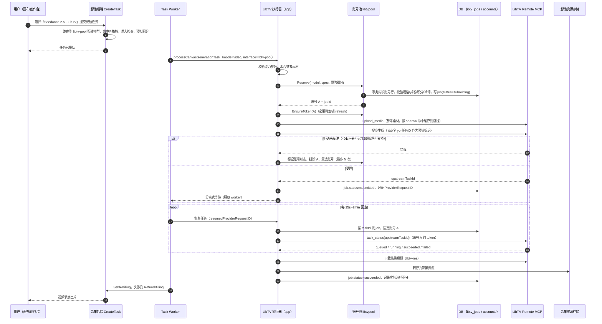
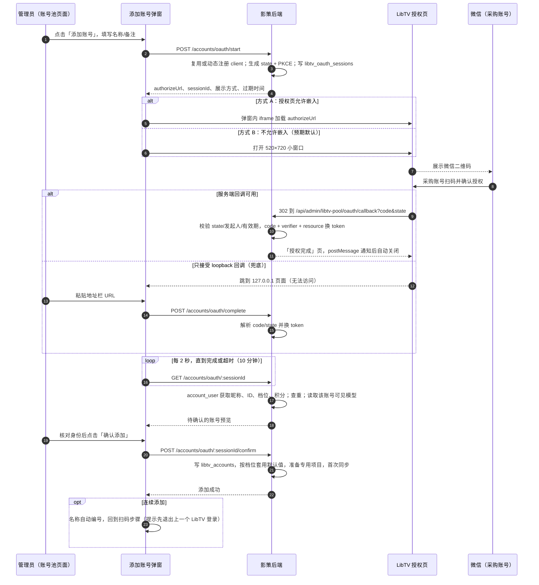

# LibTV 账号池插件调研与设计

> 状态：方案评审稿，未实施。
> 标注「〔P0 验证〕」的内容依赖 LibTV 未公开的接口细节，必须在第 0 阶段用真实账号核实后定稿。

## 1. 已确认的需求决策

| 事项 | 决策 |
| --- | --- |
| 账号授权方式 | 采购账号可以逐个微信扫码授权；**账号池页面内添加账号时必须支持扫码**（第 8 节） |
| 账号档位 | 账号可能属于不同档位；可用模型、规格和并发按账号分别生效（第 9 节） |
| 价格 | **与渠道模型完全一致**，不另起一条定价线；LibTV 模型就是「渠道与模型」里一个渠道下的普通渠道模型（第 12 节） |
| 方案范围 | 直接做账号池，不考虑其他替代方案 |

## 2. 结论速览

1. **执行通道：LibTV Remote MCP**（`https://mcp.liblib.tv/mcp`，OAuth 2.1 授权码 + PKCE，微信扫码）。它是唯一能按模型精确提交、查任务、查账号信息、读模型 schema 的官方程序接口。
2. **官方 CLI 不进生产链路**，只在 P0 用来对照协议和人工排障（第 3.3 节）。
3. **形态：宿主内置系统插件**。插件管理里启用后，后台出现「LibTV 账号池」菜单，并自动出现一个「LibTV 账号池」渠道；停用后菜单隐藏，新任务被拒，已提交的任务继续回查到出片。
4. **一条线**：模型导入、能力参数、价格档、成本价、启停全部在「渠道与模型」里操作。账号池页面只管账号（添加、授权、档位、积分、用量、调度设置）和模型覆盖情况（哪些账号能跑哪些规格）。
5. **账号在提交时选定并固定**：绑定记录在 `libtv_jobs`，回查、恢复、下载都用同一个账号，因为 LibTV 任务按账号隔离，换账号查不到。调度同时看档位能力、并发、剩余积分和冷却状态。

## 3. LibTV 接入面调研

### 3.1 四个接入面

| 接入面 | 地址 / 形态 | 鉴权 | 能力 | 结论 |
| --- | --- | --- | --- | --- |
| Remote MCP | `https://mcp.liblib.tv/mcp`，MCP Streamable HTTP（JSON-RPC，可能返回 SSE） | OAuth 2.1 + PKCE，支持动态客户端注册、refresh token、吊销；access token 约 1 小时 | 账户与画布、模型搜索与 schema、提交生成、查任务、上传素材等工具 | **选用** |
| 官方 CLI `libtv` | 本地命令行，覆盖画布、项目、节点、模型、素材 | 未公开 | `libtv project use <uuid>`、`libtv node <key> --run`（同步等待、结果写回画布、stdout 输出终态 JSON、进度走 stderr） | 只用于 P0 对照和排障 |
| IM OpenAPI | `https://im.liblib.tv/openapi/session` 等 4 个接口 | `Authorization: Bearer sk-libtv-…` 静态密钥 | 创建会话发自然语言、按 `afterSeq` 拉消息、切换项目、上传文件（≤200MB，仅图片/视频） | 不选用：后端 Agent 自行选模型和参数，规格、计费和结果数量都不确定 |
| 网页 API | `https://api.liblib.tv/api/...` | 请求头 `token: <网页会话 token>` | 现有「LibTV 画布导入」使用的 `canvas/project/detail` | 不用于生成：未公开接口，会话 token 生命周期不可控 |

### 3.2 已确认的 MCP 事实

- 授权服务器元数据（`/.well-known/oauth-authorization-server`，已直接读取）：`authorization_endpoint=/authorize`、`token_endpoint=/token`、`registration_endpoint=/register`、`revocation_endpoint=/revoke`；`grant_types=[authorization_code, refresh_token]`；`code_challenge_methods=[S256]`；`token_endpoint_auth_methods=[client_secret_post, client_secret_basic, none]`。
- scope：`libtv:account:read`、`libtv:project:read`、`libtv:project:write`、`libtv:media:write`、`libtv:task:write`、`libtv:export:write`。
- 未带凭据调用 `POST /mcp` 返回 `401`，响应头 `WWW-Authenticate: Bearer error="invalid_token" … resource_metadata="https://mcp.liblib.tv/.well-known/oauth-protected-resource/mcp"`（已实测）。
- 授权请求和换 token 请求都必须带 `resource=https://mcp.liblib.tv/mcp`（RFC 8707），否则返回 `invalid_request`；MCP 需要先 `initialize`，之后请求带 `mcp-session-id`（来自社区桥接实现 dsh-libtv）。
- 公开资料列出的工具类别：账户与画布（`doctor`、`account_user`、`list_projects`、`target_project`、`read_project`、`create_node`、`update_node`）、生成（`search_models`、`get_model`、`generation_submit`、`generate_video`、`task_status`）、上传（`upload_ticket`、`upload_complete`、`upload_media`）等，共约 86 个。
- LibTV 官方技能文档要求：模型名和参数从实时 schema 解析，不能写死；生成以画布节点为载体，提交前可做只读预检；传输超时不等于失败，不能因此重复提交；积分不足会直接报错。

### 3.3 官方 CLI 评估

| 维度 | 评估 |
| --- | --- |
| 获取 | 公开渠道未找到安装包，`libtv`、`@libtv/cli`、`@liblib/libtv-cli`、`@liblibai/libtv` 等 npm 包名均不存在 |
| 执行模型 | `--run` 同步阻塞，一个任务占一个进程几分钟到几十分钟；影策视频任务在上游排队时会释放 worker（分离式回查），阻塞进程与此冲突 |
| 多账号 | 每个账号需要单独的凭据目录和进程环境，N 个并发任务就是 N 个子进程 |
| 状态恢复 | 进程崩溃时只剩 stderr 里的任务 ID，恢复依赖再次查询节点 |
| 副作用 | 结果写回 LibTV 画布，节点持续累积 |
| 部署 | 需要打进后端镜像并覆盖 linux amd64/arm64，许可和再分发条款未知 |

结论：生产执行由后端直接调用 MCP。P0 阶段如果能拿到 CLI，用它跑一遍「列模型 → 建节点 → 运行 → 查询」，并抓包记录它发出的请求，作为 Go 客户端的对照样本。

## 4. 影策侧约束与复用点

- 插件不能自行注册路由、表、Worker，也不能注入菜单（`docs/content/docs/plugins/plugin-system.mdx` §3「非目标」；`web/src/pages/admin/components/admin-shell.tsx` 的 `adminNavigation` 是静态数组）。上传包和官方包都不能使用 `host:` 执行器，只有 Go 内置 manifest 可以（先例：`backend/internal/app/sms_plugins.go`、`workflow_plugins.go`）。
- 视频链路可直接复用：
  - 分离式回查：`providerStatePendingError{Detached:true}`、`recordWorkflowProviderRequest`、`detachedPollDelay`，最长等待 48 小时（`app/provider_protocol_async.go`）。
  - 恢复：`resumedProviderRequestID(ctx)` 非空时只回查不提交。
  - 下载转存：`runVideoDownload`、`getProviderExternalBinary`、`persistGeneratedMediaResult`。
  - 计费：`app/task_billing.go` 预扣、结算、退款、不确定转人工复核。
  - 基础设施：`runWorkerLoop` 后台循环、`Coordinator.AcquireLease` 分布式锁、`.settings-key` AES-256-GCM 加密、`userGroupAccess.allowsChannel` 分组渠道白名单。
- 渠道模型页已有「获取模型 → 选择导入」（`app/channel_models_catalog.go` 的 `FetchAdminChannelModels`、`PreviewAdminChannelModels`、`ImportAdminChannelModels`）和「规格成本价 / 销售价 / 加价」列（`ChannelModelCostSummary`）。**LibTV 模型的导入和定价直接接入这两处。**
- 必须新增的部分：`ModelChannel` 只有一个 `APIKey`，渠道内没有多 Key 轮询；声明式 `Adapter` 处理不了 OAuth 续期、MCP 会话握手和 SSE 响应，需要宿主原生执行器；没有「查用量/查余额」的 provider 合同。
- 仓库已有的 LibTV 画布导入（`backend/internal/auth/libtv.go`，设置键 `libtv`，调研见 `docs/content/docs/progress/libtv-canvas-import-research.mdx`）保持不动。新功能使用独立命名：插件 `libtv-account-pool`、协议 `libtv-pool`、表前缀 `libtv_`、设置键 `libtv_pool`。

## 5. 总体架构

```text
┌──────────────────────────── web 后台 ────────────────────────────┐
│ 渠道与模型（现有）                LibTV 账号池（新，插件启用后可见） │
│  └ 「LibTV 账号池」渠道            概览 | 账号 | 模型覆盖 | 调用记录 | 设置 │
│     获取模型/导入/能力/价格/启停     添加账号弹窗（页面内扫码）          │
└──────────────┬─────────────────────────────┬─────────────────────┘
               │ 现有渠道接口                  │ /api/admin/libtv-pool/*
┌──────────────▼─────────────────────────────▼──── backend ────────┐
│ app/channel_models_catalog.go  托管渠道的模型目录来自账号池         │
│ app/provider_libtv.go          视频执行器（提交/回查/下载/恢复）    │
│ app/libtv_pool_plugin.go       内置系统插件 manifest + host 适配器   │
│ app/libtv_pool_bridge.go       Host 实现、托管渠道、后台循环         │
│ handler/libtv_pool.go          账号池接口                          │
│ internal/libtvpool/            oauth | mcp | accounts | tiers |     │
│                                scheduler | catalog | binding |     │
│                                usage | errors | host               │
│ repository/libtv_pool.go       model/models_libtv_pool.go          │
└──────────────┬───────────────────────────────────────────────────┘
               │ HTTPS，固定主机白名单，禁止跨主机重定向携带凭据
      mcp.liblib.tv（OAuth + MCP）   libtv-res.liblib.art（结果下载）
```

依赖方向：`handler → service（别名）→ app → libtvpool → repository/model`。`libtvpool` 不 import `app` 或 `service`，通过 `Host` 接口获取加密、出站客户端、锁和插件开关，与 `internal/sms`、`internal/auth` 的做法一致。

选择「一个渠道 + 内部账号池」而不是「一个账号一个渠道」：后者会让渠道列表出现 N 个渠道、价格要配 N 遍，也无法按剩余积分和档位能力选账号。现方案在「渠道与模型」里只有一个渠道，价格只配一遍。

生成时序：



## 6. 插件形态、菜单与托管渠道

### 6.1 内置系统插件

`backend/internal/app/libtv_pool_plugin.go` 内置 manifest（Go 结构体，不进 `plugin-packages/`）：

```json
{
  "apiVersion": "yingce.plugin/v2",
  "id": "libtv-account-pool",
  "name": "LibTV 账号池",
  "version": "1.0.0",
  "author": "影策内部",
  "enabled": false,
  "installable": true,
  "surfaces": ["settings"],
  "runtime": { "backend": "host:libtv-pool", "web": "host" },
  "permissions": ["generation.run", "media.read", "external.libtv"],
  "contributes": {
    "providers": [{
      "id": "libtv-pool",
      "label": "LibTV 账号池视频",
      "capabilities": ["video"],
      "scopes": ["admin.system-channel", "canvas", "creation", "agent"],
      "detachedPolling": true,
      "create": { "method": "POST", "path": "/mcp" },
      "poll":   { "method": "POST", "path": "/mcp" },
      "response": {}
    }]
  }
}
```

- 管理策略：`Origin=system, Kind=protocol, ActivationScope=system, ConfigurationScope=system`，用户不能自行开关。
- `provider` 只用于把协议 `libtv-pool` 注册进协议表并带上 `DetachedPolling=true`，让 `validateGenerationInterface`、`shouldDeferProviderTask` 不用特判。host 适配器的 `BuildCreate` 返回「由宿主执行器处理」错误，防止被通用链路误调用。
- 宿主改动：`pluginRuntime.reload()` 目前对所有记录调用 `LoadInstalledProviders(raw, nil)`，带 provider 的 `host:` manifest 会因缺少 resolver 失败。改为只对「`Source=system` 且 `PackagePath==""`」（Go 内置）的记录传入 `hostAdapterResolver`，上传包和官方包仍传 `nil`，安全边界不变。

### 6.2 启用与停用

| 操作 | 行为 |
| --- | --- |
| 启用 | 写平台状态；若不存在则创建托管渠道「LibTV 账号池」（`managed_by=libtv-account-pool`）；启动后台循环；菜单出现 |
| 停用 | 只拦新任务；已提交任务继续回查到终态，避免已消耗 LibTV 积分的结果丢失；后台只保留 token 续期和在途对账；菜单隐藏 |
| 卸载 | 内置插件不可卸载（与现有规则一致）；提供「清空账号池」：无在途任务时吊销全部 token、软删账号、停用渠道模型 |

### 6.3 菜单

`AdminNavigationItem` 增加 `requirePlugin?: string`，`admin-shell` 用 `GET /api/admin/plugins` 返回的 `states[pluginId].platformAvailable` 过滤菜单项。直接访问已停用插件的路由时，页面显示「插件未启用」并提供跳转插件管理的按钮。菜单放在「模型与渠道」分组：

```ts
{ path: "/admin/libtv-pool", label: "LibTV 账号池", shortLabel: "LibTV", icon: <Users2 className="size-4" />, requirePlugin: "libtv-account-pool" }
```

`requirePlugin` 是通用能力，其他内置插件也能用；它只对宿主内置页面有效，不等于开放第三方插件注入菜单。

### 6.4 托管渠道在「渠道与模型」中的表现

| 项目 | 普通渠道 | LibTV 账号池渠道 |
| --- | --- | --- |
| 列表显示 | 正常 | 正常，额外显示「账号池托管」标记和「可用账号 x/y」 |
| 名称、排序、标签 | 可改 | 可改 |
| Base URL、API Key、请求头、代理 | 可改 | 隐藏，替换为「管理账号」链接 |
| 渠道并发上限 | 可改 | 隐藏，实际并发等于各账号并发上限之和 |
| 获取模型 / 导入 | 调上游 `/models` | 读账号池同步的 LibTV 视频模型目录（第 10 节） |
| 模型能力、价格档、成本价、启停、测试调用 | 现有编辑器 | **完全相同的编辑器** |
| 删除渠道 | 可删 | 禁止，由插件生命周期管理 |
| 用户分组渠道白名单 | 可选 | 可选，与其他渠道一样 |

实现上只在 `model_channels` 增加一列 `managed_by`，渠道页和 `app/admin_channels.go` 按这一列决定只读字段，不新增渠道类型。

## 7. 数据模型

GORM model 放 `backend/internal/model/models_libtv_pool.go`。实施时同步更新 `docs/content/docs/backend/backend-database.mdx`。

### 7.1 `libtv_accounts`

| 字段 | 说明 |
| --- | --- |
| `id`、`name`、`remark` | 名称支持单击铅笔编辑 |
| `status` | `active` / `disabled` / `reauth_required` / `exhausted`（积分不足）/ `cooling`（限流冷却）/ `suspended`（上游封禁） |
| `credential_source` | `oauth` / `import` |
| `libtv_user_id`（未删除记录唯一）、`libtv_nickname`、`libtv_phone_masked` | 来自 `account_user`，用于防重复录入 |
| `tier_code`、`tier_name`、`tier_expires_at` | 档位标识、显示名、到期时间〔P0 验证字段〕 |
| `tier_overridden` | 管理员手动指定档位时为 true，同步不覆盖 |
| `credits_balance`、`credits_synced_at` | 最近一次同步的余额 |
| `oauth_client_id`、`oauth_client_secret_enc` | 动态注册得到；refresh 必须用同一个 client |
| `access_token_enc`、`refresh_token_enc`、`token_expires_at`、`token_scope`、`token_version` | 加密存储；`token_version` 每次刷新加一，用于并发刷新的 CAS |
| `project_uuid`、`project_node_count` | 专用 LibTV 项目，节点数超过阈值后轮换 |
| `max_concurrency`、`max_concurrency_overridden` | 默认取档位配置，可单独覆盖 |
| `weight`、`priority`、`low_credit_threshold` | 调度参数，可覆盖档位默认值 |
| `cooldown_until`、`last_error_code`、`last_error` | 错误已脱敏 |
| `last_used_at`、`last_synced_at`、`created_by`、`created_at`、`updated_at`、`deleted_at` | 软删除 |

### 7.2 `libtv_oauth_sessions`

| 字段 | 说明 |
| --- | --- |
| `state`（唯一） | 32 字节随机数 |
| `code_verifier_enc` | PKCE verifier，加密 |
| `client_id`、`client_secret_enc`、`redirect_uri` | 本次使用的客户端 |
| `display_mode` | `iframe` / `popup` / `paste` |
| `target_account_id` | 重新授权时指向原账号；新增时为空 |
| `draft_name`、`draft_remark`、`batch_id` | 弹窗填写的信息；`batch_id` 用于连续添加 |
| `created_by` | 只能由发起授权的管理员完成 |
| `status` | `pending` / `authorized` / `confirmed` / `failed` / `expired` |
| `preview_json` | 换 token 后的账号预览，不含 token |
| `token_bundle_enc` | 确认前暂存的 token，加密；取消或过期即吊销 |
| `error`、`expires_at`（10 分钟）、`consumed_at` | 单次使用 |

### 7.3 `libtv_models`（池级目录）

`model_key`（唯一）、`display_name`、`family`、`category=video`、`union_capability_json`（各账号能力的并集，用于导入时预填）、`status`（`active` / `changed` / `retired`）、`first_seen_at`、`last_seen_at`。

### 7.4 `libtv_account_models`（账号 × 模型）

| 字段 | 说明 |
| --- | --- |
| `account_id`、`model_key` | 联合唯一 |
| `available` | 该账号当前档位能否使用该模型 |
| `schema_json`、`schema_hash` | 该账号看到的 `get_model` 原始 schema，不同档位可能不同 |
| `capability_json` | 由该 schema 归一化出的能力：模式、分辨率、时长、比例、参考素材上限、音频、水印 |
| `binding_json` | 影策字段到 LibTV 参数名的映射（第 10.3 节） |
| `credit_cost_json` | 该账号各规格的积分消耗〔P0 验证是否可得〕，只用于调度和用量统计 |
| `last_seen_at`、`last_error` | |

### 7.5 `libtv_jobs`（账号绑定的唯一依据）

| 字段 | 说明 |
| --- | --- |
| `task_id`、`route_attempt_id`（唯一） | 用户重试会产生新 attempt，对应新 job |
| `user_id`、`account_id`、`tier_code` | `tier_code` 为提交时快照 |
| `model_key`、`spec_key` | 如 `{"operation":"image_to_video","vquality":"1080p","videoSeconds":"10"}` |
| `client_ref`（唯一） | `yc-<taskId>-<attempt>`，同时写入 LibTV 节点名，用于崩溃后对账 |
| `project_uuid`、`upstream_node_key`、`upstream_task_id` | |
| `status` | `submitting` / `submitted` / `running` / `succeeded` / `failed` / `unknown`（提交结果不确定）/ `cancelled` |
| `credits_reserved`、`credits_charged` | 提交时预留的积分 / 实际消耗〔P0 验证〕 |
| `error_code`、`error_message`、`submitted_at`、`completed_at` | 错误已脱敏 |

### 7.6 其他表与改动

- `libtv_credit_snapshots`：`account_id`、`balance`、`tier_code`、`captured_at`，保留 90 天，用于消耗趋势和预计可用天数。
- `libtv_media_cache`：`(account_id, project_uuid, sha256)` 唯一，`kind`、`libtv_media_ref`、`expires_at`，同一参考素材在同一账号下只上传一次。
- `model_channels.managed_by varchar(64) not null default ''`。
- 不改 `tasks`、`route_attempts`、`billing_orders`、`channel_model_price_tiers`。

### 7.7 池级设置（`SystemSetting` 键 `libtv_pool`）

```json
{
  "channelId": "托管渠道 ID",
  "strategy": "least_loaded",
  "tierProfiles": {
    "<tier_code>": { "label": "专业版", "maxConcurrency": 3, "priority": 10, "weight": 100, "lowCreditThreshold": 500 },
    "default":     { "label": "未识别档位", "maxConcurrency": 1, "priority": 0, "weight": 50, "lowCreditThreshold": 500 }
  },
  "creditReserveMultiplier": 1.2,
  "failoverMaxAccounts": 3,
  "busyWaitSeconds": 600,
  "rateLimitCooldownSeconds": 60,
  "accountSyncIntervalMinutes": 10,
  "catalogSyncIntervalHours": 6,
  "projectRotateNodeCount": 500,
  "allowedUserGroupCodes": ["internal"],
  "keepUpstreamNodes": true
}
```

设置中没有任何价格字段。售价和成本价只存在于渠道模型价格档。

## 8. 页面内扫码添加账号



### 8.1 弹窗步骤

入口：账号页顶部「添加账号」；账号行的「重新授权」打开同一个弹窗（预填名称，锁定目标账号）。弹窗使用 `AppModal flush`。

| 步骤 | 内容 | 关键规则 |
| --- | --- | --- |
| ① 基本信息 | 名称（默认 `LibTV-01` 并自动递增）、备注、档位（默认「自动识别」，可手动指定）、「连续添加多个账号」开关 | 名称必填 |
| ② 扫码授权 | 显示 LibTV 授权页（内嵌或小窗口）、10 分钟倒计时、「重新生成」「换一种方式」按钮、状态文字（等待扫码 / 处理中 / 已过期 / 失败原因） | 每次进入此步骤生成新的 state 和 PKCE；每 2 秒轮询会话状态 |
| ③ 确认账号 | 显示 LibTV 昵称、用户 ID、手机号掩码、识别到的档位、剩余积分、会员到期、可用视频模型数 | 同一 `libtv_user_id` 已存在时拦截；重新授权时 ID 必须与原账号一致 |
| ④ 完成 | 写入账号、按档位套用默认并发等参数、准备专用项目、首次同步；连续添加模式下回到 ②，名称自动编号 | 确认前 token 只暂存在加密的会话记录里，取消即吊销 |

### 8.2 扫码页面的三种展示方式

LibTV 授权页能否被嵌入、能否回调到影策域名，都要 P0 确认。弹窗按能力自动选择，管理员也可以手动切换：

| 方式 | 体验 | 前提 | 完成方式 |
| --- | --- | --- | --- |
| A. 内嵌 | 二维码直接出现在弹窗里 | 授权页响应头没有 `X-Frame-Options: DENY/SAMEORIGIN`，`frame-ancestors` 允许 | 回调到影策后端，回调页向父窗口 `postMessage`；弹窗轮询兜底 |
| B. 小窗口（预期默认） | 点击「打开扫码窗口」，弹出小窗口显示二维码；授权后窗口自动关闭，弹窗自动进入 ③ | LibTV 动态注册接受 `https://<影策域名>/api/admin/libtv-pool/oauth/callback` | 同上 |
| C. 粘贴回调（兜底） | 扫码后小窗口跳到 `127.0.0.1` 显示无法访问，弹窗出现输入框，粘贴地址栏 URL | LibTV 只接受 loopback 回调 | 后端只解析 URL 中的 `code`、`state`、`error`，不访问该地址 |

三种方式的换 token 代码相同。回调接口要求管理员登录态，并校验 state 绑定的发起人、有效期和单次使用。

二维码由 LibTV（及其微信登录）生成，影策不代理、不抓取 LibTV 登录页，也不自己生成二维码。这样不接触 LibTV 的登录凭证，授权页改版也不影响影策。

### 8.3 防止授权错账号

小窗口和管理员浏览器共享 Cookie。授权完第一个账号后，LibTV 授权页可能记住登录状态，第二个账号会被自动授权成第一个，或被授权成管理员自己的 LibTV 账号。措施：

1. 授权 URL 带 `prompt=login`（若 LibTV 支持，〔P0 验证〕），强制每次重新扫码。
2. 不支持时，连续添加模式每次进入 ② 前提示「请先在扫码窗口内退出 LibTV 登录」，并提供 LibTV 退出地址〔P0 验证〕。
3. 第 ③ 步强制展示身份并由管理员确认；`libtv_user_id` 重复时拦截，提示「当前浏览器仍登录着上一个账号」。
4. 弹窗内说明推荐在无痕窗口打开影策后台进行批量添加。

### 8.4 导入凭据（备用）

账号页「导入凭据」：粘贴 MCP 客户端生成的 `credentials.json`（含 `client_id`、`client_secret`、`access_token`、`refresh_token`、`expires_at`、`scope`）。后端调用 `account_user` 并做一次刷新，成功后同样进入第 ③ 步确认。导入后必须删除原机器上的凭据，否则两边各自刷新会让 refresh token 互相失效。

### 8.5 续期与失效

- 后台每分钟刷新 10 分钟内到期的 token；执行器取 token 时剩余不足 60 秒则同步刷新。
- 刷新前取锁 `libtv:token:<accountId>`（有 Redis 用 `Coordinator.AcquireLease`，否则用数据库行锁）；拿到锁后重读账号，`token_version` 已变化就直接使用新 token；写回使用 `WHERE token_version=?` 的 CAS。这样在 refresh token 轮换时，多副本并发刷新不会把账号误判为失效。
- 刷新返回 `invalid_grant`：账号置 `reauth_required` 并移出调度，概览出现告警，账号行出现「重新授权」。
- 长时间不用可能导致 refresh token 过期〔P0 验证有效期〕，续期循环同时起保活作用。
- 删除账号时调用 `/revoke` 吊销，失败只告警。

### 8.6 账号状态机

```text
            确认添加
  (new) ─────────────▶ active ◀──────────────┐
                        │  │  │               │ 同步显示积分恢复
       管理员停用 ◀─────┘  │  └── 积分不足 ──▶ exhausted
         disabled           │
                            ├── 429/并发上限 ─▶ cooling ──(冷却到期)──▶ active
                            ├── refresh 失败 ─▶ reauth_required ──(重新授权)──▶ active
                            └── 上游封禁 ─────▶ suspended（只能人工处理）
```

## 9. 多档位

### 9.1 档位来源

| 来源 | 用途 |
| --- | --- |
| `account_user` 返回的会员等级和到期〔P0 验证字段〕 | 自动识别 `tier_code`、`tier_expires_at`，每次账号同步更新 |
| 管理员手动指定 | 自动识别不准时覆盖（`tier_overridden=true`） |
| 每个账号自己的 `search_models` / `get_model` 结果 | **能力的真实依据**：档位只决定默认并发等运营参数，能跑哪些模型、哪些规格以该账号实际看到的 schema 为准 |

即使 LibTV 不返回档位字段，或者同一档位内能力有差异，调度也不会出错。

### 9.2 档位配置

设置页的 `tierProfiles` 按档位给出默认并发上限、优先级、权重和低积分阈值。同步时识别到新档位代码会自动加入列表，先套用 `default` 配置，并在概览提示「发现新档位，请确认并发上限」。单个账号可以覆盖任一参数。

### 9.3 账号能力与渠道模型能力

```text
账号 A（高档位）：Seedance 2.5  720p/1080p/4K  5–15s  参考视频 3
账号 B（低档位）：Seedance 2.5  720p/1080p     5–10s  参考视频 0
账号 C（低档位）：无 Seedance 2.5
            │ 并集
            ▼
libtv_models.union_capability_json：720p/1080p/4K，5–15s，参考视频 3
            │ 导入时预填，管理员可在渠道模型编辑器里收窄
            ▼
渠道模型能力（用户侧参数面板据此渲染）
```

- 导入时用并集预填，让高档位账号的能力可以对用户开放。
- 只想开放所有账号都支持的规格时，在渠道模型编辑器里收窄；编辑器为账号池渠道提供「按全部账号交集填充」按钮。
- 账号池「模型覆盖」页按规格显示可用账号数，例如「4K · 15s：1 个账号」，让管理员看到哪些规格容量小。

### 9.4 按规格选账号

请求规格包括 `model_key`、`operation`、分辨率、时长、比例、参考图/视频/音频数量、`generate_audio`、`watermark`。候选账号必须在 `libtv_account_models` 中对该模型 `available=true`，且 `capability_json` 覆盖请求规格的每一项。

### 9.5 创建任务时的准入检查

在 `app/task_creation.go` 完成模型和价格档选择后，如果协议是 `libtv-pool`，调用 `libtvPool.Admit(model, spec)`：

| 情况 | 结果 |
| --- | --- |
| 有 `active` 账号支持该规格 | 通过（只做快速检查，不占位） |
| 支持该规格的账号全部处于 `reauth_required` / `exhausted` / `suspended` / `disabled` | 拒绝，`reason=LIBTV_POOL_NO_ACCOUNT`，提示「该规格暂无可用账号」，不预扣积分 |
| 没有任何账号支持该规格 | 拒绝，`reason=LIBTV_POOL_SPEC_UNSUPPORTED`，提示换分辨率或时长 |

准入只看静态条件，并发是否已满在执行时处理。

### 9.6 账号都忙时

- 支持该规格的账号都达到并发上限：执行器在 worker 内每 3 秒重试选号，最长 `busyWaitSeconds`（默认 10 分钟），任务阶段显示「等待 LibTV 账号空闲」。
- 超时后返回与渠道槽位超时同类的错误（`ChannelSlotFailureDetails` 可识别），走「上游请求未发出」的退款路径。
- 行为与现有渠道并发槽等待一致，不新增排队机制。

### 9.7 档位对成本的影响

如果不同档位同一规格消耗的 LibTV 积分不同（`credit_cost_json`），设置中可以选择 `cheapest_first` 策略，优先派给消耗最少的账号。用户售价不受影响，仍按渠道模型价格档计费；`libtv_jobs.credits_charged` 记录实际消耗，用于用量统计。

### 9.8 档位变化

会员到期降档后，下次同步时该账号的 schema 和能力自动更新；已提交的任务不受影响；新任务只派给仍支持对应规格的账号。概览提示「账号 X 档位从 A 变为 B」。

## 10. 模型目录：走「渠道与模型」现有流程

### 10.1 同步

后台每 6 小时（账号页也可手动触发）对每个 `active` 账号调用 `search_models`（视频类）和 `get_model`，写入 `libtv_account_models`，再汇总到 `libtv_models`。某模型在所有账号都看不到时，`libtv_models.status=retired`，对应渠道模型自动停用（不删除，保留历史任务和账单引用）。

### 10.2 导入到渠道

管理员在「渠道与模型」里对 LibTV 账号池渠道点「获取模型」：

- `fetchAdminChannelModelCatalog` 发现渠道 `managed_by=libtv-account-pool` 时不请求上游 `/models`，改为返回 `libtv_models` 中 `active` 的模型，带显示名和模型类型 `video`。
- `ImportAdminChannelModels` 为这类渠道创建模型时预填：`Protocol=libtv-pool`、`Capability=video`、`ProviderModelKey=<model_key>`、`DisplayName=<LibTV 显示名>`、`Tags=[LibTV]`、`CapabilityConfigJSON=union_capability_json`（经 `NormalizeModelCapabilityConfigForModel` 校验）。
- 与其他渠道一样，导入后默认停用，配置价格档后再启用。开启「前台模型」功能时，按现有 `SourceChannelModelID` 投影规则生成前台条目。

### 10.3 schema 到能力、请求到参数

| LibTV schema 线索〔P0 验证〕 | 影策能力字段 |
| --- | --- |
| `duration` / `seconds` 枚举或范围 | `Duration` |
| `ratio` / `aspect_ratio` | `Ratios`、`DefaultRatio` |
| `resolution` / `quality` | `Resolutions`、`DefaultResolution` |
| 首帧 / 尾帧 | `Operations` 增加 `image_to_video` |
| 参考图列表 | `Operations` 增加 `reference_to_video`，`References.MaxImages` |
| 参考视频 / 视频编辑 | `References.MaxVideos` 等，归入 `reference_to_video` |
| 参考音频 | `References.MaxAudios`，`Operations` 增加 `audio_to_video` |
| 生成音频 | `GenerateAudio` |
| 水印 | `Watermark` |
| 提示词长度 | `References.PromptMaxChars` |
| 输出数量 | 固定为 1，不暴露（一次任务对应一份计费） |

参数映射 `binding_json` 按账号自动推断（不同档位字段可能不同），示例：

```json
{
  "prompt": "prompt",
  "duration": { "field": "duration", "type": "integer" },
  "ratio": { "field": "ratio" },
  "resolution": { "field": "resolution", "map": { "1080p": "1080P" } },
  "generateAudio": { "field": "generate_audio" },
  "firstFrame": { "field": "first_frame_image" },
  "lastFrame": { "field": "last_frame_image" },
  "referenceImages": { "field": "image_list" },
  "referenceVideos": { "field": "video_list" },
  "referenceAudios": { "field": "audio_list" },
  "fixed": { "count": 1 }
}
```

执行器使用 `canvasGenerationInput` 中已校验的值（`Config.VideoSeconds`、`Config.Size`、`Config.VQuality`、`Config.VideoGenerateAudio`、首尾帧角色、`ReferenceVideos`、`ReferenceAudios`）按映射组装参数，再按该账号的 schema 做一次本地校验，避免把明显非法的请求发到上游消耗积分。推断失败的字段在「模型覆盖」页标黄，管理员可以修正映射。参数映射描述的是 LibTV 协议，不属于影策的模型配置，因此放在账号池页面。

### 10.4 schema 变化

某账号的 `schema_hash` 变化时自动重算该账号的能力和映射。并集能力变化时，在「模型覆盖」页和渠道模型列表提示「LibTV 能力已变化」，由管理员决定是否在渠道模型编辑器里更新；已上架的渠道模型能力不会被自动改写。

## 11. 生成执行

### 11.1 分叉位置

在 `app/provider.go` 的 `processCanvasGenerationTask` 中，与 `isWorkflowProviderInterface` 并列，并放在「缺少 Base URL / API Key」检查之前（托管渠道没有 API Key）：

```go
if isLibTVPoolInterface(input.Config.InterfaceType) {
    if resumedProviderRequestID(ctx) == "" {
        if err := s.requireLibTVPoolForCreate(userID); err != nil { return nil, err } // 插件开关 + 用户分组
    }
    if err := s.validateResolvedVideoCapability(&input); err != nil { return nil, err }
    if resumedProviderRequestID(ctx) == "" {
        if err := s.hydrateGenerationMedia(userID, &input, providerMediaHydrationPolicy{}); err != nil { return nil, err }
        if err := validateVideoTask(input.VideoCapability, input); err != nil { return nil, err }
    }
    return s.runLibTVPoolVideoTask(ctx, input)
}
```

### 11.2 执行器流程（`app/provider_libtv.go`）

```text
runLibTVPoolVideoTask:
  若 resumedProviderRequestID 非空：按 (taskId, upstreamTaskId) 找 job，固定账号回查
  若本 attempt 已有 submitting/unknown 的 job：对账（11.5），绝不直接重提
  spec ← 从 input 归一化请求规格
  循环（最多 failoverMaxAccounts 次，总等待不超过 busyWaitSeconds）：
    account, job ← scheduler.Reserve(model, spec, 预估积分, 已排除账号)
      无支持该规格的可用账号 → 失败退款（上游未发出）
      都忙 → 等 3 秒重试
    token ← EnsureToken(account)
    refs ← 上传参考素材（按 sha256 缓存）
    params ← 用该账号的 binding_json 组装，并按该账号 schema 本地校验
    提交（节点名 = job.client_ref）
      已受理 → job=submitted；recordWorkflowProviderRequest；返回分离式等待
      未受理·账号问题 → 处罚账号，释放 job，排除后换号
      未受理·请求问题 → 失败退款，不换号
      结果不确定 → job=unknown，进入对账
回查：
  task_status（固定账号）
    排队/生成中 → 返回分离式等待（阶段、排队位置）
    成功 → 下载结果并转存；job=succeeded，记录实际消耗；触发该账号积分同步
    失败 → job=failed；返回上游原因
```

- 返回分离式等待后，`shouldDeferProviderTask` 依据注册表元数据 `DetachedPolling=true` 让任务回到调度，间隔按 `detachedPollDelay(queueAhead)` 计算，最长 48 小时。
- 下载复用 `runVideoDownload` 和 `getProviderExternalBinary`，结果视为临时 URL，立即转存。`keepUpstreamNodes=false` 时成功后删除 LibTV 节点〔P0 验证删除工具〕。

### 11.3 调度

候选条件：`status=active`；冷却已过；token 有效或可刷新；该账号支持请求规格（9.4）；`剩余积分 − 在途预留 ≥ 预估 × creditReserveMultiplier + 低积分阈值`；在途数小于 `max_concurrency`；不在已排除集合中。

| 策略 | 规则 |
| --- | --- |
| `least_loaded`（默认） | 在途/上限最低 → 剩余积分最多 → 最久未使用 |
| `credits_first` | 剩余可用积分最多 |
| `cheapest_first` | 该规格积分消耗最少（多档位时有意义） |
| `drain_by_priority` | 优先级高的账号先用到阈值 |
| `weighted` | 平滑加权轮询 |

选号与写 job 在同一事务内完成：PostgreSQL 使用 `SELECT … FOR UPDATE` 锁住候选账号行后重算在途数和预留积分；SQLite 写事务本身串行。多副本、多 worker 并发提交不会超过账号并发上限，也不会超额预留积分。

预估积分来源依次为：该账号 `credit_cost_json` 中命中规格的值、该模型同规格最近 20 次实际消耗的 P90；都没有时跳过积分预检，依赖上游报错。

### 11.4 错误分类

| 类别 | 例子 | 账号处理 | 任务处理 |
| --- | --- | --- | --- |
| 已受理 | 返回 taskId | 计入在途 | 分离式回查 |
| 未受理·账号问题 | 刷新后仍 401；积分不足；429；并发已满；该账号无此模型或规格 | 分别置 `reauth_required` / `exhausted` / `cooling` / 更新可用性 | 换下一个账号 |
| 未受理·请求问题 | 参数校验失败；审核拦截；素材格式不符 | 不处罚 | 失败退款，不换号 |
| 结果不确定 | 提交超时、发送后断连、5xx | 不处罚 | job=`unknown`，进入对账 |
| 回查失败 | 401、网络抖动 | 刷新 token | 继续回查；账号需重新授权时保持等待并告警，超过 48 小时转人工 |
| 上游失败 | 生成失败 | 不处罚 | 失败，走现有退款逻辑 |

错误码映射〔P0 验证〕放在 `internal/libtvpool/errors.go`。未知错误一律按「结果不确定」处理，宁可人工复核也不重复消耗积分。

### 11.5 幂等与崩溃恢复

上游已收单、但影策写回 `upstream_task_id` 之前进程崩溃时，重启后直接重提会消耗两次积分。对策：

1. 提交前先写 job（`submitting`），`client_ref` 同时作为 LibTV 节点名。
2. 发现 `submitting` 或 `unknown` 的 job 时，按节点名在该账号专用项目中查找：找到则补记 taskId 并回查；确认不存在则 job 失败，按「上游未收单」退款；读取失败则保持 `unknown`，交给现有 `BillingFailureRequiresReview` 人工复核。
3. 后台每分钟处理超过 2 分钟仍为 `submitting` 的 job。
4. 如果 P0 发现提交工具支持幂等键，优先使用它，节点名作为第二道保险。

### 11.6 参考素材、取消与人工恢复

- 参考素材由 `hydrateGenerationMedia` 从影策存储取出字节，再通过 `upload_media`（或 `upload_ticket` → 直传 → `upload_complete`）上传到账号专用项目，按 `(账号, 项目, sha256)` 缓存。影策资源不能公网访问时也可以使用。
- 取消：P0 确认有取消工具时接入 `requestProviderCancellation`；否则 `supportsProviderCancellation` 返回 false，后台仍回查到终态并记录消耗。
- 人工恢复：`QueryFailedVideoTask`、`AdminQueryFailedVideoTask` 增加 `libtv-pool` 分支，只做一次 `task_status`，不提交。

### 11.7 MCP 客户端

- 优先使用 MCP 官方 Go SDK 的 Streamable HTTP 客户端，通过自定义 `RoundTripper` 注入账号 token（引入前确认版本和许可证）；否则自写最小客户端（`initialize` → `notifications/initialized` → `tools/call`，兼容 JSON 和 `text/event-stream` 响应）。
- 每个账号在每个进程内缓存一个 MCP 会话，会话失效时重新握手。
- 出站只允许 `mcp.liblib.tv`、`upload_ticket` 返回的直传主机（校验域名后缀）和 `libtv-res.liblib.art`；禁止跨主机重定向携带 `Authorization`（与 `auth/libtv.go` 现有做法一致）。
- 必须确认提交工具立即返回 taskId；如果某个工具会阻塞到生成完成，改用「建节点 + 提交 + 查状态」组合〔P0 验证〕。

## 12. 计费与价格：与渠道模型完全一致

- 用户消耗影策积分，链路不变：创建任务时按价格档预扣，成功结算，失败退款，不确定转人工复核。
- 价格档、成本价、加价展示都在「渠道与模型」现有编辑器里配置，维度与其他视频模型一致（`operation` × `vquality` × `videoSeconds`，`fixed_request` 或 `per_second`）。
- 账号池不提供定价页、定价接口或积分换算配置。
- 成本价由管理员按采购价折算后填入价格档的成本价，与其他渠道相同。`libtv_jobs.credits_charged` 记录的 LibTV 积分只用于账号池用量统计和调度，不参与用户计费。
- 多档位不影响售价：同一规格不论派给哪个账号，用户价格相同。

## 13. 用量、积分与告警

| 指标 | 来源 |
| --- | --- |
| 档位、积分、会员到期 | `account_user`，每 10 分钟同步，任务结束后对该账号做一次防抖同步 |
| 积分消耗 | 上游返回的单次消耗；拿不到时用相邻快照的余额差 |
| 任务数、成功率、平均耗时、在途并发 | `libtv_jobs` |
| 按用户、模型、档位统计 | `libtv_jobs` 关联用户和渠道模型 |

告警显示在概览页顶部和账号行，并写入管理员审计日志：

- 账号需要重新授权。
- 账号积分低于阈值；池总积分按近 7 天速度预计不足 3 天。
- 会员 7 天内到期；档位变化；发现新档位。
- 某规格只剩 1 个或 0 个可用账号。
- 模型下线或能力变化。
- 连续出现「结果不确定」。

## 14. 后台 UI

入口 `/admin/libtv-pool`，页内标签页。遵循 `docs/ui-design-system.md` 和三层 token；弹窗使用 `AppModal flush`，详情使用 `AppDrawer`；不使用静态 `Modal.confirm` 和 antd `Empty`。

### 14.1 概览

指标卡：可用账号 / 总账号、各档位账号数、池剩余积分、今日消耗、进行中任务、24 小时成功率、预计可用天数。下方是告警列表、30 天消耗趋势（按档位或账号堆叠）、按模型的调用分布，顶部提供「去配置渠道模型」跳转。

### 14.2 账号

- 表格列：名称、LibTV 昵称/ID、档位（标签和到期）、状态、剩余积分（低于阈值标红）、并发（在途/上限）、今日/30 天任务数、30 天消耗、可用模型数、最近错误、最近同步。
- 顶部操作：「添加账号」（第 8 节弹窗）、「导入凭据」、「全部同步」、按档位和状态筛选。
- 行内操作：同步、测试连接、编辑（名称、备注、档位覆盖、并发/权重/优先级/阈值覆盖）、停用/启用、重新授权、删除（有在途任务时禁止）。
- 详情抽屉：基本信息、可用模型及规格范围、最近 50 条调用、积分曲线、专用项目链接。

### 14.3 模型覆盖

回答「LibTV 的哪个模型、哪个规格，有几个账号能跑」：

- 列：模型、是否已导入渠道（链接到渠道模型编辑器）、支持的模式/分辨率/时长、各档位可用账号数、目录状态（正常 / 能力变化 / 已下线）。
- 展开行：按规格矩阵显示可用账号数，例如「1080p · 10s：5」「4K · 15s：1」。
- 只能编辑参数映射（`binding_json`）。导入、改价、改能力、启停都在「渠道与模型」里完成。

### 14.4 调用记录

`libtv_jobs` 列表，按账号、档位、模型、状态、用户、时间筛选；可跳转到影策任务详情和请求明细；`unknown` 记录提供「重新对账」。

### 14.5 设置

调度策略、档位配置（`tierProfiles` 表格编辑）、换号上限、忙时最长等待、冷却时长、同步间隔、项目轮换阈值、允许使用的用户分组、是否保留 LibTV 节点。

### 14.6 「渠道与模型」页的改动

- 账号池渠道显示「账号池托管」标记和「可用账号 x/y」。
- 渠道编辑表单隐藏 Base URL、API Key、请求头、代理和并发字段，替换为「管理账号」链接。
- 「获取模型」读取账号池目录，导入时预填能力和协议。
- 渠道模型编辑器为账号池渠道增加「按全部账号交集填充」按钮。
- 禁止删除账号池渠道。

## 15. HTTP 接口

全部挂在 `/api/admin/libtv-pool` 下，先 `RequireAdmin`，再检查插件平台可用（OAuth 回调和停用后的只读查询除外）。响应统一为 `{ code, data, msg, reason }`。

| 方法 | 路径 | 说明 |
| --- | --- | --- |
| GET | `/overview` | 指标卡、告警 |
| GET | `/accounts` | 列表（状态、档位、关键字、分页） |
| POST | `/accounts/oauth/start` | 请求 `{name, remark, tierCode?, accountId?, batchId?}`，返回 `{sessionId, authorizeUrl, displayMode, expiresAt}` |
| GET | `/oauth/callback` | 方式 A/B 的回调落地页：完成换 token，`postMessage` 后自动关闭 |
| POST | `/accounts/oauth/complete` | 方式 C：`{sessionId, callbackUrl}` |
| GET | `/accounts/oauth/:sessionId` | 轮询状态；`authorized` 时返回账号预览（昵称、ID、档位、积分、可用模型数、是否重复） |
| POST | `/accounts/oauth/:sessionId/confirm` | 确认写入账号 |
| DELETE | `/accounts/oauth/:sessionId` | 取消；已换到的 token 立即吊销 |
| POST | `/accounts/import` | `{name, remark, credentialsJson}`，返回预览后同样走 confirm |
| GET / PATCH / DELETE | `/accounts/:id` | 详情（不含 token）/ 编辑 / 删除（有在途任务返回 409） |
| POST | `/accounts/:id/sync`、`/accounts/:id/test` | 立即同步 / 连通性检查 |
| GET | `/accounts/:id/credits` | 积分快照 |
| GET | `/models` | 模型覆盖列表 |
| GET | `/models/:key` | 各账号 schema、能力、映射、规格矩阵 |
| PUT | `/models/:key/binding` | 修正参数映射 |
| POST | `/models/sync` | 立即同步目录 |
| GET | `/jobs` | 调用记录 |
| POST | `/jobs/:id/reconcile` | 手动对账 |
| GET | `/usage` | `groupBy=account\|tier\|model\|user\|day` |
| GET / PUT | `/settings` | 池级设置（含档位配置） |

没有任何定价接口；模型导入复用现有渠道模型接口。用户侧不新增接口。前端 API 模块为 `web/src/services/api/libtv-pool.ts`，使用 `http.get/post/...`。

新增 `reason`：`LIBTV_POOL_DISABLED`、`LIBTV_POOL_NO_ACCOUNT`、`LIBTV_POOL_SPEC_UNSUPPORTED`、`LIBTV_POOL_BUSY_TIMEOUT`、`LIBTV_POOL_FORBIDDEN_GROUP`、`LIBTV_ACCOUNT_REAUTH_REQUIRED`、`LIBTV_ACCOUNT_DUPLICATE`、`LIBTV_ACCOUNT_IDENTITY_MISMATCH`、`LIBTV_OAUTH_STATE_INVALID`、`LIBTV_OAUTH_EXPIRED`、`LIBTV_JOB_IN_FLIGHT`。实施时同步到 `backend/internal/app/error_codes.go`、`web/src/services/api/error-codes.ts` 和 [HTTP API 合同](../content/docs/backend/http-api.mdx)。

## 16. 安全与权限

| 风险 | 措施 |
| --- | --- |
| token 泄露 | `.settings-key` AES-GCM 加密；接口只返回 `hasToken`、`expiresAt`；日志、错误、审计、任务正文不写 token；请求日志只记录工具名和状态 |
| OAuth 劫持 | state 单次有效、10 分钟过期、绑定发起管理员；PKCE S256；回调接口要求管理员登录态；粘贴方式只解析参数不访问 |
| 授权错账号 | 第 8.3 节措施；`libtv_user_id` 唯一；重新授权校验身份一致 |
| 确认前的 token | 只暂存在加密会话记录，取消或过期即吊销 |
| SSRF 与凭据外带 | 固定主机白名单；禁止跨主机重定向携带 `Authorization` |
| 越权使用 | 后台接口仅管理员；`allowedUserGroupCodes` 在创建任务时强校验（默认分组常是「全部渠道」，只靠渠道白名单挡不住） |
| 审计 | 账号增删、重新授权、导入、档位覆盖、设置修改调用 `appendAdminAudit`；价格修改沿用渠道模型现有审计 |
| 内部使用 | 插件默认停用、不进插件市场、不对外分发 |
| 数据外发 | 提示词和素材会进入 LibTV 项目；`keepUpstreamNodes=false` 时成功后删除上游节点，并在设置页说明 |

## 17. 运维

| 后台循环（多副本时用 `Coordinator.AcquireLease` 保证单实例执行） | 间隔 |
| --- | --- |
| token 续期 | 1 分钟 |
| 账号同步（积分、档位、快照） | 10 分钟 |
| 目录同步（每个账号的模型和 schema） | 6 小时 |
| job 对账 | 1 分钟 |
| 过期 OAuth 会话清理（吊销暂存 token） | 5 分钟 |
| 专用项目轮换 | 1 小时 |
| 快照清理 | 每天 |

- 不新增必填环境变量；可选 `CANVAS_LIBTV_MCP_URL`、`CANVAS_LIBTV_ISSUER` 仅用于测试环境指向模拟服务。
- 服务器需要能访问 `mcp.liblib.tv`、`libtv-res.liblib.art` 和上传直传主机。
- 沿用 `docker-compose.deploy.yml`，不新增容器；后端镜像不需要 Node 或 CLI。
- 备份账号表时必须同时备份 `.settings-key`，否则恢复后所有账号需要重新扫码。

## 18. 代码落点

| 层 | 文件 | 内容 |
| --- | --- | --- |
| model | `backend/internal/model/models_libtv_pool.go`；`models_channel.go` | 新表；`ModelChannel.ManagedBy` |
| repository | `backend/internal/repository/libtv_pool.go` | 账号、job、目录、快照查询；带行锁的预留查询 |
| domain | `backend/internal/libtvpool/{host,oauth,mcp,accounts,tiers,scheduler,catalog,binding,usage,errors}.go` | 业务实现 |
| app | `libtv_pool_plugin.go`、`libtv_pool_bridge.go`、`provider_libtv.go` | 插件、组合根、执行器 |
| app（修改） | `provider.go`、`task_creation.go`、`task_worker.go`、`protocol_plugins.go`、`plugin_management.go`、`provider_task_recovery.go`、`admin_channels.go`、`channel_models_catalog.go` | 分叉、准入、分离式回查判断、reload 传 resolver、策略表、恢复分支、托管渠道只读、目录来源 |
| service / handler | `service/aliases_libtv_pool.go`；`handler/libtv_pool.go`、`api.go` | 别名与路由 |
| web | `services/api/libtv-pool.ts`；`pages/admin/libtv-pool/`（概览、账号、添加账号弹窗、模型覆盖、调用记录、设置）；`components/admin-shell.tsx`、`router.tsx`、`admin-route-pages.tsx`；`pages/admin/channels/*` | 页面、菜单、渠道页改动 |
| docs | `docs/content/docs/backend/libtv-pool.mdx`（新）、`backend-database.mdx`、`http-api.mdx`、`code-map.mdx`、`plugins/plugin-system.mdx`、`overview/features.mdx`、`progress/pending-test.mdx` | 实施时同步 |

## 19. 测试

- **MCP 与 OAuth**（模拟服务）：会话握手、JSON 与 SSE 响应、401 后刷新重放、refresh 轮换下并发刷新只调用一次上游、state 过期与重放、确认前取消会吊销 token。
- **添加账号**：三种展示方式的完成路径；重复账号拦截；重新授权身份不一致拦截；连续添加。
- **多档位**：同一模型不同账号 schema 不同；按规格筛选；并集预填与交集填充；准入检查三种结果；降档后的调度变化；`cheapest_first`。
- **调度**：并发上限与积分预留防超卖（PostgreSQL 下并发 20 个提交）；忙时等待与超时退款；冷却；换号规则。
- **执行器**：提交 → 分离 → 回查 → 下载转存；恢复只回查；崩溃对账三种结果；请求问题不换号；结果不确定不换号。
- **一条线**：账号池渠道的获取模型、导入预填、价格档、成本价与普通渠道行为一致；渠道页只读字段生效。
- **插件**：停用后新任务被拒、在途任务继续；上传包仍不能使用 `host:`；菜单随插件状态显示或隐藏。
- **真实冒烟**（至少 2 个不同档位的账号）：页面内扫码添加两个账号 → 渠道页获取并导入一个模型、配置价格、启用 → 画布文生视频和图生视频 → 高规格请求只落到高档位账号 → 停用一个账号后再提交 → 作废一个 token 验证重新授权 → 核对积分、用量、账单和请求明细。

推送前按 AGENTS.md 运行 `bun scripts/verify-before-push.mjs`。

## 20. 分期

工作量按一名熟悉本仓库的全栈开发估算，P0 结果可能明显改变后续估算。

| 阶段 | 内容 | 预估 |
| --- | --- | --- |
| P0 协议验证 | 用 2 个不同档位的测试账号回答第 21 节全部问题；导出全部工具 schema；跑通列模型 → 上传 → 提交 → 查询 → 下载；比较两个档位的 `get_model` 差异；产出脱敏的协议说明和测试夹具 | 2–3 天 |
| P1 单账号可用 | 表与迁移；内置插件与菜单开关；添加账号弹窗（先实现方式 B 和 C）与导入凭据；token 续期；账号同步；目录同步；托管渠道与渠道页获取/导入；执行器（单账号、分离式回查、下载、恢复） | 6–8 天 |
| P2 账号池与多档位 | 调度器（规格筛选、并发、积分预留、冷却、策略、忙时等待）；准入检查；档位配置；换号；job 记录；概览、账号、模型覆盖、调用记录、设置页；连续添加；用户分组限制 | 6–8 天 |
| P3 加固 | 崩溃对账；素材缓存；项目轮换；人工恢复分支；告警；方式 A 内嵌（若可行）；取消（若支持）；Agent 场景回归；文档 | 4–6 天 |

## 21. P0 必须回答的问题

1. 动态注册是否接受 `https://<影策域名>/api/admin/libtv-pool/oauth/callback` 作为回调地址？不接受则默认使用方式 C。
2. 授权页是否允许被 iframe 嵌入（`X-Frame-Options`、`frame-ancestors`）？
3. 是否支持 `prompt=login` 或其他强制重新登录的参数；LibTV 退出登录地址是什么？
4. `account_user` 中档位、到期、积分的字段名和单位。
5. 不同档位的 `search_models`、`get_model` 返回差异（可用模型、分辨率、时长、参考素材、水印、积分消耗）。
6. 各档位单账号并发上限、调用频率限制及对应错误码；积分不足的错误码。
7. 提交工具的确切流程：是否立即返回 taskId；是否必须指定项目；是否支持幂等键。
8. `task_status` 是否返回实际消耗积分。
9. refresh token 的有效期、是否轮换、长期不用是否失效。
10. 结果 URL 的有效期、下载是否需要鉴权；是否有取消任务、删除节点的工具；单个项目的节点数上限。

## 资料来源

- [liblib-ai/marketplace](https://github.com/liblib-ai/marketplace)：LibTV 官方插件，Remote MCP 地址与 OAuth 登录方式。
- [libtv-blender-live-action SKILL.md](https://github.com/liblib-ai/marketplace/blob/main/plugins/libtv/skills/libtv-blender-live-action/SKILL.md)：按实时模型选择、生成前预检。
- [redkiller79/dsh-libtv](https://github.com/redkiller79/dsh-libtv)：MCP 工具类别、OAuth 2.1 + PKCE、微信扫码、`resource` 参数要求。
- [libtv-labs/libtv-skills](https://github.com/libtv-labs/libtv-skills)：IM OpenAPI 接口与鉴权方式（未选用）。
- [LibTV Seedance Task ID Verification](https://www.seedance.tv/blog/libtv-seedance-task-id-verification)：官方 CLI `--run` 的同步等待与输出约定。
- [Skywork Skill Hub：libtv-cli](https://skywork.ai/skillhub/libtv-cli/)：官方 CLI 覆盖画布、项目、节点、模型、素材操作。
- `https://mcp.liblib.tv/.well-known/oauth-authorization-server`、`/.well-known/oauth-protected-resource`、`/docs`：直接读取的授权服务器元数据。

外部资料内容已改写以符合许可要求。
