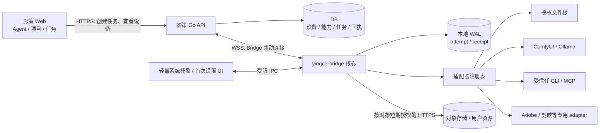

# yingce-bridge 多设备本地执行架构设计

> 状态：架构提案，未实施。本文定义目标结构和验收合同，不代表已有设备端能力。
> 日期：2026-11-12。
> 产品原则：影策 Web 仍是工作区、Agent、任务、资产与权限的主产品；yingce-bridge 是用户安装的本地执行代理，只补足浏览器不能安全访问的本机能力。

配套专题：[断连、恢复与分布式执行可靠性](yingce-bridge-reliability.md)。该文记录论文与成熟系统的证据、启动协议、异常处理矩阵和故障注入验收；本文与专题共同构成提案，尚无运行验证。

## 1. 设计结论

建设独立的 `yingce-bridge` 客户端：本机生成设备密钥，用户在已登录的影策 Web 页面确认绑定；Bridge 主动通过 TLS WebSocket 连接影策服务端，接收已授权的结构化任务，在本机适配器中执行，并把状态和经用户授权的结果回报给服务端。服务端保存设备、能力、任务与回执，负责账号权限、选择设备、排队和审计；Bridge 负责本机密钥、进程、文件、模型、GPU 和应用访问。

这不是 Web 产品的桌面副本。桌面侧只保留安装、启动、账号绑定、本地权限设置、运行状态、任务确认和故障诊断等控制面。创作工作区、Agent 对话、项目/画布、任务总览和资产管理继续使用 Web。

推荐拆为两个进程/职责：

- `yingce-bridge` Go 核心进程：设备身份、出站长连接、任务执行、能力报告、适配器、受控文件访问和本地执行账本。核心没有通用远程 Shell、任意路径访问或任意 URL 代理。
- `yingce-bridge-ui` 轻量本机控制壳：处理首次绑定、系统通知、目录选择、信任/权限确认、连接状态和更新。可用 Tauri 2 包装核心 sidecar，但它不复制影策 Web 的业务界面。Tauri sidecar 权限也必须按固定命令/参数收紧，不能把 shell 命令接口开放给 WebView。

Web 与 Bridge 的控制通道走设备发起的 WSS。大文件不塞进 WSS；需要同步时使用按任务和对象签发的短期上传/下载凭证。v1 不做 P2P、用户局域网发现或服务端发起的任意内网连接。

产品形态可以概括为：**一个 Super Agent 负责规划，一个持久化调度层负责派发，多台 Bridge 在本机授权内执行。** 本地具备有限离线执行能力：已批准的纯本地计算可以完成并保存结果；新的写入、外发和收费动作必须经过对应执行门；已经提交给外部软件的操作先核对结果。网络断开不等于任务失败，心跳超时不能直接触发换设备重做。

## 2. 现状与边界

本文根据仓库代码和文档确定以下现状：

| 已有能力 | 代码证据 | 对本设计的含义 |
| --- | --- | --- |
| 云端 Agent 的运行记录、事件日志、消息正文、检查点和审批流程已持久化 | `backend/internal/model/cloud_agent.go`、`backend/internal/app/cloud_agent_*` | 可复用 Agent 事件和审批交互，不能把本地进程生命周期塞进浏览器 SSE 会话。 |
| 生产 `yingce-agent` 是云端 Agent runtime 服务；Go 内部 `BridgeServer` 是每轮 Pi runtime 回调 Go 的 `/model`、`/tool`、`/event` 端点 | `backend/internal/agent/runtime/runtime.go`、`backend/internal/agent/yingceagent/client.go` | 用户安装的 `yingce-bridge` 是新客户端，不替代或删除云端 `yingce-agent`，也不复用内部 Bridge token。 |
| Web 已有受签名保护的 `framefield-local-runtime` API v2 客户端，默认仅访问精确 loopback endpoint；请求签名绑定 origin、方法、路径和 body hash | `web/src/services/local-runtime.ts`、`web/src/services/local-runtime-session.ts` | 这是单机浏览器到本机 runtime 的合同，不是设备账户、后台常驻任务或跨设备连接协议。迁移须保留签名、challenge、origin 和实例绑定的安全概念，禁止退回 URL Bearer token。 |
| 深度、线稿、姿态等节点已调用本地 runtime | `web/src/services/depth-runtime.ts`、`lineart-runtime.ts`、`pose-runtime.ts`、`web/src/components/canvas/nodes/media-conversion-node.tsx` | Bridge 迁移必须逐项验证行为、取消和错误状态；未迁移完的能力保持明确状态。 |
| MCP 支持远程 Streamable HTTP / SSE，工具 schema、用户归属、配置 revision、审批和外部调用回执均受校验 | `backend/internal/integrations/mcp/`、`backend/internal/app/cloud_agent_tools_mcp.go`、`docs/content/docs/backend/agent-mcp.mdx` | 本地 stdio MCP 是新的执行信任边界。审批、revision/hash、回执和“不确定时不重试”可借鉴，不能让服务器执行用户提供的 `npx`/shell。 |
| 通用任务使用 DB lease、续期和失租写入保护；仓库已说明 lease 不等于上游副作用幂等 | `backend/internal/repository/repository_tasks.go`、`docs/content/docs/backend/task-runtime-stability.mdx` | Bridge 任务需要 attempt、设备 epoch 和回执；不能声称 exactly-once，尤其是进程启动、MCP 写操作和模型提交。 |
| realtime 中的 device 是房间内临时浏览器窗口编号；不是用户设备登记 | `backend/internal/canvas/realtime_devices.go` | 新建持久设备域、密钥、授权撤销和能力注册。 |
| 云端 Agent MCP 没有本地进程或任意本机文件访问；仓库中的旧 Canvas Agent 规划采用 localhost token 模式 | `docs/content/docs/progress/local-agent-integration-plan.mdx`（当前工作区存在但被 `.gitignore` 忽略）、`web/src/services/local-runtime-session.ts` | 旧文档不能作为新安全合同；本设计取代其 URL token、任意 CLI/MCP 服务器和“网页直接控制本机”的实施方向。 |

需要保持的产品事实：ComfyUI 工作流在本机运行，不意味着工作流的推理、文件或费用都在本机。ComfyUI 的 MiniMax H3 Partner/API 节点在 MiniMax 服务器运行并通过 Comfy 账号计费；不得标为本地推理。MiniMax H3 真正本地运行涉及商业许可。凡工作流可能访问远程节点，都必须展示算力位置、外发数据和费用来源。

## 3. 产品范围

### 3.1 目标

- 一个影策账号可以登记、查看、命名、暂停和撤销多台设备。
- 每台设备独立公布可执行能力、适配器/模型/工作流版本、在线状态、并发槽和粗粒度负载；默认不公布用户名、磁盘路径、完整软件清单或原始网络地址。
- Web Agent 和用户流程能按能力、数据位置和用户偏好创建本地任务；服务端负责排队和挑选符合条件的在线设备。
- Bridge 在用户明确授予的本机权限内调用 ComfyUI、Ollama、选定 CLI/MCP 和后续桌面应用适配器。
- 本机文件读取、写入、上传、发给模型、跨设备传送分别授权；文件默认留在本机。
- 断线、撤销、取消、重试、设备重启和外部系统结果不确定时，不伪装成功或安全重试。

### 3.2 不在 v1 范围

- 多台设备自动合并显存、模型权重或同一进程地址空间。多设备协作是调度完整任务或由 adapter 明确支持的阶段，不是分布式 GPU 推理。
- 对任意 MCP server、任意 CLI、任意 ComfyUI URL、任意本地文件夹开放远程调用。
- 把“ComfyUI 支持此模型”或“模型名为 MiniMax H3”推断为本机模型。
- 用户 Web 登录 Cookie、第三方 API key、Adobe 登录凭据进入服务端任务、遥测或日志。
- 自动远程桌面控制、屏幕坐标点击或未核实 API 的剪映 UI 自动化。
- Bridge 作为多用户通用网络代理或把本地端口映射至公网。
- P2P/NAT 穿透、以服务端租约宣称外部操作 exactly-once。

## 4. 总体结构



### 4.1 组件职责

| 组件 | 责任 | 禁止承担 |
| --- | --- | --- |
| Web | 账号/项目/画布/Agent 主界面；设备列表、任务目标选择、审批、同步状态 | 直接启动子进程；持有本地设备私钥；把文件路径当成可远程访问 URL。 |
| 后端 `bridge` 域 | 设备授权、设备状态、能力快照、任务准入、匹配调度、lease/epoch、事件/回执审计、撤销 | 从公网主动扫描用户电脑；以任务正文自报字段决定设备归属；持久保存本机路径、密钥或完整模型目录。 |
| Bridge 核心 | 设备密钥和本地策略、WSS、adapter 调用、进程生命周期、文件根、资源预算、本地 WAL 和状态回报 | 执行任意 shell 拼接；接受无本机授权的云端权限提升；在断线重连后默默重复不确定副作用。 |
| 本机控制壳 | 系统浏览器绑定、目录/应用授权、弹窗确认、通知、诊断和更新 | 暴露通用 `exec`、任意读写文件或任意网络请求 IPC 给 WebView。 |
| Adapter | 把稳定能力合同映射为一个具体受控工具/本机服务/应用 API | 修改影策账号权限；将只读标记作为授权依据；隐式外发文件或改变 adapter 指向的服务端点。 |

### 4.2 信任边界

1. **账户边界**：后端以已认证连接解析 `userId`，忽略消息载荷自报的用户、设备或任务归属。
2. **设备边界**：设备由本机密钥认证。每台设备凭证可单独撤销，不能等同浏览器登录会话。
3. **操作边界**：云端审批和本地授予必须同时满足；二者取交集。服务端不能新建文件根、CLI 许可、出网规则或本地写权限。
4. **应用边界**：CLI/MCP 子进程默认继承当前用户的 OS 权限。Tauri capability、MCP roots、MCP `readOnlyHint`、命令 allowlist 都不构成 OS 沙箱。v1 只运行用户信任并明确安装/配置的 adapter；若宣传隔离，必须使用并测试 OS 沙箱或独立系统账户。
5. **数据边界**：本地文件句柄不能跨账号、设备、服务域或自部署实例重放。文件 hash 只做完整性校验，不是授权证明。

## 5. 账号绑定与设备身份

### 5.1 绑定流程

使用类似 OAuth Device Authorization Grant 的一次性设备码流程；Web 登录继续由影策现有 Cookie/session 完成，Bridge 不收集用户密码或浏览器 Cookie。

1. Bridge 首次启动时生成独立 Ed25519 设备密钥对和随机 `deviceInstanceId`。私钥放系统密钥库（macOS Keychain、Windows Credential Manager/DPAPI、Linux Secret Service）；不放配置文件或日志。
2. 用户在本机 UI 点“绑定影策账号”。Bridge 请求指定服务域的短期 `device_code` 和人类可读 `user_code`，在系统浏览器打开该服务域固定的 `/settings/bridge/pair`。
3. 用户登录后，Web 页面显示服务域、设备名称、指纹、操作系统、客户端版本和申请的基础能力权限；用户确认后才建立设备记录。
4. Bridge 以私钥签名轮询挑战，交换设备绑定的短期 access token 与轮换 refresh token。刷新令牌仅存 OS 密钥库；刷新复用、旧令牌复用或异常设备副本导致撤销/重新绑定。
5. Bridge 建立 WSS，证明设备密钥、协议版本和服务实例；服务端为连接递增 `connectionEpoch`。同一 daemon 重连可接管旧连接，旧连接不再有实时命令权限；原 attempt 的历史回执通过新连接进入核对入口。不同 daemon/账本同时使用同一设备身份时进入冲突隔离，不允许相互踢线后轮流执行。
6. 用户可在 Web 设置页撤销单设备、退出全部设备或删除设备。撤销后拒绝新派发并关闭连接；已有本地或外部执行按第 13 节和可靠性专题处理。撤销无法瞬间停止离线机器上的外部程序。

### 5.2 服务域和深链接

- 官方服务域来自随签名安装包发布的受信清单；自部署域须用户在 Bridge 本机 UI 逐字确认，写入该实例独立配置。
- 深链接只能引用已批准的服务实例 ID 和一次性 pairing transaction；不能静默切换服务器、添加文件根、安装 adapter 或开启权限。
- 同一设备密钥同时出现不同服务域时，各服务域的账号和本地权限隔离；不复用服务端签发的文件句柄或 artifact URL。

### 5.3 设备状态

`pending_pairing -> active -> revoked` 是持久授权状态；`online/offline/degraded` 是根据连接和心跳计算的瞬时状态。在线状态需有过期窗口，UI 不把设备最近一次报告的 GPU 或磁盘容量当作实时保证。

## 6. 能力合同与适配器

所有 Adapter 声明版本化 manifest。manifest 是能力描述，不是权限授予。权限必须由本机用户逐项同意，并由服务端为具体任务生成短时操作许可。

```json
{
  "protocol": "yingce.bridge.capability/v1",
  "adapterId": "com.yingce.comfyui",
  "adapterVersion": "1.0.0",
  "adapterDigest": "sha256:...",
  "commands": [
    {
      "name": "workflow.execute",
      "schemaVersion": 1,
      "inputSchemaDigest": "sha256:...",
      "risk": "external_effect",
      "requiredScopes": ["workflow.execute"],
      "executionLocality": "declared_per_workflow",
      "egress": "workflow_declared",
      "cancelMode": "adapter_specific"
    }
  ],
  "resources": {
    "slots": [{"name": "gpu:0", "capacity": 1}],
    "memoryBytes": 0
  }
}
```

设备能力清单快照包含 adapter ID/版本/digest、命令名与 schema digest、已启用模型/工作流摘要、粗粒度资源槽和权限版本。不得上报模型文件的完整路径或任何密钥。设备执行前再次校验能力版本、grant、参数 hash 和本地允许列表；清单变化会使待审批操作失效。

### 6.1 能力位置与外发声明

每个可执行工作流/模型需声明：

- `executionLocality`: `local_compute | remote_api | mixed | unknown`。
- `inputEgress`: `none | metadata_only | prompt | media | arbitrary_workflow_declared`。
- `credentialSource`: `none | local_user_secret | app_account | cloud_provider`。
- `costOwner`: `none | user_provider_account | platform_wallet | unknown`。
- 任务取消粒度、是否可查询状态、幂等能力、结果是否只留本机。
- `effectClass`、`idempotencyMode`、`reconcileMode`、`offlinePolicy`、`processOwnership`、`limitEnforcement` 和经验证的取消粒度；具体取值见可靠性专题。工作流摘要与依赖版本固定后，才能声明恢复或重试能力；需要硬预算的任务不能匹配只能尽力停止的外部服务。

`unknown` 的工作流不允许自动处理敏感文件；运行前给用户展示“可能外发/费用未知”确认，不得归类为纯本地。

### 6.2 Adapter 顺序

| Adapter | v1 方向 | 安全和实现约束 |
| --- | --- | --- |
| 本地文件 | 先支持列目录、读取受限文本/媒体 metadata；输出写入后置 | 原生 UI 选择根目录；每种 read/write/export/upload/share 权限分开授权。正文和原始媒体有字节、类型、数量上限。 |
| Ollama | 访问本机用户配置的 loopback API，发现模型、提交文本/视觉推理并消费 NDJSON 流 | 默认 API 无认证，绝不把它代理给远端；端点只从本机设置读取，不接受任务覆盖。断开流不等于确认推理已取消。 |
| ComfyUI | 连接本机配置的 ComfyUI 实例，提交已登记 workflow，查询 queue/history/view | 限定端点和 workflow digest；任务记录 prompt_id。禁止全局 interrupt；队列取消只操作自己的 prompt。用户导入工作流需审核远程节点、外发与费用声明。 |
| 固定 CLI | 按本机管理员/用户配置的 executable 身份和已注册命令调用 | 不经 shell；固定 executable inode/hash（平台适配）和精确 argv schema；不依赖可变 PATH；不得接受服务端任意命令、参数、环境变量或 cwd。 |
| 本地 MCP | v1 优先少量内建 adapter。第三方 MCP 作为用户明确信任的本机程序，先限定命令/版本/schema，再展示工具与风险 | stdio 进程不代表沙箱。每个会产生外部副作用的调用需一次审批和 durable receipt；读工具声明也不能自行取得文件根权限。 |
| Adobe | 通过 Adobe Premiere UXP 扩展和 Bridge 有界消息合同逐个应用接入 | UXP 的能力/版本矩阵逐项验证；不假设有统一 Adobe CLI。扩展安装、网络、文件访问走 Adobe 和 Bridge 各自权限。 |
| 剪映 | 后续验证官方插件/API或受限草稿文件交换 | 仓库已有剪映草稿导出链路可作为输入；未确认稳定公开 CLI/API 前不承诺直接控制剪映 UI。导入、覆盖和写入工程需单独授权。 |
| Concat / WolfCut | 候选，不进入 v1 承诺 | 仓库 ADR 中的 Concat 指 WolfCut，但 ADR 仅为历史决策且已被手工剪辑退场决策取代；需确认用户所指产品及公开接口再做 adapter。 |

## 7. 任务合同与调度

### 7.1 哪些任务由 Bridge 执行

v1 建立独立 `BridgeJob` 执行域，用于本地工具、模型和工作流动作；任务可由 Web Agent 提议，也可由用户直接发起。BridgeJob 不等同既有账务 `Task`，不自动扣影策积分，也不把本机工作流结果直接伪装成云端生成任务。

现有云端媒体任务继续走既有 provider/worker。未来若需将现有 billable task 路由到本机，必须先为 `executionTarget` 增加明确合同和账务/结果归档事务，并保证现有 `ClaimNextTask` 过滤 Bridge 目标。上线先后顺序是：加入云 worker 排除条件和迁移测试，再启用 Bridge task producer；回滚时不能让旧 Bridge 任务被云 worker 误领。

### 7.2 任务准入和设备选择

`BridgeJob` 至少保存：账号/项目/画布/Agent run 引用、能力与命令、参数 hash、输入引用及版本、要求的 locality/egress/cost policy、优先级、用户选择的设备或自动策略、审批凭证、状态和创建人。

调度过滤顺序：

1. 账号、设备授权、项目/资源归属和用户权限有效。
2. 设备活跃且协议兼容；能力 ID、版本范围、schema、workflow/model digest 匹配。
3. 用户要求的 `local_only`、外发许可、凭证来源和费用上限满足。
4. 输入 artifact 在所选设备可访问，或用户明确同意受控传输。
5. 设备重新预留 GPU/应用槽位并确认当前模型、显存、磁盘和 app 状态。
6. 在同账号队列公平性、等待时间、设备偏好和粗粒度负载间选择；匹配信息变化时回队列，不尝试不符合条件的另一设备。

“自动”只在满足所有精确约束的设备中选择。任务 UI 显示实际目标设备、能力版本、远程外发和成本声明；调度器不因设备心跳存在就假设资源仍可用。

### 7.3 Attempt、租约和回执

分别定义稳定的逻辑 `operationId/effectId`、每次实际尝试的 `attemptId/attemptGeneration`、传输用 `connectionEpoch`，以及调度器所有权。网络重传和重连沿用原 operation/attempt；只有重试准入通过后才创建新 attempt。外部服务若支持幂等，使用跨重试稳定的 effectId；相同 ID 不同 callHash 必须拒绝。

启动采用 `OFFERED -> PREPARED -> START_AUTHORIZED -> STARTING -> SUBMITTED/RUNNING`：offer 只允许准备，不含执行权限。设备持久化准备记录后，服务端在同一 DB 事务中校验取消、权限、attempt 所有权，保存 `START_AUTHORIZED` 与 outbox，再投递短时 start permit。从事务提交起，服务端必须认为任务可能已经启动，即使从未收到 started 回执。

Bridge 的本地串行执行门校验 permit、取消意图、本机策略、能力 revision 和 callHash，使用 SQLite WAL + `synchronous=FULL` 提交 `STARTING`，成功后才调用 adapter。外部引用和最终回执尽快持久化；相同 attempt 的 `STARTING/SUBMITTED/RUNNING/UNKNOWN` 禁止再次启动。SQLite 提交与外部 CLI/MCP 副作用之间仍存在崩溃窗口；记录 STARTING 不能提供任意外部操作 exactly-once。

凡已签发启动授权的 attempt 在结果未核实时失联，服务端进入 `reconciling`；查询失败或查不到历史不能证明未执行。无法确认时进入 `outcome_unknown`，不自动跨设备重派。租约只协调控制面，真正阻止旧执行者写资源，必须由实际资源端校验 fence 或版本；否则采用私有 staging、条件发布和人工核对。

历史回执可以在新连接、旧 permit 到期后提交，校验身份、原 attempt 归属、callHash 和 digest 后进入核对。它是执行证据，不会自动恢复已失效的操作权限。被新结果替代的旧产物单独归档，不能覆盖当前选定结果。

### 7.4 分离执行、连接、取消和交付状态

| 状态维度 | 示例 | 规则 |
| --- | --- | --- |
| 设备连接 | `online / suspect / offline` | 只决定可达性，不推断进程是否仍在运行。 |
| 执行阶段/结果 | `prepared / start_authorized / starting / submitted / running / succeeded / failed / cancelled` | failed 可能已发生部分副作用；cancelled 只表示已确认停止后续执行。 |
| 证据完整性 | `observed / stale / reconciling / outcome_unknown / human_reconciled` | 人工核对须记录来源、操作者与说明，不能伪装为机器确认。 |
| 取消意图 | `not_requested / requested / confirmed / not_supported / too_late` | cancelRequestedAt 不清空；成功与“取消太晚”可以同时成立。 |
| 副作用 | `none_proven / possible / confirmed / partial` | retry policy 独立检查，不能仅凭 failed 放行重试。 |
| 交付 | `local_only / sync_pending / uploading / verified / published / delivery_failed` | 本地算完、回执已收、素材已发布是不同事实。 |

ComfyUI 已提交的图即使尚未执行，也可能在 Bridge 退出后开始运行；其中远程节点可能继续收费。纯本地续跑策略只适用于经审核的纯本地工作流。要求逐节点在线授权/停机的混合工作流必须有 ComfyUI 侧协作 gate；没有该能力时只承诺整个预批准图的边界和尽力取消。取消按经过版本验证的 prompt/job 级 API 实现，禁止回退为全局 interrupt。Ollama 停止等待响应不代表已确认模型停止。

## 8. 控制协议与数据流

### 8.1 连接和 envelope

Bridge 仅向已绑定服务域建立 WSS，使用设备绑定凭证和短期签名证明；服务端用账号/设备连接上下文判定权限。连接 envelope 至少包含：

```json
{
  "protocol": "yingce.bridge.control/v1",
  "connectionEpoch": 42,
  "sequence": 1042,
  "messageId": "...",
  "type": "job.offer",
  "payload": {},
  "issuedAt": "...",
  "expiresAt": "..."
}
```

消息类型：`server.hello`、`device.heartbeat`、`capabilities.snapshot`、`job.offer`、`job.prepared/reject`、`job.start_permit`、`job.started/progress`、`job.cancel`、`job.receipt`、`receipt.committed`、`reconcile.snapshot/page`、`device.revoke`。启动命令绑定设备、operation/attempt、callHash、能力/权限 revision、恢复世代、有效期和离线策略。旧连接不得发送实时控制；重复 messageId 回放持久处理结果；过期启动许可不能通过本地启动准入。准入与外部调用之间的冻结窗口见可靠性专题，约束外部实际接收时间需要目标端配合。历史 receipt 使用当前认证连接传输，不要求原连接 epoch 或 lease 仍有效。

WSS 仅传控制、短文本和有界诊断数据。服务端以 DB 任务记录为真相；任务状态与 outbox 在同一事务提交，接收端 inbox 去重并持久提交后才 ACK。多副本间 Redis 只负责投递提示；重连按持久 cursor 补查。消息采用至少一次投递，去重和核对由应用协议完成；设备执行 context 与 socket context 分离。

### 8.2 HTTPS API 初始合同

以下路由是实现建议，需在 OpenAPI 和 CSRF/Origin 规则中定稿；所有响应继续使用项目统一 JSON 信封。账号侧路径从 session cookie 得到 `userId`，设备侧路径从设备密钥和连接上下文得到 `deviceId`，客户端传入的 `userId` 一律忽略。

| 路由 | 身份/用途 |
| --- | --- |
| `POST /api/bridge/device-authorizations` | Bridge 创建短时 device/user code；限 IP、设备公钥指纹和用户码尝试速率。 |
| `POST /api/bridge/device-authorizations/token` | Bridge 轮询授权结果并以签名证明交换设备凭证；重复/过期 code 不能重复签发。 |
| `POST /api/bridge/device-authorizations/approve` | 已登录 Web 用户批准本次设备申请；同源与 CSRF 校验；显示准确服务域、设备公钥指纹和申请权限。 |
| `GET /api/bridge/devices`、`GET /api/bridge/devices/:id` | 账号读取自己的设备、能力快照和在线/执行状态；不含本机绝对路径与凭证。 |
| `PATCH /api/bridge/devices/:id`、`DELETE /api/bridge/devices/:id` | 账号更新名称/本机确认策略，或撤销当前设备；变更必须有审计记录。 |
| `GET /api/bridge/jobs`、`GET /api/bridge/jobs/:id`、`GET /api/bridge/jobs/:id/events?after=` | 账号查看自己的任务和递增游标事件；项目/画布过滤再次校验归属。 |
| `POST /api/bridge/jobs`、`POST /api/bridge/jobs/:id/cancel` | 用户或 Agent 创建结构化 job / 请求取消；必需 idempotency key、当前能力 revision、目标策略和已批准参数。 |
| `POST /api/bridge/artifact-transfers` | 为已归属的任务申请一次性 artifact 对象/上传会话；必须有用户确认记录和 quota reservation。 |
| `GET /api/bridge/v1/connect` | 仅用于设备认证的 WSS upgrade，不向浏览器提供通用设备命令通道。 |

Job 与 artifact API 的写入必须检查只读模式守卫、用户归属和资源配额。设备撤销先使 refresh token/连接 epoch 失效，再拒绝其后续消息；撤销本身不抹除已有回执或资源审计。

### 8.3 大型输入与产物

- 云端已有素材传给设备时，后端为一条 job/attempt 签发短期、只读、对象范围固定的 URL。Bridge 下载前校验对象、hash、大小和 grant；用户选择 local-only 输入则不下载。
- 本地文件要进入云端、Agent 模型上下文或另一设备时，执行与本地读取分离的 `export`/`upload`/`share` 授权；先展示文件清单、大小和目标。上传使用配额预留、分块断点、服务端 hash 校验和每次传输独立的临时对象 key。预签名 URL 不天然一次性；发布前固定已校验的不可变对象版本，或条件固化到客户端不能覆盖的最终对象。
- Artifact 记录 `sourceDeviceId + jobId + attemptId + objectId + objectVersion + digest + size + retention + syncState`，读取固定的已验证版本。`hash` 验证字节，不代替 owner/attempt 授权，也不能单独阻止同 key 覆盖。
- 跨设备默认通过服务端对象存储中转，明确显示用户已授权上传和存储成本；v1 不使用 P2P。结果可以是 `完成在设备上 / 等待同步 / 已同步 / 同步失败`，本机完成不等于云端资源已生成。
- 服务端写入用户资源前校验 attempt 所属用户和项目、输出类型/大小、配额与资源引用；设备上报的 URL、路径和费用数值不能直接成为资源路径或计费事实。

### 8.4 文件访问合同

本机文件访问以用户在 Bridge 原生 UI 选定的目录根为前提。权限至少拆为 `list_metadata`、`read_content`、`write_new`、`overwrite`、`delete`、`export_to_cloud`、`share_to_device`。允许读取某文件不等于允许上传它。

服务端只看 opaque `fileHandle`，不持久保存绝对路径。句柄绑定 `serverInstance + accountId + deviceId + rootGrantId + fileIdentity + version + expiry + scope`，只在原设备/服务域有效。Bridge 执行时使用安全打开语义并复核文件身份；拒绝授权后被替换的 symlink/junction/reparse point、`..`、UNC、大小写绕过、压缩包路径穿越和根目录竞态。跨平台无法安全复核的能力不开放。

写入先生成预览和目标路径，写到同目录临时文件后原子交付；覆盖、删除和修改已有工程需要额外明确确认。媒体大文件使用 stream/file descriptor，不能为方便把完整 base64 放进 Agent prompt 或 WSS。

## 9. Web 与 Agent 交互

影策 Web 新增“本地设备”设置页：设备名/在线状态/最后在线、Bridge 版本、能力和工作流摘要、授权 scope、正在运行的任务、撤销/暂停入口。默认不展示原始路径。

任务创建时使用明确目标模式：

- `cloud`：既有服务端任务。
- `local_device`：用户指定设备。
- `local_auto`：服务端只从满足全部要求的在线设备挑选。

自动路由必须展示一次有效的目标概况；对读取私人文件、写入/覆盖工程、发给远程 API、上传云端或调用写入型 MCP 的操作，Web 侧审批不能单独授予本机权限。Bridge UI 在第一次授权新能力、风险升级或外发动作时给本地确认；已批准的低风险只读操作可按用户设定的本机策略免逐次提示。

Agent 工具建议先限制为：

- `bridge.list_devices`、`bridge.list_capabilities`：只读当前账号信息。
- `bridge.submit_job`：引用已注册 command、参数 schema、输入资源和目标策略；禁止裸命令、任意 URL、绝对路径。
- `bridge.get_job`、`bridge.cancel_job`：展示状态；取消只提交请求。
- `bridge.request_artifact_sync`：发起待用户确认的 artifact 上传/下载。

工具输出中的 MCP 描述、CLI 输出、工作流 metadata、日志和生成内容均为不可信数据，不得解释成系统权限或账号授权。Agent 不能通过提示词扩大 device scope。

Agent 调用 Bridge 前先持久保存计划 revision、稳定步骤 ID、operationId、参数和审批。Agent 恢复时找回原 BridgeJob、回执和已记录的模型输出；不能重新询问模型后再创建一个语义相同的新执行。编排器等待回执或人工核对的状态必须持久化，不能依赖浏览器 SSE 长连或 Pi 内存栈。

## 10. 建议数据模型

下表为设计合同，不代表迁移已存在。实际字段和索引需在实现 ADR/迁移中定稿。

| 表 | 关键字段 | 规则 |
| --- | --- | --- |
| `bridge_devices` | `id, user_id, device_instance_id, key_thumbprint, public_key, name, platform, client_version, protocol_version, status, connection_epoch, last_seen_at, revoked_at` | `user_id + device_instance_id` 唯一；设备公钥不可变，换钥走显式 rebind；撤销时间与原因审计。 |
| `bridge_pairing_sessions` | `id, user_id?, device_code_hash, user_code_hash, public_key, requested_scopes, server_instance, expires_at, approved_at, consumed_at` | 短 TTL、一次性、速率限制、只存 code hash；多次轮询不能重复发 refresh token。 |
| `bridge_capability_snapshots` | `id, device_id, revision, manifest_digest, capabilities_json, resources_json, observed_at, expires_at` | 不存私有本地路径和密钥；变化生成新 revision，使旧审批失效。 |
| `bridge_jobs` | `id, user_id, project_id, canvas_id, agent_run_id, target_policy, requirements_json, payload_json, call_hash, permission_snapshot, status, priority, created_at, completed_at` | 强制用户/项目归属；输出内容有大小预算；job 创建幂等键防浏览器重提。 |
| `bridge_job_attempts` | `id, job_id, operation_id, effect_id, device_id, attempt_generation, capability_revision, permission_revision, recovery_generation, start_permit_id, start_authorized_at, start_not_after, execution_phase, reconciliation_state, effect_state, cancel_requested_at, external_ref, lease_expires_at, receipt_digest` | connection epoch 仅记投递元数据；尚未核对副作用时不得自动创建下一 attempt。 |
| `bridge_operations` | `id, user_id, origin_run_id, stable_step_id, plan_revision, call_hash, selected_attempt_id, publication_version, retry_policy` | 调用意图和业务选用结果稳定；同 operation 不同 hash 拒绝；人工重复执行有独立授权记录。 |
| `bridge_control_outbox / bridge_device_inbox` | `message_id, device_id, attempt_id, kind, payload_digest, sequence, committed_at, acknowledged_at` | 与业务状态事务提交；至少一次发送；重复消息无新增副作用；终态保留防重 tombstone。 |
| `bridge_job_events` | `job_id, sequence, attempt_id, event_type, event_json, created_at` | append-only 有界事件；游标分页；事件不能夹带 secrets 或原始文件路径。 |
| `bridge_execution_receipts` | `attempt_id, call_hash, outcome, effect_state, adapter_ref, output_manifest, local_sequence, created_at` | 最终回执不可变；同 attempt 同 digest 幂等，内容不同隔离；后续补充事实写独立核对事件。 |
| `bridge_artifact_transfers` | `id, user_id, device_id, target_device_id?, job_id, attempt_id, staging_object_key, final_object_key, object_version, digest, size, state, expires_at` | key 由服务端分配；短期 URL 限定临时对象；发布固定不可变版本，转存受 quota、授权和资源引用约束。 |

Bridge 本机使用 SQLite WAL + `synchronous=FULL` 保存设备非密钥元数据、attempt journal、inbox/outbox、回执、同步 cursor 和有界诊断；设备私钥/刷新凭证另存 OS 密钥库。事务失败不得 ACK 或启动外部动作。重启后 `STARTING/SUBMITTED/RUNNING` 先核对。账本缺失、损坏或回退进入恢复隔离，不能把缺少记录解释为未执行；云端恢复旧备份也必须暂停派发并跨账本核对。

## 11. 与当前仓库的落点

后端沿用项目分层：

- 纯能力合同、匹配规则、job 状态转换：新增 `backend/internal/bridge/`，不依赖 `app`、`handler` 或 `service`。
- GORM 数据结构：`backend/internal/model/models_bridge.go`。
- 条件更新、租约/epoch、回执唯一性、游标：`backend/internal/repository/bridge_*.go`。
- 登录账号/项目权限、任务准入、应用本地策略、跨对象存储协调：`backend/internal/app/bridge_*.go`。
- 配对 HTTPS 路由与 WSS 协议端点：`backend/internal/handler/bridge.go`，接现有 handler/service alias 规则。
- 数据库迁移、PostgreSQL 并发和 SQLite 开发路径：`backend/internal/database/`；实现时更新 `docs/content/docs/backend/backend-database.mdx` 和 OpenAPI。
- 前端 API 与设置页：`web/src/services/api/bridge.ts`、`web/src/pages/settings/bridge/`；Agent 工具结果/审批组件归 Agent 画布现有模块。
- 本机客户端以独立发布单元维护，例如根目录 `yingce-bridge/`；它不是 `backend/yingce-agent` 的重命名。Go core 可为跨平台共用，平台安全文件访问、凭证存储、通知和安装更新按 OS 分层。

WebSocket 路由需在 Nginx 明确 upgrade、限制读写超时并做最大帧限制；不能给所有 `/api/` 请求一起关闭缓冲或复制长超时。发布包有独立签名和自动更新信任链；服务端 Host Updater 不负责用户 Bridge 更新。

## 12. 安全、威胁和可观测性

| 风险 | 防护 | 不得声称 |
| --- | --- | --- |
| 恶意/失陷 Web 页面触发本机动作 | Web API 账号审批 + server-signed operation grant + 本地 grant/能力 scope 交集；对写入/外发本机确认；固定服务域 | “因为登录了影策所以所有设备动作都可信”。 |
| 恶意 CLI/MCP | v1 默认可信 adapter；安装时展示 executable、版本、工具和权限；调用时展示参数摘要；受 OS 用户权限运行 | “MCP roots/readOnlyHint/argv allowlist/Tauri 已自动沙箱”。 |
| 浏览器或任务伪造路径 | Web/Agent 不传绝对路径；设备返回短期 handle；本机安全打开并核对文件身份 | “hash 等于文件授权”。 |
| 未授权外传 | egress policy 在 capability 和 job 两侧显式声明；原件/预览/文本分别许可；artifact 的用户确认和一次性传输 grant | “本机处理所以数据不会出网”。 |
| 设备撤销时离线 | 短期 execution grant 限制“可开始的新动作”；断连后不再派发；本机 UI 可停止；现有外部任务按 adapter 能力处理 | “离线设备可瞬间收到撤销”或“取消 ACK 就是外部操作已停止”。 |
| 重放/并发连接 | nonce、expiry、连接 epoch、sequence、message ID、call hash；本地 WAL 唯一 attempt | “lease 使第三方副作用 exactly-once”。 |
| 服务端响应/设备结果注入 | schema 校验、尺寸上限、manifest digest、quota reservation、对象级 artifact 权限、日志脱敏 | “已认证设备的输出天然可信”。 |
| 本地服务端点攻击 | endpoint 由本机配置；只允许 loopback/显式受信目标；禁重定向到私网外地址；ComfyUI/Ollama 不被反向代理 | “本地 API 默认有认证”。 |

审计至少记录账号、设备 ID、adapter/command/version、job/attempt、权限快照摘要、审批人/时间、输入输出 digest、状态变化、外部引用及取消核对结果。绝不记录 refresh token、密钥、完整文件路径、原始媒体、完整环境变量或长期 prompt 内容。指标包含设备在线/重连、队列等待、能力不匹配、lease 过期、`outcome_unknown`、artifact sync、adapter 错误和取消确认率。

## 13. 失败语义和运行规则

| 故障 | 处理合同 |
| --- | --- |
| 只有网页关闭 | 云端任务与 Bridge 继续；重新打开 Web 查询原 job。 |
| 云端与 Bridge 失联 | 停止新任务准入；已开始的纯本地计算在批准预算内完成到私有 staging；其他动作到安全边界暂停或只观察原外部任务。云端显示“失联，结果待同步/核对”，不自动重派。 |
| start permit 可能已投递，但 started 回执丢失 | 服务端从 START_AUTHORIZED 起保留“可能已启动”，TTL 到期不能证明没有执行。 |
| Bridge/系统崩溃 | 用户级 supervisor 只重启 daemon；恢复账本并查询原外部 ID，不自动重启任务。共享 ComfyUI/Adobe 可能仍在执行。 |
| 服务端重启/Redis 中断 | DB 事实与 outbox 恢复派发；不丢弃已授权 attempt，不依赖 Redis 存储真相。 |
| 云端或本地 DB 恢复旧备份 | 冻结新启动、更新显式恢复世代、核对双方账本；无证据记录维持 unknown。 |
| 用户取消/设备撤销 | 持久保存意图；在本机执行门和外部定向取消处处理。取消已发送、停止已确认、部分副作用分别显示。 |
| 同账号多设备 | 仅选择满足权限、输入位置和资源预算的设备；未知旧 attempt 的风险占用不能随连接租约释放。 |
| 模型 OOM / 磁盘满 / 应用不可用 | 启动前拒绝；启动后记录真实结果和已发生副作用。磁盘不能持久化时暂停接单，保留现有证据；不自动降低模型/改云端付费重跑。 |
| 结果算完但上传失败 | 保留本地产物和回执，只重试交付；禁止把同步失败转为重新生成。 |
| adapter 更新 | drain 旧任务后更新；版本和 revision 变化重审。无兼容查询器时保留原 adapter，不用新版本猜测旧执行结果。 |

可靠性专题给出启动/重连时序、adapter 分类、建议超时、故障注入点和论文依据。其关键不变量是：**连接健康、执行事实、取消意图、结果交付分开管理；所有自动重试都必须有明确安全依据。**

## 14. 分阶段实施与发布门槛

### 阶段 0：协议和安全基线

产出设备绑定合同、capability schema、BridgeJob/attempt 状态机、本机权限矩阵、支持平台/安装签名方案和 threat model。确认每个初始适配器的远程 egress、费用和取消能力。评审后才能开放公网 device endpoint。

### 阶段 1：单设备闭环

实现设备码绑定/撤销、设备清单、WSS outbound、SQLite WAL、只读诊断与一个真实 adapter。选择 ComfyUI 或 Ollama 作为第一个非破坏性工作流，以服务器明确调度、本机执行和状态回报验证端到端链路。此阶段不接 arbitrary CLI/MCP，不传本机目录正文。

验收：重连、断线、refresh token 复用、错误账号配对、协议版本不符、重复 offer/permit 和旧 connection epoch 均符合协议；覆盖授权前后崩溃和回执 ACK 丢失；attempt 本机持久化；服务端撤销后无新授权，本机获知撤销后拒绝启动，离线已授权操作遵循明确的有效期/续跑边界。

### 阶段 2：文件权限和资产同步

引入本机目录选择器、分项 read/export/upload 授权、opaque handle、安全打开、分块 artifact transfer、配额和资源引用。通过网页和 Bridge UI 联合显示本地完成与云端同步状态。

验收：根外路径、symlink/junction/TOCTOU、其他设备复用 handle、未经授权的 prompt/media upload、文件被替换和超额上传均拒绝；上传成功后可通过现有资源 API 验证归属。

### 阶段 3：Agent 调度和多设备

Agent 注册 `bridge.*` 工具、操作审批与结构化任务。后端 scheduler 根据 capability、用户 policy 和设备 slot 选择；完善 DB attempt/fence、outcome_unknown 和 reconcile UI。只有在 Worker target filtering 已合并并验证后才允许把现有任务系统的任务转投 Bridge。

验收：双设备争同一槽位、设备同时掉线、旧 epoch 回写、不同 capability 版本、取消和跨设备恢复不产生错归属或账务串线；未知副作用不自动重试，用户明确接受的重复计算单独记录。没有 checkpoint 的任务不声称可跨设备续算。

### 阶段 4：生态适配器

先做固定 CLI/MCP 的安装信任/风险展示，再逐个评估 Premiere UXP、剪映文件交换与其他工具。需要真正隔离的第三方 adapter 单独设计 OS 沙箱并通过逃逸测试；没做成就标明受信程序，不包装成插件沙箱。

每阶段均提供 disable/kill switch：服务端停止新派发、Bridge 保留本地 receipt、Web 显示停用原因；回滚版本不能清空用户任务回执或导致副作用重做。桌面自动更新先验证签名、版本回退和本机配置保留。

## 15. 必须自动化的关键测试

1. Pairing：一次性 code、过期/重复 code、账号切换、自部署域名确认、设备密钥替换、refresh token 轮换与重放、设备撤销、同设备双连接和伪造 device ID。
2. Scheduler：同账号多设备、能力失配、资源槽争用、worker filtering、connection epoch/fence 旧写入、事件游标重连、服务端/Redis 重启。
3. 副作用：在 adapter 已成功但 receipt 未上传时 kill Bridge 并断网；重启后核对外部状态且绝不自动二次提交；无法查询进入 `outcome_unknown`。
4. 文件：`../`、symlink race、macOS alias、Windows junction/reparse/UNC、大小写/Unicode 归一化、目录替换、archive traversal、越权读/写/覆盖/上传、句柄跨设备/账号/实例重放。
5. Adapter：ComfyUI 只按 prompt ID 取消，永不使用全局 interrupt；本地 Ollama 结果流断开时不误报取消；模型/工作流 digest 变化使审批失效；CLI 参数无 shell injection。
6. MCP：工具 schema 和 revision 变化重批，超时写操作进入 unknown；测试 server 读取授权根外文件/出网时，产品不能把它描述为已沙箱。
7. Artifacts：对象 key 不可替换、分块断点、digest/大小/quota 校验、同账号其他设备需要显式转移、资源删除引用保护。
8. UI：登录/未登录、自部署实例、深色主题、Bridge offline、撤销确认、外发同意、cancel pending 与 outcome unknown、同步/未同步都在真实页面验证。
9. 可靠性：执行配套专题中的启动授权、重复消息、取消竞态、双 daemon、断电、账本回退、共享软件持续运行和 Agent 恢复故障注入矩阵；不能仅用断 WSS/重连成功证明任务可靠。

## 16. 需在阶段 0 定稿的决策

- 首批正式支持的 OS、芯片架构、安装包格式、代码签名主体和更新分发渠道。
- Bridge core 的 Go 版本和本地 DB 加密/备份策略；refresh token 与密钥库不可用的平台如何安全降级。
- 哪个 adapter 是第一个支持真实负载的适配器，以及它支持哪些 ComfyUI/Ollama 版本。
- BridgeJob 是否与现有 Agent 运行/账务额度关联；默认是否允许 local-auto；用户如何定义第三方远程节点的费用/外发确认。
- 桌面轻 UI 使用 Tauri 2 的最小范围、IPC schema、sidecar command allowlist 和更新签名策略。
- 现有 `framefield-local-runtime` v2 的模块迁移顺序、与新 Bridge 并存期限和停用条件。
- 影策已有站点部署如何启用 `/api/bridge`；设备管理、WSS 连接和 artifact transfer 的租户/配额/保留周期。

## 17. 外部事实来源

故障处理的论文、原文位置和成熟系统对照见 [可靠性专题第 2 节与参考资料](yingce-bridge-reliability.md)。以下保留产品与接口事实来源；实际实现须锁定目标版本测试。

- Tauri 2 Sidecar 与 capability 参数限制：[Sidecar](https://v2.tauri.app/develop/sidecar/)。此配置限制 WebView 可启动哪些 sidecar 命令，不隔离该进程可访问的操作系统资源。
- OAuth 2.0 Device Authorization Grant：[RFC 8628](https://www.rfc-editor.org/rfc/rfc8628)。本设计采用一次性用户码交互形态，不代表当前影策已有 OAuth device endpoint。
- ComfyUI API 路由与队列/执行行为：[server.py](https://github.com/comfy-org/ComfyUI/blob/master/server.py)。提交 `/prompt` 返回 prompt ID；重复 prompt ID 不是幂等保证；不带目标 ID 的 interrupt 是全局操作。
- ComfyUI MiniMax H3 Partner/API 节点：[MiniMax H3 workflow](https://github.com/comfy-org/docs/blob/main/tutorials/partner-nodes/minimax/minimax-h3.mdx)、[Cloud nodes overview](https://github.com/comfy-org/docs/blob/main/cloud-nodes/overview.mdx)、[Partner node credentials](https://github.com/comfy-org/docs/blob/main/built-in-nodes/partner-node/video/minimax/minimax-text-to-video.mdx)。须逐项按本文的 locality/egress/cost 字段呈现。
- Ollama 本地 API、认证、流和运行模型：[API introduction](https://docs.ollama.com/api/introduction)、[Authentication](https://docs.ollama.com/api/authentication)、[Streaming](https://docs.ollama.com/api/streaming)、[Tags](https://docs.ollama.com/api/tags)、[Running models](https://docs.ollama.com/api/ps)。默认本机 API 无认证，Bridge 不应将其开放转发。
- MCP 传输与 Roots 注意事项：[stdio](https://modelcontextprotocol.io/specification/2026-07-28/basic/transports/stdio)、[Streamable HTTP security](https://modelcontextprotocol.io/specification/2026-07-28/basic/transports/streamable-http)、[Roots security](https://modelcontextprotocol.io/specification/2026-07-28/client/roots)。Roots 和 transport 本身都不等同 OS sandbox。
- Premiere UXP：[Premiere Pro UXP API](https://developer.adobe.com/premiere-pro/uxp/)。实际支持范围以目标版本测试为准。
- Concat/WolfCut 历史决策：[ADR-0001](../adr/0001-editor-integration-boundary.md)。
