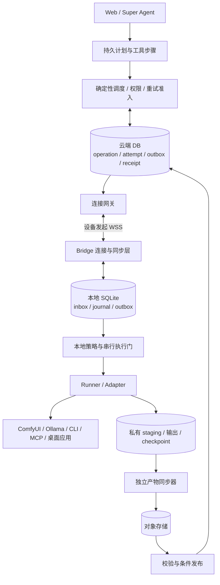
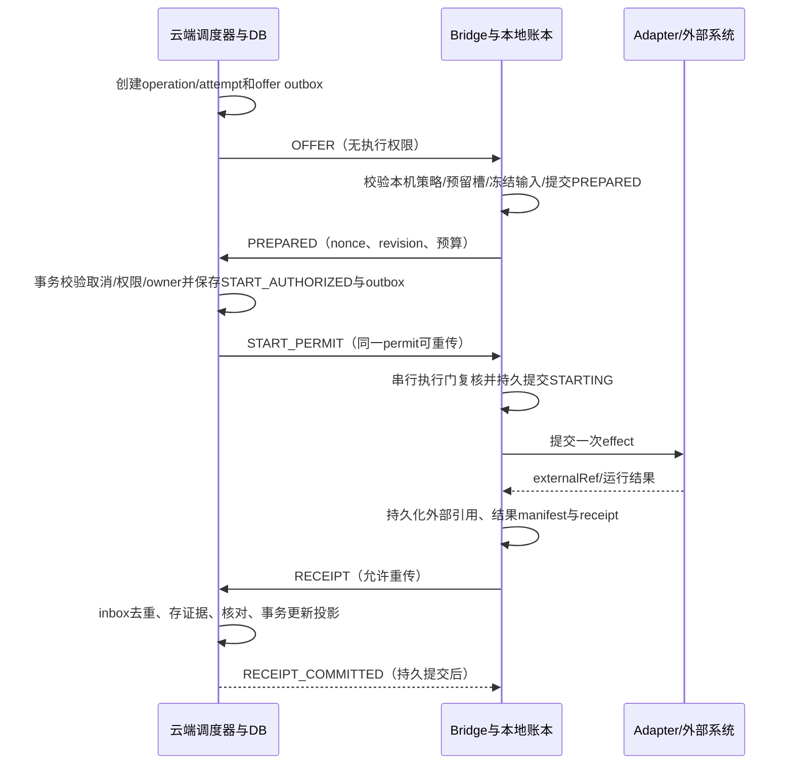

# yingce-bridge 断连、恢复与分布式执行可靠性

> 状态：研究与协议提案，未实施，未经过运行或故障注入验证。
> 研究日期：2026-11-12。论文结论、现有产品行为和影策建议分别标注；超时与容量数字均为待验证初始配置。
> 配套文档：[多设备本地执行架构](yingce-bridge-architecture.md)。本文细化该方案的启动授权、断连、恢复、重试、取消和交付合同。

## 1. 核心决策与断连后的用户体验

采用“云端持久编排 + 客户端有限离线执行 + 恢复后核对”的结构：Super Agent 负责制定并保存计划，确定性调度器派发具体操作，Bridge 在本机授权内执行完整工作单元。WSS 是传输通道，不能成为任务生命期或执行结果的唯一依据。

典型场景：用户在 Web 发起一个已审核的本地 ComfyUI 图，台式机接收并开始生成，随后云端连接中断。

1. Bridge 继续当前已批准的纯本地计算，受运行时长、GPU、磁盘和输出范围限制；本机 UI 显示“离线执行中”。
2. 云端显示“设备失联，执行结果待确认”，保留原 attempt；不在另一台电脑再次提交同一个工作流。
3. 工作完成后，输出和回执落到本机，显示“已完成，等待同步”。当前已经计算完成，不要求网络恢复后再算一次。
4. 如果用户此时在 Web 点取消，云端保存取消意图并显示“等待设备确认”；不能显示已停止。用户也可在 Bridge 本机 UI 发起停止。
5. 重连后先同步取消/权限变更，再核对原 attempt 和输出。若任务已完成，显示“已完成，取消未赶上”；若尚在执行，尝试定向取消并报告真实结果。
6. 获得有效上传许可后只同步产物，校验完成后发布为影策素材。同步失败只影响交付。

另两类场景采用不同处理：修改已有 Premiere 工程在可识别的安全边界暂停；已经向第三方模型服务提交的请求继续按原 external ID 查询。无法查询的 MCP 写操作保留“结果未知”，不自动重试。

本方案追求的保证是：关键意图与证据可恢复、未知副作用不自动重做、迟到结果不会覆盖新选择、取消状态不失真。对于任意黑盒 CLI/MCP/桌面软件，不宣称端到端 exactly-once。

## 2. 论文与成熟系统给出的机制

### 2.1 原始论文

| 资料 | 原文支持的机制及位置 | 适合影策采用的部分 | 保证成立的边界 |
| --- | --- | --- | --- |
| **Chubby，OSDI 2006** [P1] | §2.4 的 sequencer 携带锁 generation，由接收实际资源操作的服务校验；无法改造资源端时的 lock-delay 被明确称为 imperfect。§2.8–2.9 在 session 不确定时进入 jeopardy，阻塞依赖有效会话的操作，并尝试恢复。 | 失联后暂停新副作用；资源端可以配合时使用 fencing；连接恢复与执行结果恢复分离。 | 仅在影策数据库检查 fence，不能阻止旧设备继续写 Adobe 工程。grace period 是恢复机会，不是过期权限的延长期。 |
| **RIFL，SOSP 2015** [P2] | §3 要求唯一 RPC 身份、持久完成记录、重试能找到记录、安全回收；§4.1 要求副作用和完成记录原子持久化，之后才回复。§4.2–4.4 分别讨论完成记录回收、lease 管理，以及记录随资源迁移。 | 稳定 effectId、持久回执、同 ID 参数一致性、去重记录随资源保留、迟到重试处理。 | Bridge SQLite 与任意外部操作不在同一事务中。先写 STARTING 再调 CLI，或调完再写 receipt，都不能消除中间崩溃窗口。 |
| **Leases，SOSP 1989** [P3] | §2、§5 把 lease 定义为有期限的权限合同；正确性依赖明确的时钟/漂移与故障假设。 | 将连接超时、启动许可和运行预算分开；许可保守计时，重启/唤醒后重新同步。 | 不能用随意回拨的墙钟证明权限未过期。lease 到期不会撤回已发出的请求，也不会停止外部进程。 |
| **Sagas，SIGMOD 1987** [P4] | 引言与第 2 节将长事务拆成子事务和补偿事务；引言印刷第 3 页强调补偿消除语义影响，不恢复整个数据库旧快照。 | 生成、同步、工程导入、素材发布分成持久步骤，失败时只补偿确实可逆的步骤。 | 已消耗 GPU、外发数据和第三方费用通常无法撤回；不能用旧工程覆盖用户后续编辑当作“回滚”。补偿本身也可能失败。 |
| **Ray，OSDI 2018** [P5] | §3.1 假设 remote function 无状态且无副作用；§4.2.3 通过不可变对象和 lineage 重建丢失结果。 | 输入/输出不可变引用、任务 DAG、数据位置感知、纯计算的可重算性；有真实 checkpoint 时才续算。 | 不能把可重放计算直接类推到编辑器写入或收费 API。AI 生成也未必位级确定，重算结果须作为独立候选。 |
| **Beldi，OSDI 2020** [P6] | §2.2 说明底层存储假设；§3 使用 intent/step 标识、日志和重放；§3.1 要求副作用与相关记录原子提交，并记录非确定输入。 | 先保存 Agent 计划、模型输出、工具参数、审批与 operationId，再进入执行；恢复只重放已记录事实。 | 原型对操作和存储有中介控制。把任意 Adobe/MCP 接口包成函数，不会自动获得其事务保证。 |
| **Local-first software，Onward! 2019** [P7] | 讨论本地数据、离线可用、后续同步以及协作数据结构。 | 本机结果独立保存、离线状态可见、允许用户本地导出，云端故障不抹掉已有产物。 | CRDT 适用于可合并内容，不能拿来合并独占执行权、收费记录、取消/启动冲突。Bridge 仍可保持轻量。 |
| **FLP，JACM 1985** [P8] | §1–3，印刷 pp.375–377：在完全异步、确定性、最多一个 crash 等假设下，不能保证所有 admissible run 都完成共识；无法可靠区分进程死亡与极慢。 | 超时产生“怀疑”，需要后续证据来判断是否可以重试。 | FLP 不是“任何系统无法容错”或“无法 exactly-once”的笼统证明；不把共识终止限制泛化为所有故障保证。 |

RIFL 页码版本容易混淆：本次阅读的 28 页在线版中，§3 为 PDF 第 5–6 页，§4.1 为第 7–8 页，§4.2–4.4 为第 8–10 页；引用以章节为准。

### 2.2 已落地系统与工程资料

| 系统/资料 | 官方行为 | 对影策的决策 |
| --- | --- | --- |
| **Temporal** [E1] [E2] | Activity 超时后按 RetryPolicy 生成下一 attempt；取消通常通过 heartbeat 响应传播，Activity 可能未收到或忽略取消。发送 heartbeat 的 SDK 调用还可能被节流。 | 保存持久步骤、attempt 与 checkpoint；“超时”不等于旧执行停止。不可安全重做的副作用禁自动重试。未来复杂 DAG 可评估 Temporal，但它不能替代本机授权、去重和对账。 |
| **Kubernetes** [E3] [E4] | unreachable/not-ready 默认 toleration 为检测后 300 秒，可覆盖。官方明确网络分区节点上的 Pod 即使被控制面决定删除仍可能运行；强删 StatefulSet Pod 可能导致同身份两实例并存。 | 不把设备离线直接映射为释放危险操作占用并换机运行。300 秒是 K8s 默认值，不是影策故障判定依据。 |
| **KubeEdge** [E5] [E6] | 云边分层，MetaManager 本地 SQLite 保存元数据，EdgeHub 维护连接并同步状态；支持边缘应用在断网甚至离线重启时保持自治。 | 最接近 Bridge 的部署形态：云端控制、本机执行、元数据持久化、恢复后同步。借鉴职责，不要求用户安装 Kubernetes/KubeEdge。 |
| **AWS Builders Library** [E7] | 幂等使用调用者提供的请求身份；相同 ID 不同参数拒绝；变更与幂等记录要原子保存；处理迟到重试。该资料是工程文章，不是论文。 | callHash 检查参数一致性，operationId 表示用户意图。相同参数可能是用户主动运行两次，不能仅凭参数 hash 合并。 |
| **SQLite** [E8] [E9] | WAL + NORMAL 仍可能在掉电/系统崩溃后丢失最近提交；FULL 每次事务提交同步 WAL。 | 核心账本采用 WAL + FULL，持久提交后 ACK。仍依赖存储正确实现同步；不防磁盘损毁，也不把外部动作变成 DB 事务。 |

**实施选择：** v1 沿现有 Go、数据库和 Redis 通知边界实现小型持久状态机与 outbox/inbox，设备用 Go daemon + SQLite。暂不引入新的工作流平台或容器编排依赖。未来引入 Temporal 时仍遵守相同 Bridge 协议。

## 3. 组件与职责的进一步划分

- **Super Agent** 决定业务步骤，持久保存非确定的模型输出；不能越过调度/本地策略直接发命令。
- **持久编排层** 记录步骤依赖、审批、等待外部结果和人工核对，恢复时找到同一 operation。现有 Agent 检查点不能直接视为已完成多副本所有权/fencing，实施前须补齐并测试。
- **调度器** 决定可否派发与重试；**连接网关** 只投递已持久化命令。网关丢失不改变执行事实。
- **本地执行门** 是唯一启动入口；协议接收 goroutine、托盘 UI、自动更新和重连逻辑均不能直接启动 adapter。
- **Runner** 的执行 context 独立于 WSS context。连接结束不自动 kill 正在安全运行的纯本地计算；任务停止必须经过对应取消协议。
- **同步器** 独立重试结果上传，不重做生成。诊断和本机 UI 可以在没有云端时读取本地状态。

默认 Bridge 不运行自主规划的第二个 Super Agent。后续可支持用户预先批准的有限本地子 DAG，但必须冻结依赖、输入、权限、预算和可续跑边界，不能断云后自由新增工具步骤。

## 4. 身份、所有权与必须成立的不变量

### 4.1 不要把不同的编号混为一个 epoch

| 标识 | 用途 | 何时变化 |
| --- | --- | --- |
| `operationId` / `effectId` | 稳定业务意图及其中一次外部副作用；一个 operation 可以包含多个显式 effect | 用户新的意图/获批计划变更才新建；重传与安全重试保持原 effectId。 |
| `callHash` | 固定 command、规范化参数、输入版本、workflow/model/adapter digest 和权限摘要 | 内容变更产生新审批；同 effectId 不同 hash 冲突。 |
| `attemptId / attemptGeneration` | 一次具体执行尝试 | 通过重试准入后新建；恢复观察原执行不新建。 |
| `connectionEpoch` | 隔离旧 WSS 实时消息 | 同 daemon 认证重连变化；不授予重新执行权。 |
| `coordinatorEpoch` | 云端调度器的 DB 所有权 | 新调度器通过 DB CAS 接管时变化；旧 owner 不得提交新 outbox。 |
| `resourceFence` | 对同一可写资源拒绝过期执行者 | 资源端参与才有效；应按工程/对象等资源编号，不能仅按 job 编号假装隔离不同 job。 |
| `recoveryGeneration` | 云端时间点恢复后的控制世代 | 恢复 runbook 显式生成新随机身份；不使用会随旧备份一起回退的自增值。 |
| `ledgerInstanceId / bootId / daemonInstanceId` | 区分本地账本、OS 启动、当前进程；发现克隆/丢库/双进程 | 对应实例变化时变化；持久操作身份独立于这些运行实例。 |

### 4.2 协议不变量

1. 默认同一个 effect 同时最多存在一个“已授权且副作用尚未核对”的 attempt。心跳或调度 lease 到期不能解除该约束。
2. 数据库事务与条件更新决定授权、取消、选定结果的顺序；Redis lock、WSS 在线状态、LLM 判断均不决定这个顺序。
3. 未含执行权的 offer 可以重发；启动许可重传使用相同 permit/attempt。重新执行与网络重传是两个不同动作。
4. 云端先提交 START_AUTHORIZED，再可能发送许可；从提交开始就按 may-have-started 处理。没收到 started 不能证明没执行。
5. 本地 STARTING 先持久提交，外部动作后发生；如果提交失败，禁止动作。发生过 STARTING 后，恢复程序只能查询/核对，不能盲目重新调用。
6. 连接 epoch 和执行授权失效，不抹去历史结果证据。新认证连接可上报旧 attempt；证据接收与业务采用分开。
7. 最终回执不可变。相同 attempt 同 digest 幂等，不同内容隔离；后续澄清追加 reconciliation event。
8. 取消意图不因成功、失联或“不支持取消”而消失。停止未来执行不代表已发生的影响已撤销。
9. 未核对 attempt 的 **risk hold** 独立于设备在线和物理 GPU 槽位。恢复后可确认槽位空闲，但对同一危险工程/操作的重派仍需核对。
10. 人工允许重复运行必须关联原未知操作、说明重复/费用/文件影响并留痕。原 unknown 不被删除或伪装为未执行；晚到结果仍能追溯。

对于应用不能实施资源 fence 的情况，v1 优先生成新文件/工程副本再交付。仅本地 mutex 无法阻止用户手工编辑；修改已有工程还需要应用级版本校验/事务或人工确认。

## 5. 启动协议：先准备，再授予有限执行权

### 5.1 正常时序

PREPARED 可以做能力/资源检查、已授权输入下载和私有 staging 预留，不得修改用户工程或提交模型任务；准备中读取/下载文件仍需独立的数据授权。

启动许可至少绑定：服务实例与恢复世代、账号/设备、operation/effect/attempt、callHash、adapter/workflow/输入 digest、能力与权限 revision、本地 PREPARED nonce 和 boot/daemon 实例、startNotAfter、运行预算、offlinePolicy、允许的输出和外发范围。不能把它设计成可启动任意后续步骤的通用 token。

### 5.2 必须覆盖的崩溃窗口

| 崩溃位置 | 可确认的事实 | 恢复动作 |
| --- | --- | --- |
| 只有 offer，尚未提交启动授权 | 从本协议没有取得执行权 | 云端原子关闭准备态/回收预留后可以重匹配；旧 offer 不能执行。 |
| START_AUTHORIZED 已提交，尚未发送 | 服务端恢复后不能仅凭发送记录证明对端未收到 | 重发同一有效许可或进入核对；不创建另一 attempt。 |
| 设备保存 STARTING，调用尚未发生 | 本地无法仅凭 STARTING 区分此处与下一行 | adapter 可证明未执行才恢复为可重试，否则保留未知。 |
| 外部系统接受请求，响应/外部 ID 丢失 | 副作用可能已经发生 | 用稳定幂等键或可验证关联 ID 查询；没有证据则 unknown。 |
| 外部成功，本地 receipt 尚未提交 | 外部结果可能仍可查询 | 查询原任务/对象；不能因为缺 receipt 重做。 |
| 本地 receipt 已提交，云端未收到 | 本机有可恢复结果 | 重传相同 receipt。 |
| 云端 receipt 已提交，ACK 丢失 | 云端已经接收该事实 | inbox 唯一键幂等 ACK，不再次发布资源或结算。 |

SQLite 的保证止于本地事务；与外部动作之间的空隙用查询、上游幂等、隔离计算或 unknown 处理。不要对任意桌面应用套用分布式两阶段提交，也不要长时间持有 DB 事务等待设备返回。

### 5.3 ACK、重传和消息顺序

- transport ACK 只说明字节/帧收到；prepared、receipt committed 等业务 ACK 必须在对应 DB 事务成功后发送。
- 云端 outbox 与业务变更同事务；Bridge inbox、journal 与待发送结果同本地事务。发送失败不丢记录。
- `messageId` 防消息重复，`effectId` 防业务意图重复，两者不能互代。重复请求返回已有处理结果，hash 冲突返回机器可读冲突原因。
- sequence 用于发现缺页和恢复 cursor，不把乱序到达的终态回执直接丢弃；持久事件按接收/校验后的规则投影。
- cancel/撤销/receipt ACK 使用独立高优先级队列；进度和预览可合并/丢弃，终态和取消意图不可丢。
- 长连被代理阻断时可在后续版本增加出站 HTTPS 拉取/回执端点，但共用同一 inbox/outbox 和身份合同，不开启第二套执行状态机。

## 6. 连接、租约和时钟

以下是初始配置建议，不是论文推荐参数，也不是已验证 SLA。

| 参数 | 初始值/规则 | 仅用于什么 |
| --- | --- | --- |
| 设备 heartbeat | 15 秒，带轻量状态摘要 | 连接健康与资源快照；不每次上传完整日志。 |
| suspect | 45 秒未收到有效 heartbeat；显式断链可立即进入 | 停止新派发，UI 表示可疑；设备发现断链也立即关闭新启动准入。 |
| offline | 90 秒未恢复 | 在线列表与告警；不证明任务已死。 |
| 调度 owner lease | 60 秒，约每 15 秒续期 | 选择谁可修改云端调度记录；不可自动释放未知副作用。 |
| start permit | 最长 30 秒的一次启动窗口 | 限制尚未消费许可的新启动；不限制外部任务运行总时长。 |
| 运行/离线预算 | 每种 command 明确时长、输出大小、资源上限；未配置禁离线续跑 | 已开始操作可继续到哪里；安全边界和截止行为由 adapter 声明。 |
| 重连 | 指数退避，full jitter，上限 30 秒；收到 Retry-After 时尊重服务器指令 | 避免云端恢复时大量设备同时握手；稳定连接一段时间后重置退避。 |

设备墙钟仅展示和诊断。启动握手绑定本地先前生成的 PREPARED nonce，并从发送该 nonce 前的连续单调计时点保守计算剩余有效期；不能把“收到许可后的 30 秒”作为唯一到期依据，否则网络延迟会延长旧权限。需要受支持平台可靠的连续计时、漂移边界和安全余量；无法满足时拒绝启动并重新核对。

系统休眠/唤醒、daemon 重启、计时异常后，未消费许可失效，先握手与核对。已经 STARTING 的操作恢复观察，不能重新消费许可。延长或重新签发许可也必须先证明此前没有启动，不能因旧许可超时就自动续发。进程冻结后唤醒可能让已经进入外部系统的调用继续完成，不能用本机定时器提供瞬间停止保证。

“证明未启动”需要闭合竞态：本地执行门在完整、未回退的账本上原子检查尚未进入 STARTING，并持久废止旧 permit，记录 `not_started_closed` 后才回报。迟到的旧许可必须命中该关闭记录而被拒绝；云端收到可核对的关闭证据后才能重新授权。仅查询到 PREPARED、没有 started 消息或本地无记录，都不足以安全换发许可。

在线授权检查也有消息传播延迟：云端刚批准后网络可能立刻中断，或者取消与外部提交相邻发生。因此许可定义的是有限的本地准入窗口和预批准操作范围，不能承诺远程取消一发生，本机就零延迟停止。高风险操作不能接受这一窗口时，需要实际目标系统参与校验；无法配合时不开放该类无人值守执行。

还存在 `STARTING` 落盘到外部调用之间的进程冻结窗口：执行门可以在调用前尽量再次检查有效期，但两者不是原子操作。因此 `startNotAfter` 严格限制的是本地启动准入时间，不保证黑盒服务一定在该时间前收到/开始任务。需要约束目标实际接收时间时，必须由目标服务校验截止时间/fence；无法配合的 adapter 不提供该硬保证，云端仍按可能已执行保留风险占用。

## 7. 适配器恢复等级与离线政策

### 7.1 恢复能力必须由具体 command 声明

| 恢复等级 | 自动恢复能力 | 前提 |
| --- | --- | --- |
| `atomic_effect_and_receipt` | 重放同 effectId，返回原结果 | 真正执行目标把副作用与完成记录原子提交；仅本地 SQLite 写 STARTING 不满足。 |
| `upstream_idempotent` | 使用相同 effectId 重试提交/查询 | 上游合同覆盖该操作，参数一致，幂等保留期仍有效，费用也符合合同。 |
| `queryable_external_ref` | 查询原 externalRef，不重新提交 | 引用已持久化或可可靠重建；返回“找不到”须区分尚未可见、历史过期、服务重装和确实未执行。 |
| `isolated_recomputable` | 经策略批准可以新 attempt 重算 | 输入固定、无收费/外发/共享写副作用、每次输出隔离且资源预算允许；业务结果只选一次。 |
| `opaque_side_effect` | 无法自动恢复副作用 | 超时/崩溃进入 unknown，用户或外部系统核对；CLI/MCP 名称本身不能推出可重试。 |

“可查询”不能覆盖提交成功但 ID 丢失的窗口。预生成 promptId/correlationId 可改善查询，但只有上游承诺去重才能视为幂等；重复使用一个 ID 并不自动阻止重复执行。

### 7.2 离线执行政策

| 任务类别 | 建议 offlinePolicy | 断连后行为 |
| --- | --- | --- |
| 已批准的纯本地推理/转码 | `finish_current_bounded_operation` | 当前 operation 可完成到私有 staging；不能再新增 Agent 步骤、上传或写入共享项目。 |
| 真实支持 checkpoint 的长计算 | `stop_at_safe_point` | 保存可恢复 checkpoint 后暂停；恢复原 attempt。仅进度百分比或日志行不算 checkpoint。 |
| 修改现有工程、覆盖/删除、安装、对外发送 | `require_fresh_authorization` | 进入副作用前要求有效在线许可；断连后在下一真实安全边界暂停，已提交部分尽力取消并核对。 |
| 已交给外部服务的异步任务 | `observe_external_only` | 记录/查询原任务，不再次提交；不自动换账号/供应商/设备。 |
| 状态不可查询的第三方写命令 | `reconcile_before_retry` | 结果不明时 unknown；人工决定后续。 |
| Artifact 传输 | `resume_transfer_when_authorized` | 本地保留结果；已有上传授权范围内可继续传输，恢复后续传/刷新凭证并校验归属。 |

预算还需按时长、内存、输出和远程费用分别声明 `limitEnforcement=hard | best_effort | unsupported`。自有进程可通过经过验证的进程管理、资源限制与定时停止实现对应本机约束，但终止进程不能限制已提交到远端的任务/费用；共享 ComfyUI/编辑器若没有资源端限额或定向取消，只能尽力停止。预算到期后报告 `budget_exceeded`，同时保留外部执行可能仍在继续的事实；要求硬时长/费用/输出上限的任务不得匹配到不能执行该约束的 adapter。不能把配置了 runDeadline 描述成所有外部软件都会按时停止。

### 7.3 ComfyUI、Ollama、CLI/MCP、Adobe 的特别规则

**ComfyUI：** 采用“提交、观察、交付”三个独立步骤。成功提交 `/prompt` 已是外部副作用；即使仍在 queue，Bridge 退出后 ComfyUI 仍可能开始执行完整图。记录 prompt/job ID、服务实例指纹、workflow digest、输入版本和输出 namespace；重启后先查询 queue/history 与输出证据。

工作流中存在远程模型、计费或任意自定义节点时，提交整个图就可能授权未来节点的外发。必须冻结图与依赖、展示外发/费用来源、采用可强制执行的预算；无法约束费用时不能宣传硬上限，敏感场景拒绝自动运行。若用户要求断云后每个远程节点都停止，需要 ComfyUI 侧节点 gate/插件、可控凭证或对应资源端支持；普通 Bridge 无法从外部保证。协作插件也不能把其调用的黑盒付费 API 自动变成事务。

取消仅使用目标版本验证通过的 prompt/job 定向能力；共享实例禁止全局 interrupt。queue/history 清理或服务重装后“查不到”进入证据不足，不视为从未运行。纯本地 v1 模板应排除远程节点和未经审核的自定义执行。

**Ollama：** 原始流式请求中断不代表模型未完成，也不保证结果可恢复。adapter 若无法取回完整输出，报告不可恢复的当前结果；纯本地、隔离、预算允许的情况下可批准重算，生成的是另一个 attempt 的候选结果。不得宣传统一的跨设备 KV cache/推理续算。

**固定 CLI / 本地 MCP：** argv 不经 shell；明确进程生命周期、是否产出新文件、是否改共享资源、是否访问远端。STDIO EOF、退出码非零、MCP 超时都不能单独证明副作用未发生。可先支持读取/渲染到独立目录的命令，再开放有状态写操作。

**Adobe / 剪映：** 先采用生成新工程、导入交换文件、另存副本等可核对操作。应用插件可提供 operation marker、工程 revision、定向取消和查询时，再提高恢复级别。应用只读状态/用户手工编辑并发必须考虑；不杀整个共享编辑器来“保证取消”。

## 8. 重连、恢复和取消

### 8.1 恢复步骤

1. **身份握手**：认证设备，报告 ledger/boot/daemon 实例、协议、上次持久 cursor 和已见恢复世代；异常克隆或世代倒退进入隔离。
2. **暂停新启动**：完成恢复 barrier 前，只同步权限/取消和证据；不因 WSS 连上立即接单。
3. **同步控制意图**：先取得撤销、暂停、cancelRequestedAt、权限/adapter revision。同步不意味着所有运行中的外部操作已经停止。
4. **交换清单**：分页上报所有非终态 attempt、externalRef、已持久 receipt 摘要、产物 manifest、未知记录；云端返回自己已授权但本机未对应的集合。
5. **逐项核对**：优先本地不可变回执，再检查实际 adapter；记录查询对象、时间、服务实例、证据来源与可信范围。外部 API 暂不可用保持 reconciling，超过观察预算可转 unknown。
6. **处理迟到事实**：新连接提交旧 attempt，不要求旧 lease/permit 未过期；同 digest 幂等。重复或矛盾回执隔离。旧候选不能覆盖新的 selectedAttemptId。
7. **校验交付**：下载/上传只在当前授权与配额内恢复。回执已收与素材已发布分开。
8. **恢复准入**：账本完整且策略同步后可以启动新的、不冲突操作；未知工程/能力的 risk hold 继续保留，不必阻塞同设备所有无关安全工作。

设备已撤销时不再允许原 token 建连或取得操作权；保留本地结果，可由用户在账号重新认证后走专门证据导入/重新绑定流程。该入口只导入和核对资料，不恢复旧 grant。

### 8.2 取消与完成的竞态

| 取消到达时刻 | 合同 |
| --- | --- |
| START_AUTHORIZED 事务之前 | 云端 CAS 关闭启动准入；旧 offer 不可执行。 |
| 已授权但 Bridge 尚未进入 STARTING | Bridge 本地串行门若先持久化取消，则禁止调用；尚未收到取消时仍可能在有效许可内启动。 |
| 已交给 adapter | 记录 requested，调用目标粒度的取消；确认停止才记 confirmed，仍记录已发生/部分副作用。 |
| 执行完成但回执未传 | 保存 succeeded 和 too_late；不能用取消意图覆盖成功事实。 |
| adapter 不支持/无法确认 | 记录 not_supported 或 requested，并继续核对；不给“已取消”绿勾。 |

人工核对使用 `resolutionSource=human`、操作者、证据说明和处置方式。选择“允许再运行一次”不是声称上次没有发生，必须创建可追溯的重复授权并显示潜在重复费用/文件影响。

## 9. 本机持久化、进程、磁盘与升级

### 9.1 账本与保留

- 核心表：`operations`、`attempt_journal`、`control_inbox`、`receipt_outbox`、`artifact_manifest`、`sync_cursor`、`local_grants`、`reconciliation_events`。OS 密钥库独立保存私钥与 refresh token。
- `journal_mode=WAL`、`synchronous=FULL`；将关键状态、必要输出引用和 outbox 在同事务提交。操作系统/磁盘遵守同步语义是前提，不承诺磁盘物理丢失后仍可恢复。
- 活跃 WAL 数据库使用 SQLite 支持的备份机制；不能只复制主 DB 文件作为完整备份。文件输出持久化与 DB 记录有独立顺序，先完成文件写入/校验，再提交最终 manifest；孤立临时文件经核对后清理。
- 云端 receipt committed ACK 前保留本地回执；收到 ACK 后仍按保留策略保留结果/摘要。ACK 只确认云端接收事实，不授权删除用户唯一产物。
- 未核对记录不自动 GC；详细日志可按配置压缩，去重 tombstone/拒绝过期身份机制必须覆盖迟到重放。回执保留、命令有效期、最大离线期与身份关闭策略一起设计，不能简单“7 天后全删”。
- 账本损坏、缺失、回退或 cursor 倒退进入 recovery quarantine。云端有授权而本机无记录时，先判断账本是否完整；缺记录不能用作从未执行的证明。

### 9.2 进程与启动监督

用户级后台 daemon 持有 OS singleton lock；托盘只是 UI，关闭窗口不等于退出 daemon。不同服务域通过配置隔离；同一安装/OS 用户不能由两个 daemon 同时控制同一账本。supervisor 只负责重启 daemon，恢复程序决定如何观察已有任务，不重跑全部任务。

| processOwnership | 例子 | 崩溃/退出处理 |
| --- | --- | --- |
| `owned_child` | Bridge 启动的固定渲染 CLI | 管理进程组/平台 job 容器；持久保存进程实例标识。若采用随 daemon 退出终止策略，必须在目标 OS 验证，且终止不撤销先前副作用。 |
| `detached_service` | 用户独立启动的 ComfyUI/Ollama | daemon 死亡不代表服务停止；重启后查询原任务，不能重启/杀掉共享服务。 |
| `interactive_app` | Premiere、剪映 | 用户可能同时操作；插件/工程版本协议管理，不能假设独占整个应用。 |

PID 必须结合创建时间/进程实例身份，避免 PID 复用误杀。daemon 新进程启动时先拿 singleton lock，恢复 journal 和外部任务，再开放执行门；发现同设备密钥对应不同账本/运行实例时隔离冲突。

### 9.3 背压、存储与升级

入场前预留账本空间、产物目录空间与 GPU/应用槽位。可将“剩余空间低于 2 GiB 或预计输出 + 安全余量”作为初始暂停阈值，具体需按媒体负载验证；阈值不等同磁盘写一定成功。

磁盘满/IO 错误使关键事务无法提交时，禁止 ACK 新准备或启动；尽力停止自有子进程的后续动作并保留已有外部引用。无法持久记录最终结果时只能报告 evidence_degraded，恢复后核对，不能声称已可靠完成。共享外部服务可能继续占盘，必须在 UI 明示并允许用户本机处理。

终态/取消消息优先于遥测；内存队列有界，日志轮转，进度合并，断网积压进入 SQLite。暂停新任务时不删除未知回执或用户唯一结果。服务器恢复时分批对账、按账号/设备限流，避免所有设备上传历史日志占满控制通道。

升级先 drain：停止新派发，提交已有证据，按 adapter 策略等待/暂停/取消，然后替换进程。新旧 daemon 不并行执行。DB 迁移保留备份与版本门槛；回滚不能丢失新的 receipt/tombstone。仍有未核对任务依赖旧 adapter 时保留其查询能力，无法兼容则暂停升级该 adapter。

## 10. 结果交付、多设备 DAG 与补偿

### 10.1 三个完成点

1. **执行完成**：本地产物持久化，内容摘要、输入版本、attempt、adapter/workflow digest 可追溯。
2. **交付完成**：对象已按当前授权上传，服务端校验 owner、digest、大小、类型与配额。
3. **业务发布**：事务检查 operation 的 selectedAttemptId、结果版本、项目权限/输入 revision，把对象关联到素材/画布。重复提交不会重复创建或重复结算。

每个 attempt 使用独立输出 namespace，不共享“final.mp4”可覆盖路径。发布采用条件更新；晚到输出作为旧候选保留，不直接改写用户已经选定的结果。自有数据库内可对一次逻辑发布实施唯一性与事务保证，但不能推广为整个跨设备操作 exactly-once。

每个对象还必须冻结具体字节版本：预签名 PUT 即使只对应一个 key，也通常能在有效期内重复覆盖，不能把它称为天然一次性写入。上传只允许临时区；服务端校验并固定不可变 object version，或从已固定的源版本条件复制到禁止客户端覆盖的最终对象后再校验/发布。下游始终引用已验证的版本与 digest。只使用内容 hash 命名仍不足以防同 key 被重写；版本固定、写入权限/条件写与最终发布合同必须共同成立。

上传 URL 过期只刷新受授权对象的传输凭证；分块 hash 和完成状态支持续传。当前账号禁用、配额不足、权限撤销时停止新的上传/发布，保留本地结果。服务端接受执行证据不代表必须发布或计费。

### 10.2 多设备协作

例如 `A 本地素材分析 → B GPU 生成 → A 剪辑工程导入`：每个箭头引用不可变 artifact/manifest，记录数据外发许可和可用位置。下游在所需输入真实可访问且版本匹配时才开始；B 仅报告“本地生成成功”不能让 A 假装已经拿到视频。

优先把计算安排在有输入、模型和空闲资源的设备，减少大媒体传输。没有经 adapter 验证的 checkpoint 协议时，换设备只能重新计算，不能声称续算；多个 Bridge 也不自动合并显存。

纯隔离计算可以在用户批准的重复算力预算内另起 attempt，旧结果不直接发布。涉及收费、写入既有工程或不透明 MCP 时，未知旧操作默认禁止自动替代；不能以“另一设备更空闲”绕过风险占用。

### 10.3 Saga 式补偿

| 已完成步骤 | 可考虑的补偿 | 必须保留的事实 |
| --- | --- | --- |
| 预留上传/空间配额但未使用 | 释放预留 | 不能释放仍可能占用的已提交对象/外部收费预算。 |
| 上传独立临时对象，尚未发布 | 检查引用后删除临时对象 | 删除失败保持记录并重试清理；不先删资源记录。 |
| 发布了新素材但后续导入失败 | 保留素材供手工使用；可按规则撤销本次新关联 | 素材存在且可被用户使用，不把整次流程写成无结果。 |
| 插件导入了独立工程对象 | 插件支持 operation marker/revision 时撤销本次导入 | 不覆盖用户后续编辑；补偿是独立、有审批与回执的操作。 |
| 已消耗算力、扣第三方费用、已外发数据 | 通常无法技术回滚 | 展示真实已发生影响；不承诺自动退款或撤回外发。 |

补偿失败进入 `compensation_pending/failed`，可重试的补偿也要有幂等身份；unknown 的原动作先核对，不能盲目补偿一个可能未发生的操作。

## 11. 云端宕机、分区和备份恢复

### 11.1 普通重启、数据库短暂故障

DB 是授权/回执真相，Redis 仅唤醒投递。DB 不可写时暂停新授权与新发布，不发成功 ACK；Bridge 保留 outbox，本地计算按既定政策继续。DB 恢复后补发已提交命令并核对结果。

多个调度器使用 DB 所有权 CAS 与唯一约束。旧调度器失租后不得创建授权/outbox；已有 outbox 仍只包含同一 permit，重复投递由本地执行门去重。旧 gateway 的长连接不能让旧 owner 获得新的执行权。

前提是数据库存在单一权威写历史，底层 HA 正确阻止双主。不能靠业务 epoch 解决两个独立可写、彼此隔离的数据库集群；无法保证此条件时停止派发危险操作。

### 11.2 恢复旧备份不是普通重启

恢复到旧时间点可能丢失已经发出的许可、取消、去重记录或已收回执。必须使用专门 runbook：

1. 恢复环境默认关闭 Bridge 派发、授权签发与自动重试；关闭旧控制平面入口/凭证路径，避免旧环境仍派发。
2. 由恢复流程显式生成新 recoveryGeneration，并更新独立的部署恢复记录/密钥使用状态；不能只读取会随备份回退的整数。
3. 设备保存见过的世代、ledger/cursor 高水位，发现状态回退或世代变化先进入核对；未消费的旧许可在获知变更后失效。
4. 汇总受影响时间窗口内设备 journal、外部 task ID、对象 manifest 和审计证据；人工处理没有足够证据的操作。
5. 为已核对、不冲突的范围逐步恢复派发；未联系上的设备仍可能持有已开始的外部任务，不把它们当作安全停止。

更换 recoveryGeneration 不能通知离线设备，也不能停止已交给 ComfyUI/远端模型的图；旧授权的短期有效期只能限制未开始动作，未知副作用必须继续占用其风险范围。

## 12. 异常处理矩阵

| 异常 | 客户端处理 | 云端处理 / 用户可见结果 |
| --- | --- | --- |
| 浏览器关闭/SSE 断开 | 无需改变执行 | 保存 job；页面恢复后补事件。 |
| WSS 断开 | 关闭新启动准入；按 offlinePolicy 处理当前操作 | suspect/offline；已授权 attempt 进入核对，不重派。 |
| 网络恢复抖动 | 退避、限流、分页对账，重传原消息 | cursor/inbox 去重；不多次启动。 |
| 云端整体不可用 | 本机 UI/账本可用，有限计算续跑，产物留存 | 恢复后重建连接和状态；不假装能实时远程停止。 |
| Redis 不可用 | 无特殊执行变化 | DB 轮询/恢复 outbox，延迟可增加，不丢任务真相。 |
| 云端 DB 不可写 | 保留回执与结果 | 拒绝新授权和成功 ACK，恢复后处理。 |
| daemon 崩溃 | supervisor 重启后先核对 | 不把重新上线视为新 attempt。 |
| 系统重启/休眠 | 作废未消费许可，校验 ledger/进程/外部引用 | 先恢复 barrier，再接单。 |
| ComfyUI 继续跑但 Bridge 不在 | 查询原 queue/history/输出；有定向能力时取消 | 显示外部任务待核对，不能显示已取消。 |
| 外部调用超时/响应丢失 | 查询或上游同 effectId 幂等恢复；否则 unknown | 不自动换设备/改任务 ID 重试。 |
| 上游历史被清理 | 保留其他证据与 unknown | 空查询不是未执行证明。 |
| OOM/模型不可用 | 记录失败及 partial effect；清理私有 staging 须核对 | 要求用户/策略重新选择资源；不静默改云端收费。 |
| 磁盘满/SQLite 提交失败 | 禁新启动，保留关键记录，尽力暂停自有执行 | evidence_degraded；不能用默认成功掩盖。 |
| 凭证到期 | 刷新/重登；已开始的本地计算依策略运行 | 新授权/上传需要有效身份；不丢旧本地结果。 |
| 设备撤销/账号禁用 | 在线获知后关闭新执行门，尽力定向停止 | 拒绝新派发/发布；离线执行的既有影响如实保留。 |
| 上传超时/URL 失效/配额不足 | 保留结果，仅续传/等授权 | 执行成功、交付失败可同时显示。 |
| 输入/工程被用户改动 | 版本校验失败，保留新输出，禁止覆盖 | 请求重新选择/确认版本，不沿用旧审批。 |
| 同设备双 daemon/克隆 | singleton/实例冲突隔离 | 禁止互相接管后并行执行；要求核对身份。 |
| 本地账本恢复旧备份 | 恢复隔离，不重跑缺失 attempt | 与云端授权和外部结果对账。 |
| 云端恢复旧备份 | 识别世代/cursor 变化，上传证据 | 冻结调度、运行专门恢复流程。 |
| adapter 升级失败 | 保留旧查询能力和 journal；drain | 不用新版本重做旧任务，提示版本恢复。 |

## 13. 验证设计与阶段门槛

### 13.1 先实现最小可靠闭环

**阶段 R0：协议模型。** 先定义状态转移、ID、DB 唯一约束、授权/取消 CAS、adapter 恢复合同和消息 schema。用小型可控假 adapter 做故障模型，列出所有“外部接受前后”的注入点。关键不变量可用 TLA+/PlusCal 或状态机模型检验；这验证协议模型，不替代真实系统测试。

**阶段 R1：单设备、一个纯本地模板。** 使用审核过的 ComfyUI 纯本地图或受控 CLI，完成绑定、daemon、SQLite、offer/permit、receipt、断网续跑、本地结果与上传分离。阶段通过前不接不可查询的写入型 MCP、工程覆盖或远程收费节点。

**阶段 R2：云端 Agent 持久恢复与多设备。** 持久 operation/步骤/审批，owner fencing、Agent 重放同 job、多个连接网关、重复投递、Redis/DB 中断和跨设备安全重算；确认现有任务 worker 不会误领 Bridge 任务。

**阶段 R3：有状态 adapter 与交付。** 文件/工程版本合同、外发/费用、定向取消、部分副作用、补偿与 unknown UI。每个 adapter 单独声明版本和恢复等级，不按“支持 MCP”统一承诺可靠执行。

### 13.2 必须注入的故障

| 注入点 | 验收断言 |
| --- | --- |
| offer 丢失/重复/乱序 | 未取得 start permit 不发生任何执行副作用。 |
| PREPARED 后云端崩溃 | 保留准备态，不自行启动；授权事务未发生时可安全关闭准备。 |
| START_AUTHORIZED 提交后、发送前杀进程 | 仅恢复同一 permit/attempt；不能以未收到 started 为由重新匹配。 |
| 本地 STARTING 提交前磁盘满 | adapter 调用次数为 0，不发送已准备/已启动成功 ACK。 |
| STARTING 提交后、外部调用前冻结进程直至许可到期 | 恢复时尽力再次校验；黑盒接口不宣称硬性外部截止。需要硬截止的目标必须自己拒绝过期许可，云端不据到期推断未执行。 |
| 外部已接受、externalRef 回包丢失 | 可证明的同幂等键恢复或 unknown；不产生未经授权的第二次提交。 |
| 子进程成功后、receipt 落盘前 kill daemon | 查询/核对真实输出；不可查询时明确 unknown。 |
| receipt 本地落盘后断网/断电 | 在存储同步假设成立时可恢复同 receipt；不得自动重跑。 |
| 云端提交 receipt 后丢 ACK | 回执幂等，资源发布/结算不重复。 |
| cancel 与授权事务并发 | DB CAS 得到确定顺序；已授权后仍按真实停止证据显示。 |
| cancel 与成功同时发生 | 不丢取消意图，不把成功改成从未发生。 |
| ComfyUI 排队后退出 Bridge | 上游仍可能运行，Bridge 不误报取消；恢复查同 ID。 |
| 本地子进程 PID 被复用 | 不误杀无关进程。 |
| 休眠、墙钟回拨、长时间进程冻结 | 不延长未消费许可；醒来核对；已进入外部系统的影响如实记录。 |
| 新连接接管后收到旧 attempt 结果 | 通过新连接核对接收证据，禁止旧 transport 实时控制。 |
| 本机/服务端账本倒退 | 停止自动派发并核对；缺记录不能触发重复执行。 |
| 双 daemon、不同账本共用设备密钥 | 冲突隔离，最多一个正常执行入口。 |
| 对象已上传但发布响应丢失 | 条件发布幂等，不重复计费/新建素材。 |
| 校验后使用仍有效的上传 URL 再次覆盖 | 已发布引用的字节版本不变；新写入不能污染已验证素材。 |
| capability/输入/权限 revision 变化 | 旧审批拒绝新启动；已发生结果仍可核对。 |
| Agent 重启重放相同工具步骤 | 返回原 operation/job；LLM 重试不产生新的外部效果。 |
| 设备批量重连、终态与大日志同时积压 | 优先处理取消/回执，控制面内存有界；遥测拥堵不阻塞安全状态。 |

随机化消息丢失/延迟/重复/重排后，持续检查：无许可不执行、未知副作用不自动重做、每个 effect 的发布结果至多一个被选中、旧结果不能覆盖新选择、回执未持久提交不 ACK、取消/交付状态不相互冒充。

真实验收还需要在支持的 macOS/Windows/Linux 版本验证掉电、休眠、进程组、密钥库、磁盘满和文件原子交付；协议模拟通过不能替代这些平台测试。研究阶段不把以上任何测试标为已通过。

### 13.3 指标与运行目标

至少记录：unknown 数量及等待时间、断连后成功核对率、permit 已授权无 started 比例、重复消息去重次数、回执持久 ACK 延迟、local complete 到 published 的时间、取消确认/太晚/不支持比例、双实例冲突、磁盘拒单和恢复隔离次数。

以任务/设备/adapter 维度关联 trace，但不上传原始路径、密钥、完整媒体或默认完整 prompt。协议正确性以不变量验收，性能 SLA 在真实媒体负载与多设备网络测试后制定；不凭心跳配置推导“90 秒恢复成功”。

## 14. 尚需实施时验证的事项

- 所支持 ComfyUI/Ollama/Adobe 版本的查询、取消、历史保留与进程行为；动态在线资料不替代目标版本测试。
- 每种 OS 连续时钟、休眠/唤醒通知、进程监督、文件安全打开与 fsync/原子交付语义。
- 云端 PostgreSQL/开发 SQLite 的 CAS 与唯一约束实现，现有 Agent 的 owner/步骤恢复边界。
- 大型输出的空间预留与保留策略、最长离线期、回执/tombstone 的安全回收策略。
- 远程收费节点能否真正强制费用上限；不支持时如何限制自动化范围。
- 离线执行、人工核对、允许重复运行和本机结果导出的真实产品交互。

这些是实现门槛，不影响当前架构选择：Web 为主产品，多 Bridge 提供本机能力；可靠性依靠持久意图、受限执行和结果核对，而不依赖长连接永不掉线。

## 参考资料

论文一手资料：

- [P1] Mike Burrows. *The Chubby Lock Service for Loosely-Coupled Distributed Systems*. OSDI 2006. [USENIX 原文](https://www.usenix.org/legacy/event/osdi06/tech/full_papers/burrows/burrows_html/)；[PDF](https://research.google.com/archive/chubby-osdi06.pdf)。
- [P2] Collin Lee et al. *Implementing Linearizability at Large Scale and Low Latency*. SOSP 2015. [SIGOPS PDF](https://sigops.org/s/conferences/sosp/2015/current/2015-Monterey/126-lee-online.pdf)；[DOI](https://doi.org/10.1145/2815400.2815416)。
- [P3] Cary G. Gray, David R. Cheriton. *Leases: An Efficient Fault-Tolerant Mechanism for Distributed File Cache Consistency*. SOSP 1989. [Stanford PDF](https://web.stanford.edu/class/cs240/readings/leases.pdf)。
- [P4] Hector Garcia-Molina, Kenneth Salem. *Sagas*. SIGMOD 1987. [Princeton 原文 PDF](https://www.cs.princeton.edu/techreports/1987/070.pdf)；[DOI](https://dl.acm.org/doi/10.1145/38714.38742)。
- [P5] Philipp Moritz et al. *Ray: A Distributed Framework for Emerging AI Applications*. OSDI 2018. [USENIX PDF](https://www.usenix.org/system/files/osdi18-moritz.pdf)。
- [P6] Haoran Zhang et al. *Fault-tolerant and Transactional Stateful Serverless Workflows*. OSDI 2020. [USENIX PDF](https://files.usenix.org/s3fs-public/cdn/osdi20-zhang_haoran.pdf)；[论文主页](https://www.usenix.org/conference/osdi20/presentation/zhang-haoran)。
- [P7] Martin Kleppmann, Adam Wiggins, Peter van Hardenberg, Mark McGranaghan. *Local-first software: You own your data, in spite of the cloud*. Onward! 2019. [作者正文](https://www.inkandswitch.com/essay/local-first/)；[DOI](https://dl.acm.org/doi/10.1145/3359591.3359737)。
- [P8] Michael J. Fischer, Nancy A. Lynch, Michael S. Paterson. *Impossibility of Distributed Consensus with One Faulty Process*. JACM 1985. [MIT 原文 PDF](https://groups.csail.mit.edu/tds/papers/Lynch/jacm85.pdf)。

官方系统文档与工程资料（按本次访问内容理解，不承诺所有历史版本行为一致）：

- [E1] Temporal：[Activity Execution](https://docs.temporal.io/activity-execution)。
- [E2] Temporal：[Detecting Activity failures](https://docs.temporal.io/encyclopedia/detecting-activity-failures)；[固定重试次数设计](https://github.com/temporalio/documentation/blob/main/docs/design-patterns/fixed-count-retries.mdx)。
- [E3] Kubernetes：[Taints and Tolerations](https://kubernetes.io/docs/concepts/scheduling-eviction/taint-and-toleration/)。
- [E4] Kubernetes：[Force Delete StatefulSet Pods](https://kubernetes.io/docs/tasks/run-application/force-delete-stateful-set-pod/)。
- [E5] KubeEdge：[项目 README](https://github.com/kubeedge/kubeedge/)。
- [E6] KubeEdge：[MetaManager 架构](https://kubeedge.io/docs/architecture/edge/metamanager/)。
- [E7] Malcolm Featonby, AWS Builders Library：[Making retries safe with idempotent APIs](https://aws.amazon.com/builders-library/making-retries-safe-with-idempotent-APIs/)。
- [E8] SQLite：[WAL](https://www.sqlite.org/wal.html)。
- [E9] SQLite：[PRAGMA synchronous](https://www.sqlite.org/pragma.html#pragma_synchronous)。
- [E10] ComfyUI：[server.py](https://github.com/comfy-org/ComfyUI/blob/master/server.py)。具体定向取消/查询入口随版本验证；不假设 ID 去重。
- [E11] Ollama：[Streaming](https://docs.ollama.com/api/streaming)。断流恢复能力由具体 adapter/版本测试确定。

[P1]: https://www.usenix.org/legacy/event/osdi06/tech/full_papers/burrows/burrows_html/
[P2]: https://sigops.org/s/conferences/sosp/2015/current/2015-Monterey/126-lee-online.pdf
[P3]: https://web.stanford.edu/class/cs240/readings/leases.pdf
[P4]: https://www.cs.princeton.edu/techreports/1987/070.pdf
[P5]: https://www.usenix.org/system/files/osdi18-moritz.pdf
[P6]: https://files.usenix.org/s3fs-public/cdn/osdi20-zhang_haoran.pdf
[P7]: https://www.inkandswitch.com/essay/local-first/
[P8]: https://groups.csail.mit.edu/tds/papers/Lynch/jacm85.pdf
[E1]: https://docs.temporal.io/activity-execution
[E2]: https://docs.temporal.io/encyclopedia/detecting-activity-failures
[E3]: https://kubernetes.io/docs/concepts/scheduling-eviction/taint-and-toleration/
[E4]: https://kubernetes.io/docs/tasks/run-application/force-delete-stateful-set-pod/
[E5]: https://github.com/kubeedge/kubeedge/
[E6]: https://kubeedge.io/docs/architecture/edge/metamanager/
[E7]: https://aws.amazon.com/builders-library/making-retries-safe-with-idempotent-APIs/
[E8]: https://www.sqlite.org/wal.html
[E9]: https://www.sqlite.org/pragma.html#pragma_synchronous
[E10]: https://github.com/comfy-org/ComfyUI/blob/master/server.py
[E11]: https://docs.ollama.com/api/streaming
