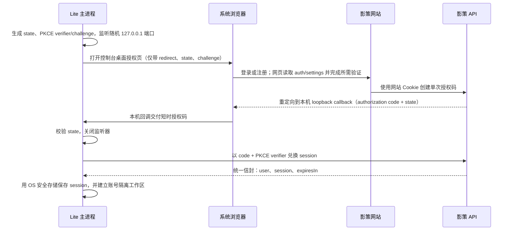

# PeekReel Lite 网站认证与服务端总体架构审阅

> 状态：本地优先实施基线；仓库已包含桌面 PKCE 登录、Lite 账号隔离和系统渠道代理实现。Lite 0.7.0 已完成本机覆盖安装与数据保全核对；生产服务联调、真实登录、旧资料手动导入和签名升级仍未验收。本稿不表示生产域名已切换或线上部署已验收。
> 范围：PeekReel Lite 桌面端、影策网站与 API、PeekReel 宣传／静态服务、服务端更新、渠道配置及本地开发工作区。
> 代码边界：源代码只在本机 Git 工作树 `D:\yingce\open-ai-canvas` 修改；生产主机只作为部署目标，不在主机上直接编辑或保存开发代码。

## 1. 结论与建议

按已确认的本地优先边界，影策网站是唯一账号身份入口；Lite 负责创作和本地数据管理。客户端点击“登录”后用系统默认浏览器打开网站；注册策略、邮箱／手机验证、密码输入、找回密码和会话建立都在网站完成。授权页必须显示当前影策账号并等待用户确认，避免浏览器已有账号时静默授权。宣传站只放产品介绍与登录／下载入口；认证界面沿用影策现有控制台页面，不在 Lite 内复制注册逻辑。

桌面登录采用 **Authorization Code + PKCE，并通过本机 loopback 回调**。Lite 临时监听随机 `127.0.0.1` 端口，生成一次性 `state` 和 PKCE verifier/challenge，然后打开控制台授权页面。用户确认当前账号后，网站将短时、单次使用的授权码送回本机；Lite 校验 `state`，再用授权码和 verifier 通过 HTTPS 交换不透明 session。只有 Lite 主进程接收和保存 session，session 不进入 URL、渲染层、日志或分析事件。现有网站登录页可继续使用 Cookie；浏览器 Cookie 不跨进程交给 Electron。

用户生成的项目、素材、任务、对话、审批状态和结果留在当前 Lite 账号的本机分区。豆包渠道由本机豆包桥直接运行；影策系统上游请求经服务端完成身份校验、权限、计费与转发，服务端不保存生成正文、参考媒体或结果。云端服务不可用时，本地工作区和豆包能力仍可使用；影策上游模型则在服务不可用期间不可请求。旧版未绑定影策用户 ID 的本地资料保留为独立档案，登录后由用户明确选择是否复制到当前账号分区；原档案保留，目标已有数据不覆盖，导入失败不切换档案。

## 2. 系统边界与职责

| 部件 | 应承担的职责 | 数据边界 |
| --- | --- | --- |
| 影策网站／控制台 | 注册与登录策略、邮箱／手机验证、密码找回、会话管理、账号资料与后台配置 | 网站认证使用安全 Cookie；桌面登录经授权码交接，不暴露浏览器 Cookie |
| 影策 API／后端 | 用户认证、session 校验／撤销、可用模型目录、计费、受控上游转发、渠道权限与只读配置 | 只持久化认证、渠道配置、账单与防重元数据；不持久化 Lite 生成正文、提示词、参考媒体或生成结果；日志脱敏 |
| PeekReel Lite Electron 主进程 | 发起网站登录、接收并兑换授权码、保存 session、管理账号生命周期、执行受信 IPC | session 仅由主进程读写 OS 保护存储；不传给网页渲染代码 |
| Lite 渲染界面 | 画布、工作台、模型选择、生成交互、结果预览与下载 | 项目、素材、任务、对话、审批状态和生成结果保存在 API origin + 影策用户 ID 对应的本机分区 |
| 本地业务后端与豆包桥 | 本机项目／素材与已有创作功能；按活动账号隔离本地运行资源 | 属于桌面运行时，不替代影策云 API 的身份认证和模型目录 |
| `peekreel.peekcart.com` 静态服务 | 宣传页面、Lite 更新 feed、直连渠道目录及静态资源 | 更新路径、渠道目录路径必须继续可用；三者与影策系统模型目录职责不同 |
| Yingce 上游适配 | 按公布的协议和能力矩阵连接上游；管理系统渠道、模型能力、限流和计费 | 上游凭据只在服务端；不下发给 Lite。豆包客户端渠道不经过该服务 |

影策控制台是账号认证的规范页面；宣传站负责引导，不应再实现另一套账号状态。Lite 云端 API 地址、控制台地址、更新源和直连渠道目录地址需要集中配置，并允许开发／测试环境覆盖。当前代码默认 API 为 `https://api.peekcart.com/api`，不能据此断言该生产域名已切换或可用。

## 3. 当前实现与证据边界

### 已在仓库代码中存在

- 网站端已有登录、注册页面；注册页读取 `GET /auth/settings`，根据注册开关及验证策略展示流程。后端已有注册、登录、注销、会话查询及相关 OAuth 路由。
- 后端注册／登录响应包含统一信封中的 user、session、expiresIn；API 支持 Bearer session。网站仍可使用 HttpOnly Cookie。
- 桌面授权码签发、单次消费、PKCE S256 校验和 session 兑换已有后端路由；控制台页会显示账号并由用户确认后签发。Lite 主进程通过 loopback 回调、校验 `state`，并用 Electron `safeStorage` 保存 session。
- Lite 本地数据库、豆包持久化分区和恢复回执按 API origin + 影策用户 ID 隔离；退出后保留账号工作区。旧版 SQLite／本地档案已提供显式选择导入：复制数据库与资源、验证本地账号后原子切换；浏览器存储按用户选择的旧 scope 复制，不覆盖目标数据、不删除来源，并有幂等标记。
- Lite 将豆包直连渠道保留在本地，将影策模型目录映射到本机只读镜像；系统模型请求由主进程附加 Bearer session 并经影策服务转发。同步文本、图片与 OpenAI 兼容语音已有入口；声明式异步协议以账单绑定的上游任务 ID 精确匹配轮询和结果下载合同，明确失败退款，状态不明留待核对。OpenAI Videos 结果下载路径受 `BuildResult` 合同约束；不代表所有视频／音频协议都可用。
- 项目、素材、提示词、对话、审批与生成结果不由 Lite 影策接线同步到云端。钱包／支付读取和电商模型配置读取走影策服务；Lite 不开放远端电商配置写入。
- 桌面更新仍配置为 `peekreel.peekcart.com` 的 generic feed；直连渠道目录使用同域静态 JSON。不要把迁移账号认证误做成移除这两类功能。

### 本机只读盘点观察（不是生产验收）

- Caddy 路由配置显示 `api.peekcart.com`、`console.peekcart.com`、`yingce.peekcart.com` 指向影策 Web 服务；`peekreel.peekcart.com/` 指向宣传静态页面，`/updates/*` 指向客户端更新文件，`/v1/*` 指向渠道目录／静态资源。
- 服务器上可见影策 Web、Backend、Agent、数据库、Redis 和独立的 `peekreel-www` 容器。宣传站代码有独立仓库，本机 Lite 工作树尚未确认包含该站的源码。
- 仓库的在线服务更新文档描述了 Release 镜像、备份／迁移、Host Updater 和健康检查；只读盘点中没有观察到 Host Updater systemd 服务正在运行。应将服务器安装与运行状态列为运维核验项，不能由设计文档推断其已上线。
- 没有使用生产账号执行注册、登录、模型目录、计费或生成请求；域名配置、匿名响应和本机模拟测试不能证明生产 API 已切换或整条链路可用。
- 旧 `newapi` 命名归档目录存在于主机文件系统这一观察不代表旧服务仍运行；本轮不读取目录内容、不修改或删除主机数据。

## 4. 桌面登录授权流程

服务端合同建议至少提供以下行为（路径和字段名需在开发前由双方定稿）：

1. 桌面授权入口只允许已登记的 `client_id`；验证 `redirect_uri` 只指向 `http://127.0.0.1:<动态端口>/...` 或明确选择的受支持 loopback 地址。拒绝任意外域重定向、非 loopback 地址和未登记 scheme。
2. 网站在已有 Cookie 会话上完成授权；若未登录，先完成现有登录／注册流程后再返回授权页。授权码绑定用户、client、重定向 URI、PKCE challenge 和过期时间，建议有效期不超过 2 分钟且原子单次消费。
3. Lite 使用 S256 PKCE；`state` 由 Lite 随机生成并在本机验证。授权码不等于 session，可短暂出现在 loopback URL 中；严禁把 session 放在 URL。
4. 兑换接口只在 TLS 下接受授权码与 verifier，校验后返回现有 session envelope。授权码重放、过期、错误 verifier、client 或 redirect URI 均失败并留下不含敏感值的审计记录。
5. Lite 只由主进程保存 opaque session 至当前操作系统用户保护的存储；每个请求使用 `Authorization: Bearer <session>`。避免把 session、密码、验证码、授权码或生成正文写入日志、崩溃上报、更新参数或遥测。
6. 退出时调用 `POST /auth/logout` 并清除本地 session；无论远端注销是否成功，都不能继续把本地凭据当作有效会话。下次启动通过 `GET /auth/session` 校验；HTTP 200 且 `data.user=null` 表示未登录。

保留现有 `GET /auth/settings` 策略来源：Lite 不再自行复制注册开关、邮箱／手机验证策略或验证码 UI。若用户需要从宣传页注册，宣传页的 CTA 跳转到控制台注册页；认证完成仍通过同一个桌面授权流程返回 Lite。

## 5. API、生成和数据归属

API origin 集中在桌面配置：默认 `https://api.peekcart.com/api`；开发／测试可用配置或环境变量注入测试地址。发布包不得把测试 API 覆盖为生产结论；部署前单独核验 DNS、TLS、反向代理前缀、CORS／回调策略和服务版本。

模型选择按登录用户的 `GET /model-catalog` 返回的 `channels[].models[]` 展示；生成请求传 `channel.id` 与模型 `modelKey`，严格按目录公布的 `protocol`、`capability`、`textWire` 选择客户端已有序列化器。不得假设所有模型兼容同一上游协议，也不从本地直连渠道目录推断系统模型权限。

同步生成使用 `POST /ai/system/{channelId}/{providerPath}`。每个用户明确发起的新意图生成一个随机 `X-Idempotency-Key`（1–128 字节）；相同意图的网络重试复用该键。服务端返回 409 时明确提示用户核对，不自动换键重试；连接断开或上游状态不确定时标为状态未知，也不创建新意图。积分不足、未授权、模型不可用、频率限制和其他业务错误均依据 HTTP 状态、统一信封 `code` 与 `reason` 一起处理，HTTP 200 本身不等同成功。

当前同步路径包括文本、图片与 OpenAI 兼容 `/audio/speech` 语音合成。声明支持异步任务的渠道由 Lite 本地任务队列发起；轮询和结果下载必须严格匹配协议声明的 `BuildPoll` / `BuildResult` 路径，并以账单绑定的上游任务 ID 授权。明确成功才结算、明确失败才退款，未知状态留待核对；不得改用通用任务 API 绕过能力边界。成功生成结果、提示词、参考媒体和项目仍只保存在 Lite 本机，并按 API origin 与远端 user id 隔离。服务端只保留认证、模型／渠道配置、必要的计费和防重记录；生成正文及结果不得进入服务端持久化或日志。

## 6. 更新、渠道和服务端运营

| 流程 | 责任方 | 继续保留的路径／约束 |
| --- | --- | --- |
| Lite 自动更新 | 本地桌面发布流程 + 静态文件服务 | generic feed `https://peekreel.peekcart.com/updates/lite/`；保持 `latest.yml` 与安装包／blockmap 配套、字节准确；版本发布使用构建产物和校验值记录 |
| Lite 静态渠道目录 | `peekreel.peekcart.com/v1/` 静态服务 | 保持直连渠道目录和资源地址稳定；渠道目录与系统登录后的 `GET /model-catalog` 分开管理 |
| 影策服务端更新 | 影策 Release 与 Host Updater 运维流程 | 从固定版本和镜像 digest 发布；备份、迁移、健康检查与回退应按服务端部署文档执行。当前服务器是否已安装并启用 Host Updater 待核验 |
| 渠道切换／配置 | 影策管理员配置与 Backend | 维护渠道可用状态、模型映射、协议能力、价格与用户分组；Lite 只展示当前会话可用模型，不内置上游凭据 |
| Yingce 官方上游适配 | 服务端适配负责人 | 订阅官方变更公告与协议版本；先在测试环境回归协议／媒体能力，再更新服务端适配和目录声明，记录发布版本与回滚点；不得以客户端临时硬编码替代服务端适配 |
| 宣传页面 | 宣传站维护方 | 负责介绍、下载和跳转控制台；与桌面更新静态目录及渠道目录保持独立发布边界 |

上游沟通应建立清晰责任链：指定服务端适配负责人、上游技术联系人和升级通知来源；把每次上游变更记录为“公告／版本—受影响协议和模型—测试结论—服务端发布版本—回滚方式”。客户端只消费目录声明，不直接持有上游密钥，也不需要跟随每次上游小改动单独发布。

## 7. 本地工作区与发布资料规整

当前唯一源码工作树为本机 `D:\yingce\open-ai-canvas`，分支 `commercial`；当前 Git 状态已有较多未提交源码、文档及安装器产物。此次审阅不重置、不覆盖、不清理这些内容。所有后续代码、测试和文档修改都在本机工作树完成，通过可审阅提交和构建产物进入发布流程；生产主机只接受发布产物与受控配置。

推荐的日常边界：

- `backend/`、`web/`、`desktop/`、`yingce-agent/`：只放源码、测试及维护脚本；`docs/plans/` 放设计和交接，`docs/content/` 放面向使用者的文档。
- `desktop/release/`：唯一当前构建输出目录。安装器、`latest.yml` 和 `.blockmap` 作为同一版本的一组产物。
- 历史安装包放入本机忽略目录（例如 `.local/artifacts/desktop/<version>/<build-id>/`），旁边存版本、构建时间和 SHA-256 索引；不提交、不删除。当前 `desktop/release-installer-*` 中约 1.3 GB 的未跟踪产物先盘点并确认最新包与引用关系，再做可逆归档；本轮未移动它们。
- `.env`、真实 session、API key、用户数据库、生成结果和服务器备份不得加入 Git；示例配置只使用占位值。每次上线前从干净构建记录版本、提交、安装包 SHA-256、`latest.yml` 和目标环境。
- 宣传站若需与 Lite 同步开发，应先把其真实源码纳入本地可审阅仓库或明确的本地子项目；不得直接在服务器工作目录改源码。明确仓库边界后再决定是否 monorepo，不能把服务器检出目录当作唯一源代码。

建议发布目录职责保持清楚：桌面客户端、静态宣传站、静态更新文件、静态渠道目录、影策 API／控制台和 Host Updater 分别有版本、发布者、健康检查和回退说明。它们可共用域名，但不得因为域名相同就合并生命周期。

## 8. 分阶段实施与验收门槛

| 阶段 | 工作 | 当前状态 | 完成门槛 |
| --- | --- | --- | --- |
| A. 架构定稿 | 控制台认证、loopback + PKCE、显式授权、本地优先与服务端责任边界 | 已按用户确认；服务端合同写入 OpenAPI 与 HTTP API 文档 | 需服务端／网站发布负责人确认目标环境配置 |
| B. 服务端授权码 | 授权码签发／单次消费／PKCE 兑换、redirect 校验和限流 | 仓库代码与本地测试已存在；未发布到生产 | 目标环境覆盖成功、错误 verifier、重放、过期、错误 redirect 与禁用账号 |
| C. 网站登录承接 | 登录／注册／验证后回到授权页，遵循 `auth/settings` | 页面与路由已接线；需真实验证码和已有登录态验收 | 覆盖注册关闭、邮箱／短信策略、验证码失败、已有登录态、确认、切号和取消 |
| D. Lite 登录迁移 | 系统浏览器、loopback、session OS 安全存储、退出与账号切换 | 主进程 IPC 与本地账号生命周期已接线；授权确认已改为显式点击 | 真实桌面覆盖端口占用、超时、迟到回调、401、退出与切换 |
| E. 本地数据隔离 | API origin + user ID scope、豆包本地分区、生成回执与离线本地工作区 | 新账号分区和旧版档案显式导入代码已实现；真实双账号与安装升级迁移未验收 | 验证导入、保留、失败恢复、双账号隔离与重启恢复 |
| F. 预生产联调与发布 | 验证认证、目录、收费、上游生成、更新 feed 与静态目录 | 未完成；无真实服务／生产账号验证，不发布生产包 | staging 通过后生成有效签名安装包；生产切换单独审批并有回滚方案 |

生产验收必须单列真实邮箱／手机验证码投递、注册策略变化、账号被禁用／session 撤销、积分不足、409、频率限制、上游超时状态未知、多个账号切换、Lite 更新覆盖和旧用户数据迁移。模拟测试、匿名探测、页面 HTTP 200、安装器退出码为 0 均不能替代这些验收。

## 9. 已确认的架构决策

1. **认证入口：** 沿用影策控制台登录／注册与现有验证策略；宣传站只提供产品介绍、下载和控制台入口。
2. **桌面认证：** 随机 `127.0.0.1` loopback + Authorization Code + PKCE；必须向用户展示当前浏览器账号并等待明确授权，不静默回跳。
3. **本地优先：** 豆包生成在客户端本地运行；项目、素材、任务、对话、审批和结果按影策账号保存在本机。影策上游走服务端鉴权、模型配置、计费与转发；远端不可用不阻断本地工作区和豆包。
4. **旧版资料：** 未绑定影策用户 ID 的资料保留为单独档案，登录后由用户明确选择导入；不得自动并入首个账号。已实现复制、校验、幂等和失败保留，尚待真实桌面流程验收。
5. **云端数据边界：** 服务端允许保存认证、模型／渠道配置、账单和防重元数据；Lite 生成正文、提示词、参考媒体、项目、对话和结果不得持久化到云端。
6. **服务端更新：** Host Updater 的目标主机安装与运行状态仍待运维核验，不能只凭部署文档声称可用。
7. **工作区：** 保留本机 Git 工作树作为唯一源码；不清理已有安装器产物，不在生产主机编辑源码。

## 10. 当前未完成事项

桌面授权、旧版本地档案显式导入和异步上游计费合同已有代码与自动测试，但尚未部署或使用真实影策账号验收。异步协议需逐项确认服务端实际安装并授权的插件合同；生产注册／验证码／账单／上游生成、豆包风控、双账号完整切换、签名覆盖升级和 Host Updater 状态仍未验收。当前没有连接发布服务器、推送 Git 或切换生产服务。

## 11. Lite 0.7.0 本轮实施与本机验收

- Lite 0.7.0 资源重建、清单校验和 NSIS 安装包构建通过。安装包位于 `desktop/release/PeekReel-Lite-Setup-0.7.0-x64.exe`，SHA-256 为 `5DE9926F55D97086FB9FAEFD8645D15D910FB61301C6CB4FCB47580FA1F1ECC7`；Authenticode 状态为 `NotSigned`，仓库没有可用签名证书。
- 修正后的安装器已在确认关闭客户端后覆盖安装到 `D:\PeekReel`，静默安装退出码为 0。安装前后数据目录 200 个文件／519,582,381 bytes，IndexedDB 12／34,936,392 bytes，Local Storage 7／17,338 bytes，Partitions 1,217／117,611,918 bytes，豆包桥 6／9,529,283 bytes，均一致；`config.json` SHA-256 未变化，`D:\PeekReel.data-upgrade` 不存在。安装版 manifest 为 Lite 0.7.0，`app.asar` 与修正候选包 SHA-256 均为 `B97F74DAD4980383E63A58E001A81D20DFD4AD5D142994B15E62CEB0E878E12F`。
- 覆盖安装后正常启动，进程响应，窗口标题为“登录 PeekReel Lite”，本机登录页 HTTP 200；当前验收客户端窗口已恢复显示。隔离 smoke test 退出码为 0，资源清单为 Lite 0.7.0。线上只读探测中 `/auth/settings` 返回成功且启用邮箱注册、要求邮箱验证码，`/auth/session` 为未登录，`/model-catalog` 返回 401；尚未提交账号凭据或生成请求。
- 登录实测发现服务端尚未部署桌面授权：浏览器打开 `https://console.peekcart.com/auth/desktop/authorize` 显示“页面不存在”；线上授权 API `POST /api/auth/desktop/authorize` 返回 HTTP 404。当前源码路由已注册；隔离目录 `.local/cache/console-authorize-build` 的完整生产构建包含 `desktop-authorize` 路由 chunk。故此为目标 Web／Backend 部署缺失，不是本机 0.7.0 安装问题。真实登录须先发布含授权路由和 API 的 Web、Backend，再重新验收。
- 更新源另有部署缺口：首次 0.7.0 安装包清单误指向通用 `/updates/`，该地址当前发布的是完整版 0.6.0；Lite 专用 `/updates/lite/latest.yml` 返回 404。已修正共享配置继承并独立重建、覆盖安装 Lite 0.7.0；新产物 `app-update.yml` 只有 Lite feed。安装包 SHA-256 为 `051F2B3E0E5B52089201D49186AC0B7968BBC2588C846F6D4AB478D811B3CCAD`，签名状态 `NotSigned`。更新服务尚未发布匹配的 0.7.0 feed，在线更新仍待验收。
- 自动验证：桌面完整测试 100 项、存储维护测试 9 项通过；前端类型检查与 Lite 构建通过；旧浏览器状态迁移专项 2 项通过；异步代理 app 定向测试和 handler 完整测试通过。
- 完整 app 测试仍有两个 Cloud Agent 画布用例失败：`TestCloudAgentCanvasPatchesPersistDraftSubmissionAndAllTerminalStates/succeeded` 与 `/failed`，均报“数据已被更新，请刷新后重试”，位置为 `backend/internal/app/cloud_agent_canvas_events_test.go:130`。相关文件未修改；该失败不是 Lite 代理专项测试的通过证据。
- 尚待真实环境验收：发布桌面授权 Web／Backend 和匹配的 Lite 0.7.0 更新 feed 后，再验证影策登录与验证码、账号切换、豆包实际生成、计费上游实际生成及异步任务跨重启恢复。当前未连接发布服务、未发布安装包、未推送 Git 或切换生产服务；smoke test 隔离目录仍保留在本机。
