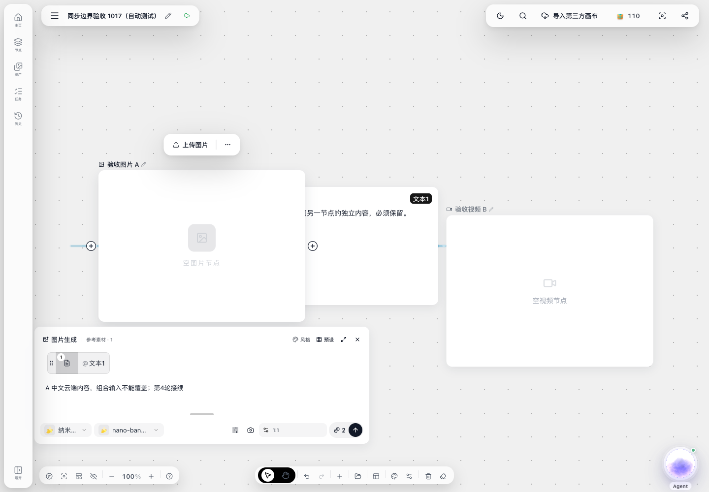

# v1.6.8.8 二开协作同步修复与验收记录

> 非官方最新自动合并方案的验收报告。
>
> 验证日期：2026-10-17。本文说明二开版本的问题、修复、实际验证结果，以及与官方新方案的差异，供作者和开发者讨论。本分支基于官方 v1.6.8.8（8591e7eb）提交替代方案供评审，尚未移植到官方新方案；与 main 的冲突需要在作者确认方向后处理。

## 一、我们遇到的问题

基于 v1.6.8.8 的二开测试站，在两端几乎同时编辑同一节点时发现：

1. 未抢到编辑锁的一端保留了冲突草稿，后续持续处于“正在输入／待同步”状态，影响继续保存。
2. 处理草稿阻塞后，节点下方仍打开的生成提示词输入框，在部分输入法组合事件时序下仍残留旧文字；收起再打开才显示云端内容。继续编辑存在把旧文字重新带回提交的风险。

第二项已复现的一条路径是：组合输入期间云端内容变化，富文本控件跳过显示更新，组合结束后没有补回受控内容。此结论不代表所有残留文字都来自同一个原因。

## 二、我们的修复方式

当前二开版本采用“明确拒绝的冲突文字服从已确认云端内容”的约定：

- 同一节点发生明确文字冲突后，失败端放弃对应冲突文字，回填云端内容，恢复后续编辑和保存。
- 只恢复冲突文字，不清空整个本地画布。独立新建节点和其他不冲突的修改仍保留。
- 断网、超时等无法确认是否已经提交成功的请求，保留原请求与操作编号，不误当成已拒绝，也不重新生成编号重复提交。
- 保存失败不继续作为输入活动续锁；恢复时清理对应编辑状态。
- 提示词框保持打开时也更新内容，处理被中断后迟到的组合输入事件，避免已弃用文字再次提交。

修复未更改后端、数据库或渠道配置，未重复执行生成任务。

## 三、与官方新方案的差异

整理贡献时发现，官方 2026-10-17 的 `bc961c56` 提交已改为自动合并多端输入。以下为代码核对结果，不是对官方新方案的浏览器验收。

| 项目 | 我们已验证的二开方案 | 官方 bc961c56 新方案 |
| --- | --- | --- |
| 同一节点同时输入 | 抢锁成功端继续，失败端停止输入 | 两端可以继续输入 |
| 编辑锁的作用 | 限制同时编辑和提交 | 主要协调云端提交，不直接禁止本地输入 |
| 冲突文字 | 明确拒绝后恢复云端内容 | 保留本地修改，尝试与云端文字自动合并 |
| 后续恢复 | 回填云端内容、解除失败状态后继续编辑 | 合并后自动恢复保存 |
| 主要取舍 | 结果明确，但会放弃失败端的冲突文字 | 尽量保留双方输入，但文字合并不保证语义合理 |

例如，官方新增的组件测试以“场景：”为共同原文，一端输入“甲”、另一端输入“乙”，预期合并成“场景：甲乙”。我们的方案在 A 抢锁成功时保留 A 的版本，放弃 B 的冲突文字。

双方同时修改同一句生成提示词时，保留两份内容与正确表达用户意图是不同问题。这里希望与作者确认的是产品取舍，而不是声称官方自动合并存在已复现的新缺陷。

待确认：项目是否统一采用自动合并？生成提示词是否使用相同规则？方向明确后，再判断哪些输入框修复和测试仍适合提交，避免把官方新方案覆盖回旧方案。

## 四、验证环境与人工确认

测试对象为部署了修复的二开 v1.6.8.8，修复标记为 `f08e5556-open-prompt-sync-20261017`。

使用两个独立 Chromium 上下文，同一测试账号，仅共享登录 Cookie，不共享本地缓存。在专用测试画布执行操作，没有改动用户正在使用的画布。保存、租约和读取请求实际进入测试站服务端。

用户此前已亲自确认：A 抢锁并保存后，仍打开的 B 端提示词框直接显示云端内容，不再残留旧文字；B 解锁后能够继续保存。下面的自动化验证补充边界，不替代这项人工验收。

## 五、已通过的八项边界测试

| 场景 | 实际操作及核对结果 |
| --- | --- |
| 不同节点同时编辑 | A、B 分别修改不同节点提示词，两笔真实保存均成功，云端和双方编辑器保留两份修改。 |
| 离线、租约过期、重新接续 | B 取得租约后断网 56 秒；A 保存新内容。B 重连收到真实 409 后自动恢复 A 的云端内容，继续输入可以保存并回填 A。 |
| 保存成功但响应丢失 | 请求实际进入服务端并提交，再人为中断响应；重试沿用原 mutationId，成功且没有重复增加版本或节点。之后刷新双方页面，内容一致。未覆盖“刷新先于重试”的特定顺序。 |
| 冲突期间新建节点 | B 的提示词抢锁失败期间，通过真实界面创建另一个文本节点；冲突恢复后该节点仍保留。 |
| 冲突期间其他节点内容 | 同一冲突过程中编辑另一文本节点正文，双方刷新后正文仍存在。这是实际正文编辑，不是付费生成回调。 |
| 移动与输入同时发生 | A 移动视频节点，B 修改图片提示词；位置和文字均保留。 |
| 打开中的引用输入框与组合事件 | 在真实 Chromium 中注入组合输入事件，A 保存后 B 原输入控件接收云端内容；迟到的组合结束及输入事件没有重新提交已弃用文字。未使用操作系统原生输入法。 |
| 四轮交替接续 | B、A、B、A 依次接续输入；每轮核对服务端内容、另一端显示和租约释放。最终双方一致且可继续操作。 |

最终测试画布保留 3 个节点、1 条引用连接。记录中没有页面运行异常，也没有尝试调用付费生成接口。

组件层此前另有真实 React 控件挂载到模拟 DOM 的 9 项测试（36 条断言），以及 132 项关联回归（534 条断言）、类型检查和差异检查通过。模拟 DOM 结果不视为原生输入法测试。

## 六、证据说明

本地已保留请求结果记录和 A、B 两端的修复后截图。B 图可展示测试结束时的提示词、引用和保留节点。没有修复前截图，不制作或声称前后截图对比；下图是已有的修复后截图，不是官方新方案或本提取分支的浏览器截图。

收尾时，数据核对与两张截图均已完成；一个可选的积分按钮读取因专注模式隐藏按钮而超时。随后只重新导出已有记录，没有重跑测试，也未据此宣称完成了双方最终积分的程序化对账。

## 七、独立发现与未覆盖边界

- **非文字位置冲突未解决：**初始测试节点尺寸需自动规范化，两端同时提交位置修正时，B 的非文字操作收到 409，旧操作记录阻塞后续保存。保留证据后，仅重建专用测试 B 上下文，再开展上述八项测试。该问题应单独检查，不能将本次结论理解为“所有同步冲突已解决”。
- **原生输入法未覆盖：**操作系统原生中文输入法、多操作系统和移动端尚未验收；本轮组合事件为程序注入。
- **真实任务回写未覆盖：**冲突期间真实付费生成完成、Agent 回写、跨账号共享及更广泛的网络时序尚未验收。生成结果保留已有模拟测试，但不能替代真实任务回调。
- **官方新方案未验收：**本记录不覆盖 `bc961c56` 的自动文字合并实现，不应作为其测试通过的依据。

## 八、当前结论

本文列出的二开修复流程和八项边界测试已完成，不是待执行清单。剩余边界已单独列明。

由于官方同步策略已变化，本 PR 以 Draft 形式提供替代方案，请作者先确认处理方向，不主张直接回退官方后续修复。代码仅提取本次文字恢复、编辑状态与提示词控件修复，没有带入其他二开功能。已有浏览器测试没有为补截图而重跑。

提取后的官方基线分支检查：121 项关联回归（511 条断言）通过；独立进程运行的 9 项输入框组件用例通过；前端类型检查通过。二开部署此前的 132 项结果与此处 121 项结果对应不同代码基线和用例集合，不混计。

负载方面仅提出待评估风险：并发文字合并可能增加处理工作，但本次没有对官方新方案做吞吐、CPU、数据库压力或轮询频率对比，不声称其必须每 200～500 毫秒轮询，也不声称本方案已有量化性能优势。
