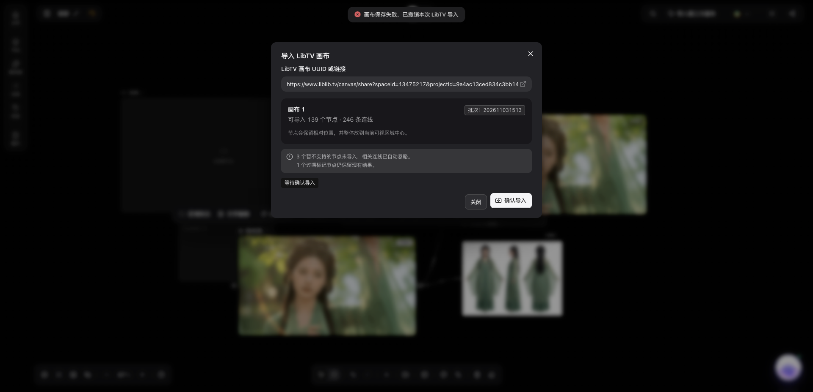

# 第三方画布导入同步修复计划

关联问题：[Issue #953](https://github.com/ddcat-ai/open-ai-canvas/issues/953)。

> 执行流程：按 `superpowers:executing-plans` 逐项完成，测试先复现再修复。

**目标：** LibTV 大画布导入在同步等待超时后保留已提交节点与后续编辑，不误报云端保存成功，不允许重复应用同一批次。

**边界：** 修复第三方导入与页面保存的衔接，复用既有账号隔离、本地持久化、后台重试及 mutation receipt；不延长全局超时，不改供应商鉴权、服务端协议或数据库。TapNow 使用相同回调，需一起验证。

**技术栈：** React、TypeScript、Zustand、Bun 测试、Go 本地服务。

## 实施

- [x] 补充行为回归：等待超时后仍保留导入、原事务延迟成功、重复确认、明确失败、本地持久化失败、后续编辑。
- [x] 区分本地持久化、服务端确认和待同步结果；导入使用明确的保存结果，普通保存与分享仍要求原有成功合同。
- [x] 更新 LibTV/TapNow 确认流程，避免同一批次重复应用，并准确提示云端确认状态。
- [ ] 更新待测试文档，检查变更文件格式、类型、lint、前端测试及构建。
- [x] 使用本地隔离数据目录和用户提供的测试凭据、分享链接，验证真实导入与刷新重进；凭据不进入代码、日志、截图或 PR。
- [ ] 独立代码审查，修复问题后从最新 main rebase，干净工作区运行 `bun scripts/verify-before-push.mjs`，推送并确认 CI。
- [ ] 验证通过后合并到 `medivh_dev`，检查合并差异并验证，交付分支、Issue、PR 与验证证据。

## 审查重点

- 等待超时不代表事务取消，不能用旧数组覆盖已经同步或正在同步的节点。
- 没有服务端确认时只能显示本地保存或待同步，不得显示云端保存成功。
- 持久化失败必须传播；权限和数据校验失败不能悄悄当成功。
- 同一批次重复点击不能再追加节点，用户在等待期间的新增编辑必须保留。
- 普通保存和分享不能因导入的特殊处理被放宽。

## 原始现象

## 已验证的补充边界

- 独立审查复现重试清掉素材身份的风险，改为导入前绑定身份并同时写入编辑器和本地记录，回归已由红转绿。
- 真实刷新验收复现缓存素材被预置为已确认的漏传，初始化只对确认基线之后新增、且归属匹配的导入素材取消预确认；回归包含复制节点共享同一素材的情况。
- 37 项专项与 TypeScript 检查通过，生产构建通过。慢网等待后立即刷新及限流自动恢复最终核对到 141 个节点、249 条连线和 141 条唯一素材记录。
